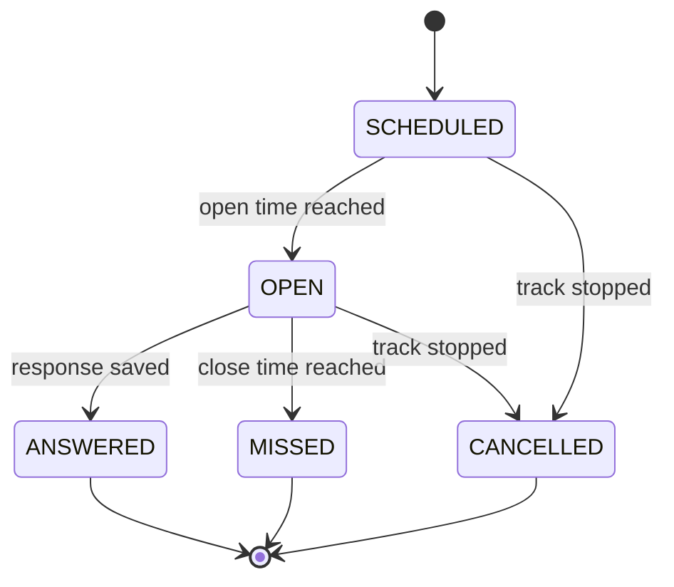
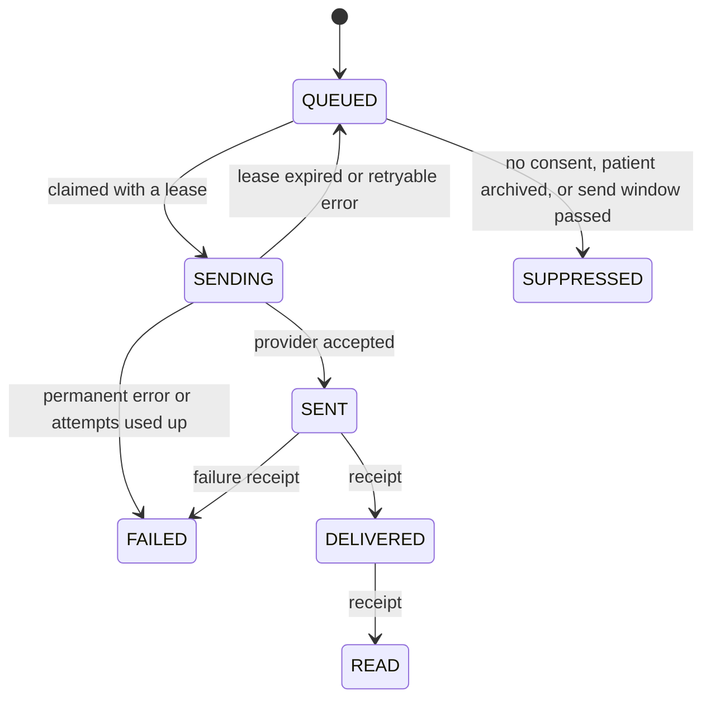
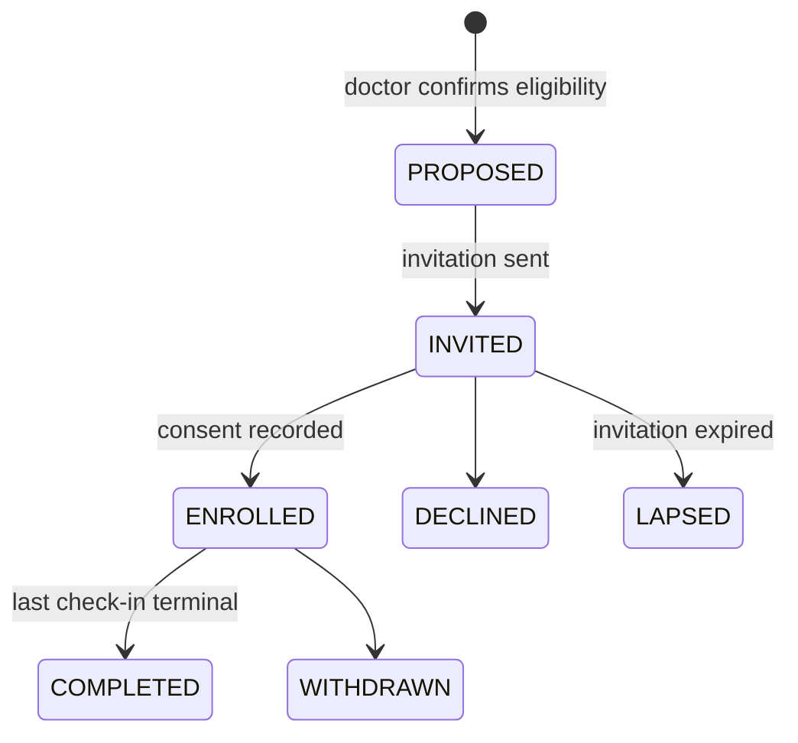

# Patient portal, follow-ups, and clinical studies

Draft 1, 24 November 2026. Baseline commit `318e1eb`. Owner `nareshshah139`. Status: for review, nothing built.

## Summary

This spec adds a patient-facing side to the clinic system. It has three parts, built in this order.

1. **Follow-ups.** After a visit, the clinic sends a patient scheduled check-ins on WhatsApp. The patient answers a short form and can attach photos. Answers that need a person land in a staff worklist. Patients can also write to the clinic, and every message they send lands in the same worklist.
2. **Portal sign-in and records.** A patient signs in with a one-time code sent to their registered phone and sees their appointments, prescriptions, check-in history, and messages.
3. **Clinical studies.** A study is a consented group of the clinic's own patients who answer the same check-ins on a fixed schedule. Registries come first. Trials are designed here and built last, after a regulatory review.

The three parts share one mechanism. A check-in is a versioned form sent to one patient at a planned time. A follow-up plan and a study protocol are both lists of check-ins. Building follow-ups first builds most of what studies need.

Today a patient cannot reach the system at all. Every route is for staff, and nothing contacts a patient after the visit ends. The doctor sets a review date, the system books a review appointment, and then nobody hears how the patient is doing until they return or do not.

## Decisions already made

The owner made these four calls on 24 November 2026.

| Decision | Choice |
| --- | --- |
| What a clinical study is | Both registries and trials. Registries first. |
| How a patient proves identity | A single-purpose link answers one check-in with no sign-in. Records need a one-time code sent on WhatsApp. |
| What ships first | Follow-ups. |
| Patient self-service in the first release | Message the clinic. No self-booking, refill requests, or online payment. |

This spec adds the decisions below. Each one is a default that the owner can overturn. The reasons are in [Appendix A](#appendix-a-alternatives-rejected).

| Decision | Default in this spec |
| --- | --- |
| Patient principal | A new principal keyed by a verified phone. Not a `User` row with role `PATIENT`. |
| Existing `Patient.portalUserId` path | Retire it. |
| Inbound WhatsApp replies | Captured into the clinic inbox from the first follow-up release. |
| Sender number | One WhatsApp number for the clinic. Per-doctor credentials are not used for follow-ups. |
| Patient text and photos sent to OpenAI | Never, in every release this spec covers. |
| Follow-up plan authoring | Plans load from reviewed data files in the first release. A builder screen comes later. |

## What exists today

The citations below come from four read-only explorations at commit `318e1eb`. The lead re-checked every row marked "yes" against the file.

| Fact | Where | Re-checked |
| --- | --- | --- |
| `UserRole.PATIENT` exists, and `Patient.portalUserId` links a patient to one `User`. | `backend/prisma/schema.prisma:311`, `:2231` | yes |
| Staff can create or link a patient login with an email and password. No patient-facing route or screen uses it. | `backend/src/modules/patients/patients.service.ts:434`, `patients.controller.ts:96-106` | yes |
| `POST /auth/login` looks up any `User` with no role filter, so a `PATIENT` user would receive the staff cookie. | `backend/src/modules/auth/auth.service.ts:62` | yes |
| The frontend guard checks only that the `auth_token` cookie exists. It does not check the role. | `frontend/src/middleware.ts:13-22` | yes |
| Clinic staff role lists exclude `PATIENT`, and a contract requires it. | `backend/src/shared/decorators/clinic-staff-roles.ts:9-12`, `backend/src/modules/CONTRACTS` | yes |
| Phone is required on `Patient` and is not unique. Several patients can share one number. | `schema.prisma:294`, `:338`, `:342` | yes |
| A job merges duplicate patients every six hours. A coverage test fails when a new table that references `Patient` is missing from the merge. | `backend/src/modules/patients/patient-deduplication.service.ts:35`, `patients/tests/patient-merge.coverage.spec.ts` | yes |
| The follow-up date lives in `Visit.followUp`. Completing a visit books a review appointment. No message goes to the patient. | `schema.prisma:410`, `backend/src/modules/visits/visits.controller.ts:454`, `visits/review-booking.ts` | yes |
| Outbound WhatsApp uses the Meta Cloud API. Sends are inline, retry twice, and store no delivery status. | `backend/src/modules/notifications/notifications.service.ts:79-97` | yes |
| No inbound WhatsApp webhook exists. A patient reply reaches nobody. | explorer grep, no handler found | no |
| The only scheduled jobs are patient merge, pharmacy agent cleanup, and inventory automation. No queue exists. | three `@Cron` uses under `backend/src/modules` | yes |
| The `Consent` table exists and no code writes to it. | `schema.prisma:983`, explorer grep | partly |
| No study, cohort, questionnaire, or patient-reported table exists. | explorer grep | no |
| Visit findings and diagnosis are JSON text in `String` columns. A query cannot select patients by diagnosis. | `schema.prisma:404-412` | no |
| The audit extension copies every written row into `AuditLog` as JSON, redacts six key names, and swallows its own errors. | `backend/src/shared/database/prisma.service.ts:5-13`, `:96-142` | yes |
| `/uploads` is served with no authentication. | `backend/src/main.ts:70` | yes |
| The clinic photo route sets `Cache-Control: public, max-age=31536000, immutable`. | `visits.controller.ts:595` | yes |
| The default rate limit is `ttl: 60` with `limit: 10`. Per-route limits in the same module use `ttl: 60_000`, so the default window is 60 milliseconds. | `backend/src/modules/auth/auth.module.ts:15-16`, `auth.controller.ts:55` | yes, inferred |
| CORS accepts any `https://*.railway.app` origin with credentials. | `backend/src/shared/cors-origins.ts:11-12` | yes |

Four of these rows are defects that the portal would make worse. [Prerequisites](#prerequisites) lists them.

## People and the core loop

| Person | What they need |
| --- | --- |
| Patient | To tell the clinic how the treatment is going without a phone call or a visit, in English, Telugu, or Hindi, on a phone. |
| Doctor | To learn which patients are doing badly before the review date, and to collect comparable outcomes over time. |
| Reception or nurse | One list of patients who need a call, a reply, or a booking. |
| Owner or investigator | Consented, comparable outcome data that can leave the clinic without names attached. |

The core loop has five steps.

1. The doctor completes a visit and picks a follow-up plan, or picks none.
2. On each planned day the system sends one WhatsApp message with a link.
3. The patient opens the link, answers a few questions, and may add photos or a note.
4. An answer that matches a rule, a missed check-in, or any patient message opens an item in the staff worklist.
5. A staff member replies, calls, or books a review, and resolves the item.

A study runs the same loop from step 2. Enrolment with consent replaces step 1.

## Scope

### Release 1a. Foundations

Nothing changes for patients. This release makes automated contact safe.

- Messaging consent, preferred language, and a portal switch for each patient.
- A durable outbound message record with delivery status.
- An inbound WhatsApp webhook for delivery receipts, opt-out replies, and patient messages.
- The four prerequisites.

### Release 1b. Follow-ups and the clinic inbox

- Instruments, follow-up plans, tracks, and check-ins.
- Single-purpose task links and the patient task page.
- The scheduler that opens, reminds, and closes check-ins.
- Review appointment reminders.
- The staff worklist and the plan picker on the visit form.
- Staff replies to patient messages inside the WhatsApp 24-hour window.

### Release 1c. Sign-in and records

- One-time code sign-in, sessions, and the profile picker for shared phones.
- Read-only appointments, prescriptions, check-in history, and messages.
- Writing to the clinic from inside the portal, and reading staff replies there.

### Release 2. Registries

- Studies, protocol versions, consent form versions, and participation.
- Clinician-completed instruments.
- Consent in the portal and on paper in the clinic.
- Withdrawal, completeness reporting, and de-identified export.

### Release 3. Trials

Arms, allocation, eligibility screening, adverse events, protocol deviations, re-consent after an amendment, and data lock. Release 3 starts only after the review described in [Trials](#trials-release-3).

### Out of scope for every release in this spec

Self-booking and rescheduling. Refill requests. Online payment. Invoices and lab results in the portal. A native app. Video calls. SMS. Marketing broadcasts. Automatic replies written by a language model.

## Domain model

### Principals

Three kinds of caller exist after this work. Code represents them as one discriminated union, and each route accepts exactly one kind.

```ts
type Principal =
	| { kind: 'staff'; userId: string; role: UserRole; branchId: string }
	| { kind: 'portal-identity'; sessionId: string; identityId: string }
	| { kind: 'portal-patient'; sessionId: string; identityId: string; patientId: string; branchId: string }
	| { kind: 'task-link'; linkId: string; patientId: string; branchId: string; checkInIds: string[] };
```

A `portal-identity` principal has proved control of a phone and has not yet chosen a patient. It can list and choose profiles and nothing else. A `task-link` principal can read the questions of its check-ins and write their responses and nothing else.

Portal services take the patient from the principal. No portal route has a patient id in its path, query, or body.

### Tables

Every table below is new unless marked.

| Group | Table | Holds |
| --- | --- | --- |
| Access | `PortalIdentity` | One verified phone number, digits only, unique. |
| Access | `PortalOtpChallenge` | One issued code as a keyed hash, with expiry, attempt count, and consumed time. |
| Access | `PortalSession` | An opaque session token as a hash, the identity, the chosen patient, idle and absolute expiry, and revoked time. |
| Access | `PortalTaskLink` | An opaque link token as a hash, the patient, expiry, and revoked time. A join table lists its check-ins. |
| Access | `PortalAccessEvent` | Append-only record of sign-ins, link opens, record views, and exports. |
| Access | `PatientPortalProfile` | One row per patient. Preferred language, WhatsApp consent state with who recorded it and when, and whether the portal is enabled. |
| Messaging | `OutboundMessage` | One planned send. Channel, template key, recipient, purpose, a unique dedupe key, state, provider message id, attempt count. |
| Messaging | `InboundWhatsAppEvent` | One raw webhook event, unique on the provider event id. |
| Messaging | `PatientMessage` | One message in a patient's thread. Direction, channel, body as plain text, author, and read time. `patientId` is null when the sender's phone matches no single patient. |
| Follow-up | `Instrument`, `InstrumentVersion` | A form and its numbered versions. A version holds items, translations, scoring, flag rules, the respondent kind, and a licence note. |
| Follow-up | `FollowUpPlan`, `FollowUpPlanVersion` | A named schedule and its numbered versions. A version holds ordered steps. |
| Follow-up | `FollowUpTrack` | One patient on one plan version from one anchor date. Purpose is `CARE` or `STUDY`. |
| Follow-up | `CheckIn` | One step for one track. Open time, close time, instrument version, respondent, state. |
| Follow-up | `CheckInResponse` | The answers to one check-in, the computed score, and the submit time. Unique on the check-in. Never updated. |
| Follow-up | `ResponseAttachment` | One image attached to a response or a patient message. |
| Follow-up | `AttentionItem` | One worklist entry. Source kind and source id, priority, state, assignee, resolution. Unique on source kind and source id. |
| Studies | `Study` | Code, title, kind (`REGISTRY` or `TRIAL`), state, investigator, ethics approval reference, approval document, approval expiry. |
| Studies | `StudyProtocolVersion` | Eligibility criteria, the plan version, the consent form version, and the data scope. Never updated after approval. |
| Studies | `ConsentFormVersion` | The consent text in each language and its hash. Never updated after approval. |
| Studies | `StudyParticipation` | One patient in one study. Participant code, state, protocol version, consent record, enrolment and withdrawal times. Unique on study and patient. |
| Studies | `Consent` (existing) | Gains `RESEARCH` in `ConsentType`, the consent form version, the participation, the method, and evidence of how the patient agreed. |
| Studies | `StudyExport` | Who exported, when, which protocol versions, the row count, and the file hash. |

A plan step has this shape.

```ts
type PlanStep = {
	key: string;              // 'day3', 'week12'
	offsetDays: number;       // days after the anchor date, counted in Asia/Kolkata
	windowDays: number;       // days the check-in stays open
	instrumentVersionId: string;
	respondent: 'PATIENT' | 'CLINICIAN';
	reminderAfterDays: number[];   // [] to [1, 3]
	onMissed: 'attention' | 'none';
};
```

An instrument item is one of `scale`, `single-choice`, `multi-choice`, `text`, or `photo`. A photo item names a `PhotoPosition`, which reuses the existing enum. A flag rule belongs to an item and has the shape `{ when, priority }`, for example a pain scale of 8 or more with priority `URGENT`.

### State machines

Each lifecycle below gets a model under `verification/state-machines/` before its code is written. See [Verification](#verification).

**Check-in.**



**Track.** `ACTIVE` becomes `COMPLETED` when every check-in is terminal. `ACTIVE` becomes `STOPPED` with a reason. The reasons are doctor stopped, visit deleted, patient archived, replaced by a newer track on the same plan, and study withdrawal.

**Outbound message.**



**Attention item.** `OPEN`, then `CLAIMED` by one staff member, then `RESOLVED` with a resolution code and a note. A claimed item can return to `OPEN`.

**Participation.**



A trial inserts `CONSENTED`, `SCREENING`, and `SCREEN_FAILED` between `INVITED` and `ENROLLED`, and adds `LOST_TO_FOLLOW_UP`. One transition table keyed by study kind holds both sets.

**Study.** `DRAFT`, `APPROVED`, `RECRUITING`, `ENROLMENT_CLOSED`, `COMPLETED`. Any state from `APPROVED` on can move to `SUSPENDED` and back.

**One-time code.** `ISSUED`, then `CONSUMED`, `EXPIRED`, or `LOCKED` after too many wrong attempts.

### Rules

These hold in every reachable state. Each becomes an invariant or a property in a model, and a test.

| Rule | Statement |
| --- | --- |
| `OwnDataOnly` | A portal principal reads and writes only rows that belong to its patient. |
| `LinkAnswersOnly` | A task-link principal reads only the questions of its check-ins and writes only their responses. |
| `StaffCookieStaysStaff` | No portal credential is accepted on a staff route, and no staff credential is accepted on a portal route. |
| `NoSendWithoutConsent` | An outbound message with a care or study purpose reaches `SENT` only if the patient's WhatsApp consent is `OPTED_IN` at the moment of sending. |
| `OneResponsePerCheckIn` | A check-in has at most one response. |
| `ResponsePinsVersion` | A response names the instrument version it answered, and a published version never changes. |
| `UrgentReachesWorklist` | A response that matches an urgent flag rule and its attention item commit in one transaction. |
| `EveryPatientMessageLands` | Every inbound patient message becomes a `PatientMessage` with an `OPEN` attention item, including a message from a phone that matches no single patient. |
| `OptOutSticks` | After a patient opts out, no care or study message is sent to them until a staff member or the patient opts in again. A merge of two patient rows keeps the opt-out. |
| `NoStudyDataBeforeConsent` | A study track exists only for a participation that is `ENROLLED` with a consent record for the consent form of its protocol version. |
| `WithdrawalStopsCollection` | When a participation becomes `WITHDRAWN`, every non-terminal check-in on its track becomes `CANCELLED` in the same transaction. |
| `CareIndependentOfStudy` | Declining, lapsing, or withdrawing changes no care track, appointment, or visit. |
| `ExportHasNoDirectIdentifiers` | An export contains no name, phone, email, address, date of birth, patient id, patient code, or ABHA id. |
| `EveryCheckInEnds` | Every check-in eventually reaches a terminal state, even if no message can be sent. |

## Requirements

Each requirement has an id. A later acceptance file binds evidence to these ids, in the style of `docs/product/inventory-workflow-acceptance.md`.

### Consent to contact and patient preferences (release 1a)

| Id | The system MUST |
| --- | --- |
| PP-01 | Record WhatsApp consent for each patient as `NOT_ASKED`, `OPTED_IN`, or `OPTED_OUT`, with the number it applies to, who recorded it, when, and how. |
| PP-02 | Let reception record consent and preferred language when they register a patient and when they edit a patient. The default state is `NOT_ASKED`, and `NOT_ASKED` sends nothing. |
| PP-03 | Treat an inbound `STOP`, and its Telugu and Hindi equivalents on a list the clinic maintains, as an opt-out. Confirm the opt-out to the patient once. |
| PP-04 | Reset consent to `NOT_ASKED` when the patient's phone number changes. |
| PP-05 | Let staff turn the portal off for one patient. Turning it off revokes that patient's sessions and task links at once. |
| PP-06 | Add every new table that references `Patient` to the duplicate merge. On a merge, an opt-out on either row wins, a disabled portal on either row wins, and all sessions and links of both rows are revoked. |

### Outbound and inbound messaging (release 1a)

| Id | The system MUST |
| --- | --- |
| PP-07 | Create an `OutboundMessage` row before any automated send, with a dedupe key that is unique for the event that caused it. A second attempt to create the same message is a no-op. |
| PP-08 | Check consent, the portal switch, and the archived flag at the moment of sending, and move the message to `SUPPRESSED` if any check fails. |
| PP-09 | Send care and study messages only between 09:00 and 20:00 Asia/Kolkata. One-time codes and staff replies are exempt. |
| PP-10 | Send at most one automated care or study message to a patient in one Asia/Kolkata day. Check-ins that open on the same day share one message and one link. |
| PP-11 | Store the provider message id and move the message through `SENT`, `DELIVERED`, `READ`, and `FAILED` from webhook receipts. |
| PP-12 | Open an attention item when a message reaches `FAILED`, so that staff can call the patient. |
| PP-13 | Expose a webhook that verifies the Meta signature on every request, answers the Meta verification challenge, and stores each event once by its provider id. |
| PP-14 | Store every inbound text and image as a `PatientMessage`. Assign it to the patient when the sender's phone matches exactly one patient with the portal enabled. When the phone matches several, assign it to the patient named in the newest outbound message to that phone in the last seven days. Otherwise leave it unassigned. |
| PP-15 | Open an attention item for every inbound patient message. An unassigned message asks staff to pick the patient. |
| PP-16 | Reply once in any 24 hours with a fixed acknowledgement in the patient's language. The text gives the hours when staff read messages and the number to call in an emergency. It makes no promise of a reply time. |
| PP-17 | Keep message text out of application logs and out of analytics events. |

### Follow-up plans and check-ins (release 1b)

| Id | The system MUST |
| --- | --- |
| PP-18 | Load instruments and plans from reviewed data files through an owner-only import. A published version is never changed. A change creates the next version. |
| PP-19 | Refuse to publish an instrument version that lacks a translation for any item in English, Telugu, or Hindi. |
| PP-20 | Show a plan picker in the Follow-up tab of the visit form. "No follow-up" is always a choice. The picker remembers each doctor's last choice for a new visit. |
| PP-21 | Create one track and all of its check-ins when a visit with a plan is completed, anchored on the Asia/Kolkata date of completion. Completing the same visit twice creates nothing new. |
| PP-22 | Stop a track when its visit is deleted, when the doctor stops it, when the patient is archived, or when a newer track on the same plan starts for the same patient. Stopping cancels every non-terminal check-in in the same transaction. |
| PP-23 | Run a scheduler pass every five minutes that opens due check-ins, queues their messages and reminders, and closes check-ins whose window has ended. Running the pass twice, or on two instances at once, produces the same rows as running it once. |
| PP-24 | Open and close check-ins on time when no message can be sent. A patient with no consent still sees open check-ins after signing in. |
| PP-25 | Open an attention item when a check-in is missed and its step says `onMissed: 'attention'`. |
| PP-26 | Queue a reminder the day before a review appointment that is still `SCHEDULED` or `CONFIRMED`. The reminder names the date, the time, and the doctor. |

### Task links and the patient task page (release 1b)

| Id | The system MUST |
| --- | --- |
| PP-27 | Issue a link token of at least 256 random bits and store only its hash. |
| PP-28 | Keep the token out of server logs, analytics, and the `Referer` header. The first design to try puts the token in the URL fragment and posts it in a request body. |
| PP-29 | Make every `GET` on a portal route free of side effects, so that a link preview fetch changes nothing and records nothing as "opened". |
| PP-30 | Expire a link when its check-ins close, and revoke it when the track stops, the portal is turned off, or the patient opts out. |
| PP-31 | Show on the task page only the clinic name, the patient's first name, the doctor's name, and the questions. No diagnosis, no medicine name, no earlier answer, no appointment. |
| PP-32 | Write check-in messages with no diagnosis, no medicine name, and no score. |
| PP-33 | Save a response and its attachments in one transaction, and compute the score on the server from the pinned instrument version. A repeat submit of an answered check-in returns the first response and writes nothing. |
| PP-34 | Accept only images as attachments, re-encode each one on the server, strip its metadata, and cap its stored size. The page compresses the image before upload. |
| PP-35 | Tell the patient at once, on the confirmation screen, to call the clinic when a submitted answer matches an urgent flag rule. The screen shows the clinic's number. |
| PP-36 | Let the patient change the language on the task page, and save the choice as their preference. |
| PP-37 | Work on a slow mobile connection. The task page loads its questions in one request and keeps typed answers if a submit fails. |

### Staff worklist and clinic inbox (release 1b)

| Id | The system MUST |
| --- | --- |
| PP-38 | Add a "Follow-ups" entry under Clinical in the sidebar for doctors, nurses, reception, managers, admins, and owners. |
| PP-39 | List open attention items sorted by priority and then by age, and show the age of each item. |
| PP-40 | Show, for one item, the answers, the photos, the score, earlier responses to the same instrument, and the patient's message thread. |
| PP-41 | Let a staff member claim an item, so that two people do not work the same patient, and resolve it with a resolution code and a note. |
| PP-42 | Let staff reply with free text while the WhatsApp 24-hour window is open. When the window is closed, the worklist says so and offers "log a call" in place of the reply box. |
| PP-43 | Show a patient's tracks, check-ins, responses, messages, consent state, and language on the existing patient page. |
| PP-44 | Render patient text as plain text everywhere in the staff screens. |

### Sign-in and records (release 1c)

| Id | The system MUST |
| --- | --- |
| PP-45 | Send a six-digit code on WhatsApp to a number that belongs to at least one patient with the portal enabled, and answer every request with the same text and timing whether or not the number is known. |
| PP-46 | Expire a code after five minutes, lock it after five wrong attempts, and consume it atomically so that two concurrent correct submissions yield one session. |
| PP-47 | Limit codes to three in fifteen minutes and ten in a day for one phone. Count these limits in the database. |
| PP-48 | Issue a session as an opaque token, store only its hash, and set it in an `HttpOnly`, `Secure`, `SameSite=Lax` cookie with a name other than `auth_token`. |
| PP-49 | End a session after 30 minutes idle and after 24 hours in total, and let the patient sign out everywhere. |
| PP-50 | After sign-in, show every patient who has that phone and has the portal enabled, across branches, by first name and branch. The patient picks one. Switching profile needs no new code. |
| PP-51 | Refuse `PATIENT` users at `POST /auth/login`, and refuse any request on a staff route that carries only a portal cookie. |
| PP-52 | Show upcoming appointments, past visit dates with the doctor's name, the prescription for each visit rendered from `Prescription.items` with its instructions, the patient's own check-in history, and the message thread. All read-only. |
| PP-53 | Withhold complaints, examination, diagnosis, clinic photos, invoices, and lab orders from the portal in this release. |
| PP-54 | Let a signed-in patient write to the clinic and read staff replies. A staff reply sent when the WhatsApp window is closed queues a templated notice with a link to the portal. |
| PP-55 | Record each sign-in, profile choice, and record view in `PortalAccessEvent`. |

### Registries (release 2)

| Id | The system MUST |
| --- | --- |
| PP-56 | Hold a study in `DRAFT` until an owner records the ethics committee's approval reference, approval document, and approval expiry. |
| PP-57 | Refuse a new invitation when the study is not `RECRUITING` or its approval has expired. |
| PP-58 | Create a participation only when a doctor confirms that the patient meets the eligibility criteria of the current protocol version. |
| PP-59 | Show the consent form only to a signed-in patient, in the patient's language. A task link can announce an invitation and cannot record consent. |
| PP-60 | Record consent with the consent form version and its hash, the session, the time, the typed name, and each statement the patient ticked. Send the patient a copy. |
| PP-61 | Let staff record paper consent in the clinic by uploading the signed form. |
| PP-62 | Start the study track at enrolment and never earlier. |
| PP-63 | Let the patient withdraw from the portal in two taps, and let staff record a withdrawal. Withdrawal asks one question, whether the clinic may keep the answers already given. |
| PP-64 | Support clinician-completed instruments. A clinician check-in opens in the visit form when the patient has a visit inside its window. |
| PP-65 | Give each participant a study-specific code from `NumberSequence` that reveals nothing about the patient. |
| PP-66 | Show, for each study, the count in each participation state and the share of answered check-ins at each step. |
| PP-67 | Export responses with the participant code, age in years at enrolment, sex, and day offsets from enrolment in place of dates. The export leaves out free text and photos unless the consent form version has a separate statement for each and the patient ticked it. |
| PP-68 | Leave out the data of a withdrawn participant who asked for removal from every export made after the withdrawal. |
| PP-69 | Restrict export to owners and the study's investigator, and record every export in `StudyExport`. |
| PP-70 | Skip the merge of two duplicate patient rows that both have a participation in the same study, and open an attention item for it. |

### Trials (release 3)

Release 3 is not specified to the requirement level. The owner must first settle these questions with the ethics committee and counsel.

- Which trials need regulator approval, registration in the Clinical Trials Registry of India, or both.
- Whether the audit trail meets the expectations of the sponsor or regulator. Today the audit extension is best-effort and swallows its own errors (`prisma.service.ts:140-142`). A trial needs an audit write in the same transaction as the data write, with a reason for each change.
- Who may see the allocated arm.
- The serious adverse event procedure and its deadlines.

The registry model already leaves room for trials in five places. A study has a kind. The participation transition table is keyed by kind. Instruments have a respondent kind, so an eligibility checklist and an adverse event form are clinician instruments. Protocol versions are immutable, so an amendment is a new version, and a participation records which version it consented to. Responses are never updated, so a correction is a new response that names the one it replaces.

Release 3 adds four tables, `StudyArm`, `Allocation`, `AdverseEvent`, and `ProtocolDeviation`, and one rule. An allocation is written once per participation and never changed.

## Security and privacy

| Id | The system MUST |
| --- | --- |
| PP-71 | Mount every patient-facing route under `/portal` on the backend, behind one decorator that both marks the route public to the staff guard and applies a portal guard. A test lists every `/portal` route and fails if any route answers a request with no credential. |
| PP-72 | Construct the patient scope only inside the portal guard. A portal service cannot be called with a bare patient id. |
| PP-73 | Add a `@cc` contract next to `declared-clinic-staff-boundary` that states `OwnDataOnly`, `LinkAnswersOnly`, and `StaffCookieStaysStaff`. |
| PP-74 | Serve portal attachments through an authenticated route with `Cache-Control: private, no-store`, a fixed image content type, and `X-Content-Type-Options: nosniff`. |
| PP-75 | Add `codeHash`, `tokenHash`, and attachment bytes to the audit redaction list before any portal table ships, and record the actor kind in `AuditLog`. |
| PP-76 | Send no patient identifier, phone, token, or answer to analytics. The existing closed vocabulary and its checker in `verification/openpanel-analytics-2026-11-10/` extend to portal routes. |
| PP-77 | Send no patient-entered text or photo to `api.openai.com`. |
| PP-78 | Serve the portal pages with a content security policy that allows scripts only from the portal's own origin. |

Three properties of this design are accepted risks, and the owner should read them as such.

- **Whoever holds the phone holds the account.** A one-time code proves control of the phone and nothing more. On a shared family phone, any family member can open any profile on that number. PP-05 is the control. A per-profile PIN is an open decision.
- **Whoever holds a task link can answer that check-in.** The link reveals the first name and the questions. A question such as "How is your acne today?" reveals the condition. PP-31 limits what else is shown.
- **A duplicate WhatsApp message is possible.** If the process stops after Meta accepts a message and before the row is saved, the lease expires and the message is sent again. The duplicate carries the same link. The alternative loses messages.

## Screens

**Patient, task page.** Reached from the WhatsApp message. One column. The clinic name, a greeting, a language switch, the questions, a photo step with a guide for each position, an optional note, and a confirmation screen. The confirmation screen says when staff read answers and gives the number to call. It offers "See my records", which starts sign-in.

**Patient, portal home.** After sign-in. The next appointment, open check-ins, the latest prescription, and messages. A profile switch shows when the phone has several patients.

**Staff, visit form.** One new control in the Follow-up tab, next to the review date (`frontend/src/components/visits/MedicalVisitForm.tsx:85`).

**Staff, Follow-ups.** A new route `/dashboard/follow-ups` with three tabs. "Needs attention" lists open items. "Waiting on patient" lists open check-ins. "Messages" lists threads with unread patient messages.

**Staff, patient page.** A new timeline section on `/dashboard/patients/[id]`.

**Staff, Studies.** A new route `/dashboard/studies` in release 2.

The patient pages live in the same Next.js app under `/p`. The frontend guard in `frontend/src/middleware.ts` gains a second matcher for `/p`, so that a portal cookie never opens `/dashboard` and a staff cookie never opens `/p`.

## Prerequisites

Release 1a fixes these four defects first. Each is true today and each gets worse when patients hold links to this system.

| Defect | Why it blocks the portal | Fix |
| --- | --- | --- |
| `/uploads` is public (`main.ts:70`). | Legacy visit files are readable by anyone who has the path. | Serve them through an authenticated route, or move them into the attachment tables. |
| The clinic photo route caches as `public` for a year (`visits.controller.ts:595`). | A shared cache could keep and serve a patient photo. | `private, no-store`. |
| The default rate limit window is 60 milliseconds (`auth.module.ts:15`). | The code endpoints must not depend on it. PP-47 counts in the database for this reason. | Set the window to 60,000. |
| `PATIENT` users can sign in at the staff login (`auth.service.ts:62`). | They receive the staff cookie and pass the dashboard guard. | PP-51. |

Retiring `Patient.portalUserId` needs one fact from production, the count of patients with a linked user. If the count is zero, remove the three staff endpoints and drop the column. If it is not zero, create a `PortalIdentity` for each linked patient's phone first. The enum value `PATIENT` stays.

## Verification

The repo already proves lifecycles with TLA+ models and replay tests (`verification/state-machines/README.md`). This work follows that practice.

| Model folder | Covers | Rules it checks |
| --- | --- | --- |
| `portal-access` | Code issue and verify, session, profile choice, task link, portal switch | `OwnDataOnly`, `LinkAnswersOnly`, `StaffCookieStaysStaff` |
| `outbound-message` | Queue, lease, send, receipts, opt-out | `NoSendWithoutConsent`, `OptOutSticks` |
| `check-in` | Track, check-in, scheduler pass, response, attention item | `OneResponsePerCheckIn`, `UrgentReachesWorklist`, `EveryCheckInEnds` |
| `study-participation` | Invitation, consent, track start, withdrawal | `NoStudyDataBeforeConsent`, `WithdrawalStopsCollection`, `CareIndependentOfStudy` |

Each model is written before its code. Its negative-control modes remove one guard each and must break the rule that the guard protects.

Other checks:

- A route test for PP-71, in the style of `patients/clinical-access.spec.ts`.
- Database-backed specs for PP-07, PP-21, PP-23, PP-33, and PP-46, each running the operation twice and concurrently with `backend/src/shared/testing/interleave.ts`.
- The existing merge coverage test for PP-06. It fails on its own if a table is missed.
- An extension of the analytics checker for PP-76.
- A `verify-clinic` recipe that drives the full loop in a real browser against a fake WhatsApp endpoint. The recipe completes a visit with a plan, advances the clock, opens the link at phone width, answers with a photo, and resolves the worklist item.

## Measures

No baseline exists, because nothing contacts patients today. Set targets after four weeks of release 1b.

| Measure | Definition |
| --- | --- |
| Reach | Messages `DELIVERED` divided by messages `SENT`. |
| Response rate | Check-ins `ANSWERED` divided by check-ins whose message was `DELIVERED`. |
| Time to first look | Median time from an urgent attention item opening to a staff member claiming it, counted in clinic hours. |
| Opt-out rate | Patients who opted out divided by patients who received at least one message. |
| Review attendance | Review appointments attended divided by review appointments booked, compared for patients with and without a plan. |
| Registry completeness | For each study step, answered check-ins divided by due check-ins. |

## Regulatory assumptions to confirm

These come from a web search on 24 November 2026 and from general knowledge. None is legal advice. The owner should confirm each with counsel or the ethics committee. Sources are in [Appendix B](#appendix-b-sources).

| Assumption | Effect on this spec |
| --- | --- |
| The Digital Personal Data Protection Rules were notified in November 2025. The notice, consent, and security duties start in May 2027. | PP-01 to PP-05 and PP-63 to PP-68 are built to meet them. A privacy notice in three languages is needed before release 1b. |
| Processing a child's data needs verifiable consent from a parent, with a limited exemption for healthcare providers. The Act defines who counts as a child. This search did not confirm the age. | Open decision 4. Date of birth is unreliable here, because the system stores 1 January of the birth year when only an age is given. |
| Research that is not a clinical trial needs approval from an ethics committee registered with the Department of Health Research, before it starts. | PP-56 and PP-57. |
| A clinical trial needs regulator and ethics approval first. An investigator reports a serious adverse event within 24 hours. | Release 3 gate. |
| WhatsApp one-time codes must use an authentication template, which has been available in India since July 2024. Clinic-initiated messages outside the 24-hour window need templates that Meta has approved. | The clinic must get three templates approved before release 1b and one more before release 1c. Nothing in the repo submits templates to Meta. |
| Some validated questionnaires need a licence. | `InstrumentVersion` has a licence note. The system ships with no licensed content. |

## Open decisions

Each row has a default that the build will use unless the owner says otherwise.

| # | Question | Default | What the other choice costs |
| --- | --- | --- | --- |
| 1 | One WhatsApp number for the clinic, or one for each branch? | One. | A number id on `Branch`, and webhook routing by number. |
| 2 | Should a profile on a shared phone have its own PIN? | No. Staff can turn the portal off for one patient. | A PIN reset flow at reception. |
| 3 | What happens when a one-time code cannot be delivered on WhatsApp? | The patient calls reception. | An SMS provider and its registration. |
| 4 | May patients under 18 be invited to a study or use the portal? | No study invitations. The portal works, on the guardian's phone. | A guardian link between patients and a consent flow for two people. |
| 5 | Does the portal show the diagnosis and the doctor's notes? | No. | A review of note wording by the doctors. |
| 6 | Does a withdrawn participant's earlier data stay in the study? | Yes, unless the patient asks for removal at withdrawal. | Nothing in code. The consent form must say it. |
| 7 | Do follow-up plans come only from data files in release 1? | Yes. | A builder screen with versioning and translation entry. |
| 8 | Does the portal get its own hostname? | No. It lives under `/p`. | A domain, and host-based routing in the frontend guard. It gives stronger isolation between staff and patient cookies. |
| 9 | Which staff roles may resolve an urgent attention item? | Doctors, nurses, and admins. Reception may claim and call. | Nothing in code. |

## Risks

| Risk | Where it lands | What to watch |
| --- | --- | --- |
| A patient reports a serious symptom and nobody reads it for a day. | Release 1b | Time to first look. PP-16 and PP-35 set the patient's expectation. The clinic must name who checks the worklist each morning. |
| Meta rejects or reclassifies a template, or pauses the number for low quality. | Release 1b | Opt-out rate and block rate. PP-09 and PP-10 limit volume. |
| The fragment-borne token does not survive a WhatsApp template button or an in-app browser. | Release 1b | Settle with a prototype before building PP-28. The fallback is a path token with log redaction and `Referrer-Policy: no-referrer`. |
| Photo bytes in Postgres grow the database quickly. | Release 1b | Stored bytes per week. PP-34 caps each image. Object storage is the next step if growth is high. |
| The scheduler runs on more than one instance. | Release 1b | PP-23 holds under two instances by design. The replica count in production is unknown. |
| The audit log fills with answers and photos. | Release 1a | PP-75. |
| A patient in a study and on a care plan gets the same questionnaire twice. | Release 2 | Count of patients with two open check-ins on one instrument. |
| The existing visit data cannot select a cohort, because diagnosis is free text. | Release 2 | Doctors propose patients by hand (PP-58). Structured diagnosis is a separate project. |

## Appendix A. Alternatives rejected

**Reuse `User` with role `PATIENT` for the patient principal.** The schema already has it. It loses for four reasons. A `User` maps to one patient, and a phone here maps to several. A `User` needs a unique email and a password, and the chosen sign-in is a code to a phone. A `PATIENT` user receives the same cookie as staff, so every staff route must keep refusing it forever, and the frontend guard does not check. Staff-only assumptions already leak to any authenticated user, for example `GET /reports/alerts`. A separate principal makes the staff boundary a matter of type and not of remembering to exclude a role.

**A one-time code for every action.** It is stronger. It adds a step to every check-in reply, and the response rate is the measure that makes follow-ups worth building. The task link is limited to writing one answer so that the cheaper path exposes almost nothing.

**Ignore replies on WhatsApp and tell patients to use the portal.** It is less to build. Once the clinic sends automated messages, patients answer in the same chat. A reply about a bad reaction that no one sees is the worst outcome this feature can produce. The webhook is needed for receipts and opt-outs in any case.

**Separate machinery for studies.** A study schedule and a care plan are the same structure with a different reason for existing. One set of tables means the registry reuses delivery, reminders, the task page, and the worklist.

**Classify free-text messages by keyword or by a language model.** A wrong "not urgent" is worse than no label. Every message opens an item, and structured answers carry the urgent rules.

**A job queue such as BullMQ on Redis.** The repo has no queue in use. A table with a unique dedupe key and a five-minute pass under row locks gives the same guarantees at this volume with nothing new to run.

**Store patient photos in `VisitAttachment` or `DraftAttachment`.** Those hold photos that clinic staff took under known conditions. A patient's photo has a different source and quality, and belongs to a response and not to a visit.

## Appendix B. Sources

Code citations are `path:line` at commit `318e1eb`.

Regulatory sources, read as search summaries on 24 November 2026:

- [MeitY notifies final Digital Personal Data Protection Rules 2025, Bar and Bench](https://www.barandbench.com/view-point/meity-notifies-final-digital-personal-data-protection-rules-2025)
- [Regulatory alert on enforcement of the DPDP Act and Rules, Shardul Amarchand Mangaldas](https://www.amsshardul.com/wp-content/uploads/2025/11/Regulatory-Alert-Enforcement-of-DPDP-Act-and-Notification-of-DPDP-Rules.pdf)
- [Authentication templates, WhatsApp Business Platform documentation](https://developers.facebook.com/docs/whatsapp/business-management-api/authentication-templates)
- [India clinical research regulations, ClinRegs](https://clinregs.niaid.nih.gov/country/india)
- [Serious adverse event checklist, CDSCO](https://cdsco.gov.in/opencms/export/sites/CDSCO_WEB/Pdf-documents/Serious_Adverse_Event/SAE-CheckListDocument.pdf)
- [National Ethical Guidelines for Biomedical and Health Research Involving Human Participants, ICMR 2017](https://www.ipgmer.gov.in/pdf/ResearchOversightCommittee/ICMR_Human_ethics_guidelines2017.pdf)
