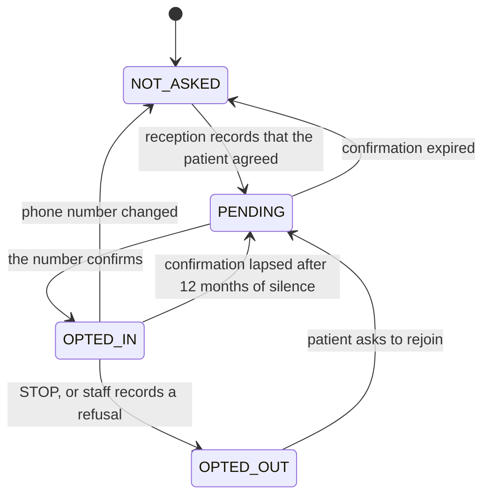
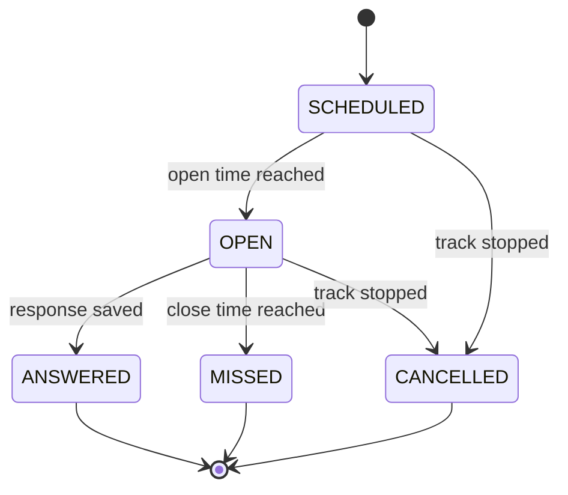
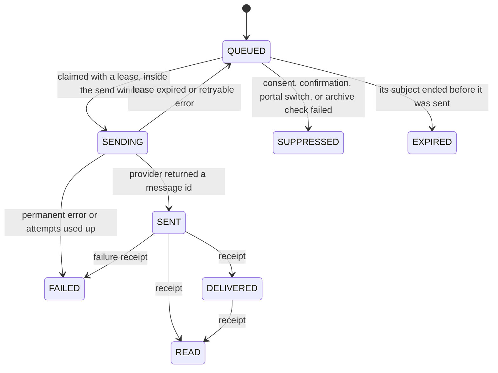
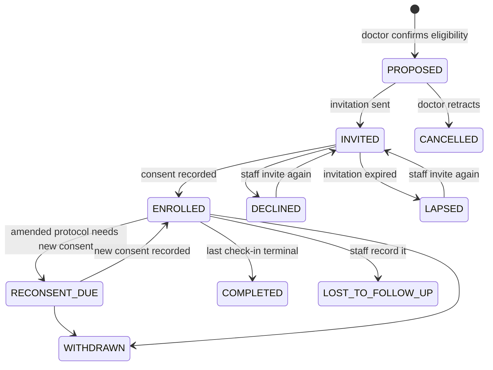

# Patient portal, follow-ups, and clinical studies

Draft 2, 24 November 2026. Written against commit `318e1eb`. Owner `nareshshah139`. Status: for review, nothing built.

Draft 2 follows two independent reviews of draft 1. [Appendix C](#appendix-c-what-review-changed) lists what they changed.

## Summary

This spec adds a patient-facing side to the clinic system. It has three parts, built in this order.

1. **Follow-ups.** After a visit, the clinic sends a patient scheduled check-ins on WhatsApp. The patient answers a short form and can attach photos. Answers that need a person land in a staff worklist. Patients can also write to the clinic, and every message they send lands in the same worklist.
2. **Portal sign-in and records.** A patient signs in with a one-time code sent to their confirmed phone and sees their appointments, prescriptions, check-in history, and messages.
3. **Clinical studies.** A study is a consented group of the clinic's own patients who answer the same check-ins on a fixed schedule. Registries come first. Trials are scoped here and built last, after a regulatory review.

The three parts share one mechanism. A check-in is a versioned form sent to one patient at a planned time. A follow-up plan and a study protocol are both lists of check-ins. Building follow-ups first builds most of what studies need.

Today a patient cannot reach the system at all. Every route is for staff, and nothing contacts a patient after the visit ends. The doctor sets a review date, the system books a review appointment, and then nobody hears how the patient is doing until they return or do not.

## Decisions already made

The owner made these four calls on 24 November 2026.

| Decision | Choice |
| --- | --- |
| What a clinical study is | Both registries and trials. Registries first. |
| How a patient proves identity | A single-purpose link answers one check-in with no sign-in. Records need a one-time code sent on WhatsApp. |
| What ships first | Follow-ups. |
| Patient self-service in the first release | Message the clinic. No self-booking, refill requests, or online payment. |

This spec adds the decisions below. Each one is a default that the owner can overturn. The reasons are in [Appendix A](#appendix-a-alternatives-rejected).

| Decision | Default in this spec |
| --- | --- |
| Patient principal | A new principal keyed by a confirmed phone. Not a `User` row with role `PATIENT`. |
| Existing `Patient.portalUserId` path | Retire it. |
| Proof that a number belongs to the patient | The number confirms itself once, by a tap or by a code read out at reception, before any care message goes to it. |
| Inbound WhatsApp replies | Captured into the clinic inbox from the first follow-up release. |
| Sender number | One WhatsApp number for the clinic. Automated messages stop using per-doctor credentials. |
| Patient text and photos sent to OpenAI | Never, in every release this spec covers. |
| Follow-up plan authoring | Plans load from reviewed data files in the first release. A builder screen comes later. |
| Research consent record | A new table. The existing `Consent` table stays as it is. |

## What exists today

The citations below come from four read-only explorations at commit `318e1eb`. The lead re-checked every row marked "yes" against the file.

| Fact | Where | Re-checked |
| --- | --- | --- |
| `UserRole.PATIENT` exists, and `Patient.portalUserId` links a patient to one `User`. | `backend/prisma/schema.prisma:2231`, `:311` | yes |
| Staff can create or link a patient login with an email and password. No patient-facing route or screen uses it. | `backend/src/modules/patients/patients.service.ts:434`, `patients.controller.ts:96-106` | yes |
| `POST /auth/login` looks up any `User` with no role filter, and the JWT strategy does not check the role either. A `PATIENT` user would receive and keep the staff cookie. | `backend/src/modules/auth/auth.service.ts:62`, `auth/strategies/jwt.strategy.ts:40-52` | yes |
| The frontend guard checks only that the `auth_token` cookie exists. | `frontend/src/middleware.ts:13-22` | yes |
| Clinic staff role lists exclude `PATIENT`, and a contract requires it. | `backend/src/shared/decorators/clinic-staff-roles.ts:9-12`, `backend/src/modules/CONTRACTS` | yes |
| Phone is required on `Patient`, is indexed, and is not unique. It is stored as digits with whatever prefix was typed. | `schema.prisma:294`, `:337`, `:342`, `patients.service.ts:29-33` | yes |
| A job merges duplicate patients every six hours, keyed on branch, phone digits, and name. It archives the duplicate row. A coverage test fails when a table that references `Patient` is missing from the merge. | `backend/src/modules/patients/patient-deduplication.service.ts:35`, `:229`, `:319`, `patients/tests/patient-merge.coverage.spec.ts` | yes |
| The follow-up date lives in `Visit.followUp`. Completing a visit books a review appointment after the completion commits. No message goes to the patient. | `schema.prisma:410`, `backend/src/modules/visits/visits.controller.ts:454`, `visits/review-booking.ts` | yes |
| `VisitsService.complete` locks the visit row and returns early when the visit is already completed. `CompleteVisitDto` carries no plan. | `backend/src/modules/visits/visits.service.ts:578-583`, `visits/dto/create-visit.dto.ts:333-347` | yes |
| Outbound WhatsApp uses the Meta Cloud API. `sendWhatsApp` returns nothing, skips silently when it is not configured, and logs a 4xx error without throwing. | `backend/src/modules/notifications/notifications.service.ts:102-117`, `:135-140` | yes |
| No inbound WhatsApp webhook exists. A patient reply reaches nobody. | explorer and reviewer grep | no |
| The only scheduled jobs are patient merge, pharmacy agent cleanup, and inventory automation. No queue exists. | three `@Cron` uses under `backend/src/modules` | yes |
| No code creates a `Consent` row. The merge repoints existing rows. | `schema.prisma:983`, `patient-deduplication.service.ts:215` | partly |
| No study, cohort, questionnaire, or patient-reported table exists. | explorer grep | no |
| Visit findings and diagnosis are JSON text in `String` columns. A query cannot select patients by diagnosis. | `schema.prisma:404-412` | no |
| The audit extension copies every written row into `AuditLog` as JSON, redacts six key names, and swallows its own errors. Doctors pass every permission check, including audit export. | `backend/src/shared/database/prisma.service.ts:5-13`, `:96-142`, `backend/src/shared/guards/roles.guard.ts:13-16` | yes |
| The global idempotency interceptor scopes stored responses by `req.user`. Callers with no user share one scope. | `backend/src/shared/interceptors/idempotency.interceptor.ts:67-76` | yes |
| The shared frontend API client, on a 401, copies the URL fragment into local storage and into `/login?next=`. | `frontend/src/lib/api.ts:251-262` | yes |
| `/uploads` is served with no authentication. | `backend/src/main.ts:70` | yes |
| The clinic photo route sets `Cache-Control: public, max-age=31536000, immutable`. | `visits.controller.ts:595` | yes |
| The default rate limit is `ttl: 60` with `limit: 10`. Per-route limits in the same module use `ttl: 60_000`, so the default window is 60 milliseconds. The guard counts by `req.ip`, and nothing sets `trust proxy`. | `backend/src/modules/auth/auth.module.ts:15-16`, `auth.controller.ts:55` | yes, inferred |
| CORS accepts any `https://*.railway.app` origin with credentials. | `backend/src/shared/cors-origins.ts:11-12` | yes |

Five of these rows are defects that the portal would make worse. [Prerequisites](#prerequisites) lists them.

## People and the core loop

| Person | What they need |
| --- | --- |
| Patient | To tell the clinic how the treatment is going without a phone call or a visit, in English, Telugu, or Hindi, on a phone. |
| Doctor | To learn which patients are doing badly before the review date, and to collect comparable outcomes over time. |
| Reception or nurse | One list of patients who need a call, a reply, or a booking. |
| Owner or investigator | Consented, comparable outcome data that can leave the clinic without names attached. |

The core loop has five steps.

1. The doctor completes a visit and picks a follow-up plan, or picks none.
2. On each planned day the system sends one WhatsApp message with a link.
3. The patient opens the link, answers a few questions, and may add photos or a note.
4. An answer that matches a rule, a missed check-in, or any patient message opens an item in the staff worklist.
5. A staff member replies, calls, or books a review, and resolves the item.

A study runs the same loop from step 2. Enrolment with consent replaces step 1.

## Scope

### Release 1a. Foundations

Nothing changes for patients except one confirmation message. This release makes automated contact safe.

- A normalised phone number, number confirmation, messaging consent, preferred language, and a portal switch for each patient.
- A durable outbound message record with delivery status, and a sender that reports what happened.
- An inbound WhatsApp webhook for delivery receipts, opt-out replies, and patient messages.
- The five prerequisites.

### Release 1b. Follow-ups and the clinic inbox

- Instruments, follow-up plans, tracks, and check-ins.
- Single-purpose task links and the patient task page.
- The scheduler that opens, reminds, and closes check-ins.
- Review appointment reminders.
- The staff worklist and the plan picker on the visit form.
- Staff replies to patient messages inside the WhatsApp 24-hour window.

### Release 1c. Sign-in and records

- One-time code sign-in, sessions, and the profile picker for shared phones.
- Read-only appointments, prescriptions, check-in history, and messages.
- Writing to the clinic from inside the portal, and reading staff replies there.

### Release 2. Registries

- Studies, protocol versions, consent form versions, and participation.
- Clinician-completed instruments.
- Consent in the portal and on paper in the clinic.
- Withdrawal, completeness reporting, and pseudonymised export.

### Release 3. Trials

Arms, allocation, eligibility screening, adverse events, protocol deviations, and data lock. Release 3 starts only after the review described in [Trials](#trials-release-3).

### Out of scope for every release in this spec

Self-booking and rescheduling. Refill requests. Online payment. Invoices and lab results in the portal. A native app. Video calls. SMS. Marketing broadcasts. Automatic replies written by a language model.

## Domain model

### Principals

Three kinds of caller exist after this work. Code represents them as one discriminated union, and each route accepts exactly one kind.

```ts
type Principal =
	| { kind: 'staff'; userId: string; role: StaffRole; branchId: string }
	| { kind: 'portal-identity'; sessionId: string; identityId: string }
	| { kind: 'portal-patient'; sessionId: string; identityId: string; patientId: string; branchId: string }
	| { kind: 'task-link'; linkId: string; patientId: string; branchId: string; checkInIds: string[] };
```

`StaffRole` is `UserRole` without `PATIENT`. A `portal-identity` principal has proved control of a phone and has not yet chosen a patient. It can list and choose profiles and nothing else. A `task-link` principal can read the questions of its open check-ins and write their responses and nothing else.

Portal services take the patient from the principal. No portal route has a patient id in its path, query, or body.

### Tables

Every table below is new unless marked.

| Group | Table | Holds |
| --- | --- | --- |
| Access | `PatientPortalProfile` | One row per patient. The phone in E.164 form, when that number was confirmed, WhatsApp consent state with who recorded it and when, preferred language, whether the portal is enabled, and a merge hold reason. |
| Access | `PortalIdentity` | One confirmed phone number in E.164 form, unique. |
| Access | `PortalOtpChallenge` | One issued code as a keyed hash, with expiry, attempt count, and consumed time. |
| Access | `PortalSession` | An opaque session token as a hash, the identity, the chosen patient, idle and absolute expiry, and revoked time. |
| Access | `PortalTaskLink` | An opaque link token as a hash, the patient, and revoked time. A join table lists its check-ins. |
| Access | `PortalAccessEvent` | Append-only record of sign-ins, profile choices, record views, and exports. |
| Messaging | `OutboundMessage` | One planned send. Template key, recipient number, purpose, the subject it is about, a unique dedupe key, earliest send time, state, provider message id, attempt count. |
| Messaging | `InboundWhatsAppEvent` | One raw webhook event, unique on the provider event id, with the time it was applied. |
| Messaging | `PatientMessage` | One message in a patient's thread. Direction, channel, body as plain text, author, the outbound message it replies to, and read time. `patientId` is null until the sender is known. |
| Follow-up | `Instrument`, `InstrumentVersion` | A form and its numbered versions. A version holds items, translations, scoring, flag rules, the respondent kind, and a licence note. |
| Follow-up | `FollowUpPlan`, `FollowUpPlanVersion` | A named schedule and its numbered versions. A version holds ordered steps. |
| Follow-up | `FollowUpTrack` | One patient on one plan version from one anchor date. Purpose is `CARE` with a visit, or `STUDY` with a participation. At most one track that is not stopped exists for a visit, and at most one for a participation. |
| Follow-up | `CheckIn` | One step for one track. Open time, close time, instrument version, respondent, state. |
| Follow-up | `CheckInResponse` | The answers to one check-in, the computed score, and the submit time. Unique on the check-in. Never updated. |
| Follow-up | `ResponseAttachment` | One image attached to a response or a patient message. |
| Follow-up | `AttentionItem` | One worklist entry. Kind, subject, priority, state, assignee, resolution. |
| Studies | `Study` | Code, title, kind (`REGISTRY` or `TRIAL`), state, investigator, ethics approval reference, approval document, approval expiry. |
| Studies | `StudyProtocolVersion` | Eligibility criteria, the plan version, the consent form version, the data scope, and whether enrolled participants must consent again. Never updated after approval. |
| Studies | `ConsentFormVersion` | The consent text in each language, its hash, and its list of optional statements. Never updated after approval. |
| Studies | `StudyParticipation` | One patient in one study. A random participant code, state, the protocol version in force, enrolment and withdrawal times, and the patient's choice about data already given. Unique on study and patient. |
| Studies | `ResearchConsent` | One act of consent. The participation, the consent form version and its hash, the method, the session or the scanned form, the time, the typed name, and each statement ticked. Never updated. |
| Studies | `StudyExport` | Who exported, when, which protocol versions, the row count, and the file hash. |
| Existing | `Visit` | Gains `followUpPlanVersionId`, the plan the doctor picked. |
| Existing | `AuditLog` | Gains `actorKind`, one of staff, portal, task link, webhook, or system. |

A plan step has this shape.

```ts
type PlanStep = {
	key: string;              // 'day3', 'week12'
	offsetDays: number;       // days after the anchor date, counted in Asia/Kolkata
	windowDays: number;       // days the check-in stays open, at least 1
	instrumentVersionId: string;
	respondent: 'PATIENT' | 'CLINICIAN';
	reminderAfterDays: number[];   // [] to [1, 3]
	onMissed: 'attention' | 'none';
};
```

An instrument item is one of `scale`, `single-choice`, `multi-choice`, `text`, or `photo`. A photo item names a `PhotoPosition`, which reuses the existing enum. A flag rule belongs to an item and has the shape `{ when, priority }`, for example a pain scale of 8 or more with priority `URGENT`.

An attention item has one of four kinds, and each kind has its own subject.

| Kind | Subject | How many can be open |
| --- | --- | --- |
| `RESPONSE_FLAG` | One response | One per response. |
| `MISSED_CHECK_IN` | One check-in | One per check-in. |
| `PATIENT_MESSAGE` | One patient, or one phone number when the sender is unknown | One per subject. A new message joins the open item and moves it to the top. After the item is resolved, the next message opens a new one. |
| `DELIVERY_FAILURE` | One outbound message | One per message. |

### State machines

Each lifecycle below gets a model under `verification/state-machines/` before its code is written. See [Verification](#verification).

**WhatsApp consent.**



**Check-in.**



**Track.** `ACTIVE` becomes `COMPLETED` when every check-in is terminal. `ACTIVE` becomes `STOPPED` with a reason. The reasons are doctor stopped, plan changed on the visit, visit deleted, patient archived by staff, and study withdrawal. A merge of duplicate patients is not a stop.

**Outbound message.**



Receipts only move a message forward in the order `SENT`, `DELIVERED`, `READ`. A late or repeated receipt changes nothing.

**Attention item.** `OPEN`, then `CLAIMED` by one staff member, then `RESOLVED` with a resolution code and a note. A claimed item can return to `OPEN`.

**Participation.**



A trial inserts `CONSENTED`, `SCREENING`, and `SCREEN_FAILED` between `INVITED` and `ENROLLED`. One transition table keyed by study kind holds both sets.

**Study.** `DRAFT`, `APPROVED`, `RECRUITING`, `ENROLMENT_CLOSED`, `COMPLETED`. Any state from `APPROVED` on can move to `SUSPENDED` and back.

**One-time code.** `ISSUED`, then `CONSUMED`, `EXPIRED`, or `LOCKED` after too many wrong attempts.

### Rules

These hold in every reachable state. Each becomes an invariant or a property in a model, and a test.

| Rule | Statement |
| --- | --- |
| `OwnDataOnly` | A portal principal reads and writes only rows that belong to its patient. |
| `LinkAnswersOnly` | A task-link principal reads only the questions of its open check-ins and writes only their responses. It reads no stored answer. |
| `StaffCookieStaysStaff` | No portal credential is accepted on a staff route, and no staff credential is accepted on a portal route. |
| `NoSendToUnconfirmedNumber` | A care or study message reaches `SENT` only if, at that moment, the patient's consent is `OPTED_IN` and the recipient number is the confirmed one. |
| `OptOutSticks` | After an opt-out, no care or study message is sent to that patient until consent returns to `OPTED_IN`. A merge of two patient rows keeps the opt-out. |
| `ReminderOnlyWhileOpen` | A message about a check-in reaches `SENT` only while that check-in is `OPEN`. |
| `OneResponsePerCheckIn` | A check-in has at most one response. |
| `SecondAnswerNotLost` | Content submitted for an answered check-in is saved as a patient message with an open attention item. |
| `ResponsePinsVersion` | A response names the instrument version it answered, and a published version never changes. |
| `UrgentReachesWorklist` | A response that matches an urgent flag rule and its attention item commit in one transaction. |
| `EveryPatientMessageLands` | Every inbound patient message becomes a `PatientMessage` under an open attention item, including a message whose sender is unknown. |
| `EveryCheckInEnds` | Every check-in eventually reaches a terminal state, even if no message can be sent. |
| `OneLiveTrackPerVisit` | A visit has at most one track that is not stopped, however many times the visit is completed, edited, or retried. |
| `NoStudyDataBeforeConsent` | A study track exists only for a participation that has a `ResearchConsent` for the consent form of its protocol version in force. No study check-in opens while the participation is `RECONSENT_DUE`. |
| `WithdrawalStopsCollection` | When a participation becomes `WITHDRAWN`, every non-terminal check-in on its track becomes `CANCELLED` in the same transaction. |
| `CareIndependentOfStudy` | Declining, lapsing, or withdrawing changes no care track, appointment, or visit. |
| `ExportHasNoDirectIdentifiers` | An export contains no name, phone, email, address, date of birth, patient id, patient code, or ABHA id. |

## Requirements

Each requirement has an id. A later acceptance file binds evidence to these ids, in the style of `docs/product/inventory-workflow-acceptance.md`.

### Phone numbers, consent, and preferences (release 1a)

| Id | The system MUST |
| --- | --- |
| PP-01 | Derive one E.164 number for each patient with one function, in the same transaction as every write to `Patient.phone`. A ten-digit number takes country code 91. A number that the function cannot normalise stores null, sends nothing, and shows a prompt on the patient's page. `Patient.phone` and `Patient.secondaryPhone` keep their current form and uses. |
| PP-02 | Match a phone to patients only by equality on the E.164 number. No portal or messaging code matches by prefix, and none uses `secondaryPhone`. |
| PP-03 | Record WhatsApp consent as `NOT_ASKED`, `PENDING`, `OPTED_IN`, or `OPTED_OUT`, with who recorded it, when, and how. The default is `NOT_ASKED`. |
| PP-04 | Move consent to `OPTED_IN` only when the number confirms itself. Reception records that the patient agreed, and the system sends one confirmation message that names the clinic and no person. The number confirms when its holder taps "Yes" in that message, or when reception enters the code that the message shows. One confirmation covers every patient on that number whose consent is `PENDING`. |
| PP-05 | Let reception record the preferred language when they register or edit a patient. |
| PP-06 | Treat an inbound `STOP`, and its Telugu and Hindi equivalents on a list the clinic maintains, as an opt-out for every patient on that number. Confirm the opt-out once. |
| PP-07 | On a change to a patient's phone number, set consent to `NOT_ASKED`, clear the confirmation, and revoke that patient's sessions and task links, in the same transaction as the change. |
| PP-08 | Move consent from `OPTED_IN` to `PENDING` and send a new confirmation when the number has sent no message and completed no sign-in for 12 months. |
| PP-09 | Let staff turn the portal off for one patient. Turning it off revokes that patient's sessions and task links at once. |
| PP-10 | Handle every new table in the duplicate merge as the table in [Merging duplicate patients](#merging-duplicate-patients) says. |

### Outbound and inbound messaging (release 1a)

| Id | The system MUST |
| --- | --- |
| PP-11 | Create an `OutboundMessage` row before any automated send, with a dedupe key that is unique for the event that caused it. A second attempt to create the same message is a no-op. |
| PP-12 | Send through a function that returns the provider's message id on success and throws a typed error otherwise, with "not configured" and "rejected by the provider" as distinct errors. The existing `sendWhatsApp` does neither and is not used for these sends. |
| PP-13 | Check, at the moment of sending, consent, the confirmed number, the portal switch, the archived flag, and that the subject is still current. A check-in subject is current while it is `OPEN`. An appointment subject is current while it is `SCHEDULED` or `CONFIRMED` and in the future. A failed patient check moves the message to `SUPPRESSED`. A subject that is no longer current moves it to `EXPIRED`. |
| PP-14 | Send care and study messages only between 09:00 and 20:00 Asia/Kolkata. A message queued outside those hours waits. One-time codes, confirmations, and staff replies are exempt. |
| PP-15 | Send at most one automated care or study message to a patient in one Asia/Kolkata day. When several are due, a review appointment reminder goes first, then a newly opened check-in, then a reminder for an open check-in. The others wait for the next day and are checked again under PP-13. Check-ins that open on the same day share one message and one link. |
| PP-16 | Store each receipt by provider message id, and apply it when the message row exists. A receipt that arrives before the row commits is applied by the next scheduler pass. |
| PP-17 | Open an attention item when a message reaches `FAILED` and its subject is still current, so that staff can call the patient. |
| PP-18 | Send the automatic appointment confirmation through `OutboundMessage` from the clinic's number. Sends that a staff member starts by hand, such as sharing a prescription, stay as they are in release 1. |
| PP-19 | Expose a public webhook that computes the Meta signature over the raw request body and compares it in constant time, answers the Meta verification challenge, and stores each event once by its provider id. The route skips the global validation pipe. |
| PP-20 | Store every inbound text and image as a `PatientMessage`. Assign it to a patient only when exactly one patient with the portal enabled has that number, or when the message quotes one outbound message. Otherwise leave it unassigned. An assignment made from a quoted message is marked "suggested" until a staff member confirms it. |
| PP-21 | Keep one open `PATIENT_MESSAGE` attention item per patient, or per phone number when the sender is unknown. |
| PP-22 | Reply once in any 24 hours with a fixed acknowledgement in the patient's language. The text gives the hours when staff read messages and the number to call in an emergency. It makes no promise of a reply time. |
| PP-23 | Keep message text out of application logs and out of analytics events. |

### Follow-up plans and check-ins (release 1b)

| Id | The system MUST |
| --- | --- |
| PP-24 | Load instruments and plans from reviewed data files through an owner-only import. A published version is never changed. A change creates the next version. |
| PP-25 | Refuse to publish an instrument version that lacks a translation for any item in English, Telugu, or Hindi. |
| PP-26 | Show a plan picker in the Follow-up tab of the visit form. "No follow-up" is always a choice. The picker lists the patient's active tracks and lets the doctor stop any of them. No track stops unless the doctor stops it or one of the reasons in PP-29 applies. |
| PP-27 | Store the picked plan on the visit, and create the track and all of its check-ins inside the transaction of `VisitsService.complete`, after the row lock. The anchor is the Asia/Kolkata date of the first completion. A partial unique index allows one track that is not stopped per visit. |
| PP-28 | When a doctor edits a completed visit and changes its plan, stop the old track and create the new one in the transaction of the update. The anchor stays the date of the first completion. A change to the follow-up date alone changes no track. |
| PP-29 | Stop a track when the doctor stops it, when its visit is deleted, or when staff archive the patient. The stop happens in the transaction of that action and cancels every non-terminal check-in. |
| PP-30 | Open a check-in at 09:00 Asia/Kolkata on its due date and close it at 20:00 Asia/Kolkata on the last day of its window. When a check-in opens late, extend its close time so that it stays open through at least one whole send window. |
| PP-31 | Run a scheduler pass every five minutes that applies stored receipts, opens due check-ins, queues their messages and reminders, sends queued messages, and closes check-ins whose window has ended, in that order for each check-in. Running the pass twice, or on two instances at once, produces the same rows as running it once. |
| PP-32 | Open and close check-ins on time when no message can be sent. A patient with no consent still sees open check-ins after signing in. |
| PP-33 | Open an attention item when a check-in is missed and its step says `onMissed: 'attention'`. The item says whether any message about that check-in was delivered. |
| PP-34 | Queue a reminder the day before a review appointment. The reminder names the date, the time, and the doctor. |

### Task links and the patient task page (release 1b)

| Id | The system MUST |
| --- | --- |
| PP-35 | Issue a link token of at least 256 random bits and store only its hash. |
| PP-36 | Keep the token out of every URL that reaches a server, out of browser storage, out of logs, and out of analytics. The first design to try carries the token in the URL fragment and sends it in a request body. The portal pages use their own API client, because the shared one copies the fragment into local storage and a query string on a 401. A test opens an expired link and asserts that the token appears in no request URL and no storage key. |
| PP-37 | Change no domain state on any `GET` to a portal route. Opening a link is not recorded as the patient having seen it. |
| PP-38 | Keep a link valid while at least one of its check-ins is `OPEN`. Revoke it when the portal is turned off, the patient opts out, or the phone number changes. |
| PP-39 | Answer an unknown, expired, and revoked token with the same response. |
| PP-40 | Show on the task page only the clinic name, the patient's first name, the doctor's name, and the questions of the open check-ins. No diagnosis, no medicine name, no stored answer, no appointment. |
| PP-41 | Write check-in messages with no diagnosis, no medicine name, and no score. |
| PP-42 | Save a response and its attachments in one transaction, and compute the score on the server from the pinned instrument version. A submit for a check-in that is already answered returns only "already answered", shows no stored answer, and saves what was submitted as a patient message with an attention item. |
| PP-43 | Accept only images as attachments, at most four for one response. Re-encode each on the server, strip its metadata, limit its long edge to 2048 pixels, and store at most 1.5 MB for each. The page compresses the image before upload. |
| PP-44 | Tell the patient at once, on the confirmation screen, to call the clinic when a submitted answer matches an urgent flag rule. The screen shows the clinic's number. |
| PP-45 | Let the patient change the language on the task page for that page only. The saved preference changes only from a signed-in session or at reception. |
| PP-46 | Work on a slow mobile connection. The task page loads its questions in one request and keeps typed answers if a submit fails. |

### Staff worklist and clinic inbox (release 1b)

| Id | The system MUST |
| --- | --- |
| PP-47 | Add a "Follow-ups" entry under Clinical in the sidebar for doctors, nurses, reception, managers, admins, and owners. |
| PP-48 | List open attention items sorted by priority and then by age, and show the age of each item. |
| PP-49 | Show, for one item, the answers, the photos, the score, earlier responses to the same instrument, and the patient's message thread. |
| PP-50 | Let a staff member claim an item, so that two people do not work the same patient, and resolve it with a resolution code and a note. |
| PP-51 | Let staff reply with free text while the WhatsApp 24-hour window is open. The reply goes to the patient's current confirmed number. When the window is closed or the number is not confirmed, the worklist says so and offers "log a call" in place of the reply box. |
| PP-52 | Let staff assign an unassigned message to a patient and confirm a suggested assignment. Until then the message appears on no patient's page. |
| PP-53 | Show a patient's tracks, check-ins, responses, messages, consent state, and language on the existing patient page. |
| PP-54 | Render patient text as plain text everywhere in the staff screens. |

### Sign-in and records (release 1c)

| Id | The system MUST |
| --- | --- |
| PP-55 | Send a six-digit code on WhatsApp only to a confirmed number that belongs to at least one patient with the portal enabled, and answer every request with the same text and timing whether or not a code was sent. |
| PP-56 | Expire a code after five minutes, lock it after five wrong attempts, and consume it atomically so that two concurrent correct submissions yield one session. |
| PP-57 | Count limits in the database. One phone gets at most three codes in fifteen minutes and ten in a day, and is locked for 24 hours after ten wrong attempts across all of its codes. A ceiling on codes issued per hour for the whole clinic pauses issuing and opens an attention item when it is reached. Portal routes do not depend on the global throttler. |
| PP-58 | Issue a new session on every sign-in as an opaque token, store only its hash, and set it in a cookie with the `__Host-` prefix, `HttpOnly`, `Secure`, and `SameSite=Lax`. |
| PP-59 | Refuse any portal write whose `Origin` header is not exactly the portal's own origin. |
| PP-60 | End a session after 30 minutes idle and after 24 hours in total, and let the patient sign out everywhere. |
| PP-61 | Show, after sign-in, every patient who has that confirmed number, has the portal enabled, and is not archived, across branches, by first name and branch. Build the list again on every request. Switching profile needs no new code. |
| PP-62 | Refuse `PATIENT` users at `POST /auth/login` and in the JWT strategy, so that an already issued token stops working. Refuse any request on a staff route that carries only a portal cookie. |
| PP-63 | Show upcoming appointments, past visit dates with the doctor's name, the prescription for each visit rendered from `Prescription.items` with its instructions, the patient's own check-in history, and the message thread. All read-only. |
| PP-64 | Withhold complaints, examination, diagnosis, clinic photos, invoices, and lab orders from the portal in this release. |
| PP-65 | Let a signed-in patient write to the clinic and read staff replies. A staff reply sent when the WhatsApp window is closed queues a templated notice with a link to the portal. |
| PP-66 | Record each sign-in, profile choice, and record view in `PortalAccessEvent`. |

### Registries (release 2)

| Id | The system MUST |
| --- | --- |
| PP-67 | Hold a study in `DRAFT` until an owner records the ethics committee's approval reference, approval document, and approval expiry. |
| PP-68 | Refuse a new invitation when the study is not `RECRUITING` or its approval has expired. |
| PP-69 | Create a participation only when a doctor confirms that the patient meets the eligibility criteria of the current protocol version. The doctor can cancel it before the invitation goes out. |
| PP-70 | Show the consent form only to a signed-in patient, in the patient's language. A task link can announce an invitation and cannot record consent. |
| PP-71 | Record consent as a `ResearchConsent` row with the consent form version and its hash, the session, the time, the typed name, and each statement the patient ticked. Send the patient a copy. |
| PP-72 | Let staff record paper consent in the clinic by uploading the signed form. |
| PP-73 | Start the study track at enrolment and never earlier. |
| PP-74 | Let the patient withdraw from the portal in two taps, and let staff record a withdrawal. Withdrawal asks one question, whether the clinic may keep the answers already given, and stores the answer on the participation. |
| PP-75 | When an approved protocol version says that participants must consent again, move every enrolled participation to `RECONSENT_DUE`, open no study check-in for it, and invite the patient to consent to the new form. A version that does not require it leaves participations on their original consent. |
| PP-76 | Support clinician-completed instruments. A clinician check-in opens in the visit form when the patient has a visit inside its window. |
| PP-77 | Give each participant a random study-specific code that reveals neither the patient nor the order of enrolment. |
| PP-78 | Show, for each study, the count in each participation state and the share of answered check-ins at each step. |
| PP-79 | Export responses with the participant code, age in years at enrolment, sex, and day offsets from enrolment in place of dates. The export leaves out free text and photos unless the consent form version has a separate statement for each and the patient ticked it. It never includes a photo taken at a face position. |
| PP-80 | Label the export "pseudonymised", refuse to export a study with fewer than five enrolled participants, and require the ethics committee's approval of the export fields to be recorded on the study before the first export. |
| PP-81 | Leave out the data of a withdrawn participant who asked for removal from every export made after the withdrawal. |
| PP-82 | Restrict export to owners and the study's investigator, and record every export in `StudyExport`. |

### Trials (release 3)

Release 3 is not specified to the requirement level. The owner must first settle these questions with the ethics committee and counsel.

- Which trials need regulator approval, registration in the Clinical Trials Registry of India, or both.
- Whether the audit trail meets the expectations of the sponsor or regulator. Today the audit extension is best-effort and swallows its own errors (`prisma.service.ts:140-142`). A trial needs an audit write in the same transaction as the data write, with a reason for each change.
- Who may see the allocated arm.
- The serious adverse event procedure and its deadlines.

The registry model already leaves room for trials in five places. A study has a kind. The participation transition table is keyed by kind. Instruments have a respondent kind, so an eligibility checklist and an adverse event form are clinician instruments. Protocol versions are immutable, and a participation records which version is in force and holds a consent for it. Responses are never updated, so a correction is a new response that names the one it replaces.

Release 3 adds four tables, `StudyArm`, `Allocation`, `AdverseEvent`, and `ProtocolDeviation`, and one rule. An allocation is written once per participation and never changed.

## Merging duplicate patients

The merge job repoints rows from the duplicate patient to the kept patient and then archives the duplicate. A merge is not an archive by staff, so PP-29 does not apply and no track stops.

| Table | On merge |
| --- | --- |
| `FollowUpTrack`, `PatientMessage`, `AttentionItem`, `OutboundMessage`, `PortalTaskLink`, `PortalAccessEvent` | Repoint to the kept patient. Open links keep working. |
| `PatientPortalProfile` | Combine into the kept patient's row and delete the duplicate's. An opt-out on either row wins. A disabled portal on either row wins. |
| `PortalSession` | Revoke the sessions whose chosen patient is the duplicate. |
| `StudyParticipation`, `ResearchConsent` | Repoint, unless both rows have a participation in the same study. |

When both rows have a participation in the same study, the merge cannot keep both, because a study has one participation per patient. The job then sets a merge hold reason on both profiles, opens one attention item, and skips the pair. The job's candidate query leaves out any patient with a merge hold, so the pair is not retried every six hours. A staff member resolves the item by withdrawing one participation and clearing the hold.

## Security and privacy

| Id | The system MUST |
| --- | --- |
| PP-83 | Mount every patient-facing route under `/portal` on the backend, behind one decorator that both marks the route public to the staff guard and applies a portal guard. A test lists every `/portal` route and fails if any route answers a request with no credential. |
| PP-84 | Construct the patient scope only inside the portal guard. A portal service cannot be called with a bare patient id. |
| PP-85 | Add a `@cc` contract next to `declared-clinic-staff-boundary` that states `OwnDataOnly`, `LinkAnswersOnly`, and `StaffCookieStaysStaff`. |
| PP-86 | Exclude `/portal` and the webhook from the global idempotency interceptor. Portal writes are idempotent through unique constraints, and no portal response body is stored. |
| PP-87 | Serve portal attachments through an authenticated route with `Cache-Control: private, no-store`, a fixed image content type, and `X-Content-Type-Options: nosniff`. |
| PP-88 | Write only the row id, the action, the actor kind, and the names of changed fields to `AuditLog` for every table in the Access, Messaging, Follow-up, and Studies groups. No value from those tables is copied. |
| PP-89 | Send no patient identifier, phone, token, or answer to analytics. The existing closed vocabulary and its checker in `verification/openpanel-analytics-2026-11-10/` extend to portal routes. |
| PP-90 | Send no patient-entered text or photo to `api.openai.com`. |
| PP-91 | Serve the portal pages with a content security policy that allows scripts only from the portal's own origin. |
| PP-92 | Set `trust proxy` to the known number of proxies in front of the backend, and treat a recorded IP address as a hint and never as a control. |

Three properties of this design are accepted risks, and the owner should read them as such.

- **Whoever holds the phone holds the account.** A one-time code proves control of the phone and nothing more. On a shared family phone, any family member can open any profile on that number. PP-09 is the control. A per-profile PIN is an open decision.
- **Whoever holds a task link can answer that check-in.** The link reveals the first name and the questions. A question such as "How is your acne today?" reveals the condition. PP-40 and PP-42 limit what else a holder can learn or overwrite.
- **A duplicate WhatsApp message is possible.** If the process stops after Meta accepts a message and before the row is saved, the lease expires and the message is sent again. The duplicate carries the same link. The alternative loses messages.

## Screens

**Patient, task page.** Reached from the WhatsApp message. One column. The clinic name, a greeting, a language switch, the questions, a photo step with a guide for each position, an optional note, and a confirmation screen. The confirmation screen says when staff read answers and gives the number to call. It offers "See my records", which starts sign-in.

**Patient, portal home.** After sign-in. The next appointment, open check-ins, the latest prescription, and messages. A profile switch shows when the phone has several patients.

**Staff, patient registration and edit.** A consent control, a language control, and the confirmation step of PP-04.

**Staff, visit form.** One new control in the Follow-up tab, next to the review date (`frontend/src/components/visits/MedicalVisitForm.tsx:85`).

**Staff, Follow-ups.** A new route `/dashboard/follow-ups` with three tabs. "Needs attention" lists open items. "Waiting on patient" lists open check-ins with the delivery state of their message. "Messages" lists threads with unread patient messages.

**Staff, patient page.** A new timeline section on `/dashboard/patients/[id]`.

**Staff, Studies.** A new route `/dashboard/studies` in release 2.

The patient pages live in the same Next.js app under `/p`. The frontend guard in `frontend/src/middleware.ts` gains a second matcher for `/p`, so that a portal cookie never opens `/dashboard` and a staff cookie never opens `/p`.

## Prerequisites

Release 1a fixes these five defects first. Each is true today and each gets worse when patients hold links to this system.

| Defect | Why it blocks the portal | Fix |
| --- | --- | --- |
| `/uploads` is public (`main.ts:70`). | Legacy visit files are readable by anyone who has the path. | Serve them through an authenticated route, or move them into the attachment tables. |
| The clinic photo route caches as `public` for a year (`visits.controller.ts:595`). | A shared cache could keep and serve a patient photo. | `private, no-store`. |
| CORS accepts any Railway origin with credentials (`cors-origins.ts:11-12`). | The portal cookie is `SameSite=Lax`. If a browser treats another Railway site as same-site, that site can read portal records. | An exact list of allowed origins. PP-59 is the second barrier. |
| The default rate limit window is 60 milliseconds and counts by an address that every patient shares behind the proxy (`auth.module.ts:15`). | It limits nothing today. Once the window is fixed, all patients share one bucket and one caller can lock the rest out. | Set the window to 60,000, apply PP-92, and keep portal limits in the database under PP-57. |
| `PATIENT` users can sign in at the staff login and keep a valid token (`auth.service.ts:62`, `jwt.strategy.ts:40-52`). | They receive the staff cookie and pass the dashboard guard. | PP-62. |

Retiring `Patient.portalUserId` needs one fact from production, the count of patients with a linked user. If the count is zero, remove the three staff endpoints and drop the column. If it is not zero, start the PP-04 confirmation for each linked patient first. The enum value `PATIENT` stays.

## Verification

The repo already proves lifecycles with TLA+ models and replay tests (`verification/state-machines/README.md`). This work follows that practice.

| Model folder | Covers | Rules it checks |
| --- | --- | --- |
| `portal-access` | Number confirmation, code issue and verify, session, profile choice, task link, portal switch, phone change | `OwnDataOnly`, `LinkAnswersOnly`, `StaffCookieStaysStaff` |
| `outbound-message` | Queue, lease, send, receipts in any order, opt-out, send window, daily cap | `NoSendToUnconfirmedNumber`, `OptOutSticks`, `ReminderOnlyWhileOpen` |
| `check-in` | Visit complete, edit, and delete, track, check-in, scheduler pass after an outage, response, second submit, attention item | `OneLiveTrackPerVisit`, `OneResponsePerCheckIn`, `SecondAnswerNotLost`, `UrgentReachesWorklist`, `EveryCheckInEnds` |
| `study-participation` | Invitation, consent, track start, amendment, withdrawal, merge hold | `NoStudyDataBeforeConsent`, `WithdrawalStopsCollection`, `CareIndependentOfStudy` |

Each model is written before its code. Its negative-control modes remove one guard each and must break the rule that the guard protects.

Other checks:

- A route test for PP-83, in the style of `patients/clinical-access.spec.ts`.
- Database-backed specs for PP-11, PP-27, PP-31, PP-42, and PP-56, each running the operation twice and concurrently with `backend/src/shared/testing/interleave.ts`.
- The existing merge coverage test for PP-10, extended to accept the combine and hold cases of the merge table.
- The browser test of PP-36.
- An extension of the analytics checker for PP-89.
- A `verify-clinic` recipe that drives the full loop in a real browser against a fake WhatsApp endpoint. The recipe confirms a number, completes a visit with a plan, advances the clock, opens the link at phone width, answers with a photo, and resolves the worklist item.

## Measures

No baseline exists, because nothing contacts patients today. Set targets after four weeks of release 1b.

| Measure | Definition |
| --- | --- |
| Confirmation rate | Numbers that reached `OPTED_IN` divided by numbers that reached `PENDING`. |
| Reach | Messages `DELIVERED` or `READ` divided by messages `SENT`. |
| Response rate | Check-ins `ANSWERED` divided by check-ins with a delivered message. |
| Time to first look | Median time from an urgent attention item opening to a staff member claiming it, counted in clinic hours. |
| Opt-out rate | Patients who opted out divided by patients who received at least one message. |
| Review attendance | Review appointments attended divided by review appointments booked, compared for patients with and without a plan. |
| Registry completeness | For each study step, answered check-ins divided by due check-ins. |

## Regulatory assumptions to confirm

These come from a web search on 24 November 2026 and from general knowledge. None is legal advice. The owner should confirm each with counsel or the ethics committee. Sources are in [Appendix B](#appendix-b-sources).

| Assumption | Effect on this spec |
| --- | --- |
| The Digital Personal Data Protection Rules were notified in November 2025. The notice, consent, and security duties start in May 2027. | PP-03 to PP-09 and PP-74 to PP-82 are built to meet them. A privacy notice in three languages is needed before release 1b. |
| Processing a child's data needs verifiable consent from a parent, with a limited exemption for healthcare providers. The Act defines who counts as a child. This search did not confirm the age. | Open decision 4. Date of birth is unreliable here, because the system stores 1 January of the birth year when only an age is given. |
| Research that is not a clinical trial needs approval from an ethics committee registered with the Department of Health Research, before it starts. | PP-67 and PP-68. |
| A clinical trial needs regulator and ethics approval first. An investigator reports a serious adverse event within 24 hours. | Release 3 gate. |
| WhatsApp one-time codes must use an authentication template, which has been available in India since July 2024. Clinic-initiated messages outside the 24-hour window need templates that Meta has approved. | The clinic must get four templates approved before release 1b (confirmation, check-in, check-in reminder, review reminder) and two more before release 1c (one-time code, reply notice). Nothing in the repo submits templates to Meta. |
| Some validated questionnaires need a licence. | `InstrumentVersion` has a licence note. The system ships with no licensed content. |

## Open decisions

Each row has a default that the build will use unless the owner says otherwise.

| # | Question | Default | What the other choice costs |
| --- | --- | --- | --- |
| 1 | One WhatsApp number for the clinic, or one for each branch or doctor? | One. Automated messages stop using a doctor's own number. | A number id on `Branch` or `User`, and webhook routing by number. |
| 2 | Should a profile on a shared phone have its own PIN? | No. Staff can turn the portal off for one patient. | A PIN reset flow at reception. |
| 3 | What happens when a one-time code cannot be delivered on WhatsApp? | The patient calls reception. | An SMS provider and its registration. |
| 4 | May patients under 18 be invited to a study or use the portal? | No study invitations. The portal works, on the guardian's phone. | A guardian link between patients and a consent flow for two people. |
| 5 | Does the portal show the diagnosis and the doctor's notes? | No. | A review of note wording by the doctors. |
| 6 | Does a withdrawn participant's earlier data stay in the study? | Yes, unless the patient asks for removal at withdrawal. | Nothing in code. The consent form must say it. |
| 7 | Do follow-up plans come only from data files in release 1? | Yes. | A builder screen with versioning and translation entry. |
| 8 | Does the portal get its own hostname? | No. It lives under `/p`. | A domain, and host-based routing in the frontend guard. It gives stronger isolation between staff and patient cookies. |
| 9 | Which staff roles may resolve an urgent attention item? | Doctors, nurses, and admins. Reception may claim and call. | Nothing in code. |
| 10 | How long may a number stay silent before it must confirm again? | 12 months. | Nothing in code. A shorter period sends more confirmation messages. |

## Risks

| Risk | Where it lands | What to watch |
| --- | --- | --- |
| A patient reports a serious symptom and nobody reads it for a day. | Release 1b | Time to first look. PP-22 and PP-44 set the patient's expectation. The clinic must name who checks the worklist each morning. |
| Reception skips the confirmation step because it slows registration. | Release 1a | Confirmation rate. No care message can go out without it, so a low rate means follow-ups reach few patients. |
| Meta rejects or reclassifies a template, or pauses the number for low quality. | Release 1b | Opt-out rate and block rate. PP-14 and PP-15 limit volume. |
| The fragment-borne token does not survive a WhatsApp template button or an in-app browser. | Release 1b | Settle with a prototype before building PP-36. The fallback is a path token with log redaction and `Referrer-Policy: no-referrer`. |
| Photo bytes in Postgres grow the database. | Release 1b | Stored bytes per week. A reviewer's estimate is about 13 GB a year, from guessed inputs of 28 tracks a day, four check-ins each, and two 400 KB photos on 40% of them. PP-43 caps each image. Object storage is the next step if growth is high. |
| The scheduler runs on more than one instance. | Release 1b | PP-31 holds under two instances by design. The replica count in production is unknown. |
| A patient in a study and on a care plan gets the same questionnaire twice. | Release 2 | Count of patients with two open check-ins on one instrument. |
| The existing visit data cannot select a cohort, because diagnosis is free text. | Release 2 | Doctors propose patients by hand (PP-69). Structured diagnosis is a separate project. |
| A small single-clinic cohort can be re-identified from age, sex, and timing. | Release 2 | PP-80. The ethics committee decides what may leave the clinic. |

## Appendix A. Alternatives rejected

**Reuse `User` with role `PATIENT` for the patient principal.** The schema already has it. It loses for four reasons. A `User` maps to one patient, and a phone here maps to several. A `User` needs a unique email and a password, and the chosen sign-in is a code to a phone. A `PATIENT` user receives the same cookie as staff, so every staff route must keep refusing it forever, and neither the frontend guard nor the JWT strategy checks. Staff-only assumptions already reach any authenticated user, for example `GET /reports/alerts`. A separate principal makes the staff boundary a matter of type and not of remembering to exclude a role.

**Trust the number that reception typed.** It is one less step at the desk. A mistyped digit or a number that the carrier gave to someone else then sends a stranger a patient's first name and questions about their condition, and lets the stranger sign in. One confirmation tap closes both.

**A one-time code for every action.** It is stronger. It adds a step to every check-in reply, and the response rate is the measure that makes follow-ups worth building. The task link is limited to writing one answer so that the cheaper path exposes almost nothing.

**Ignore replies on WhatsApp and tell patients to use the portal.** It is less to build. Once the clinic sends automated messages, patients answer in the same chat. A reply about a bad reaction that no one sees is the worst outcome this feature can produce. The webhook is needed for receipts and opt-outs in any case.

**Guess which family member sent a message.** Draft 1 assigned a message from a shared phone to whoever was messaged last. A mother writing about herself would land in her child's record. Staff confirm instead.

**Stop an older track when a newer one starts on the same plan.** It avoids two tracks for one condition. It also cancels check-ins the patient is part way through, on the strength of an unrelated visit. The doctor sees active tracks in the picker and decides.

**Separate machinery for studies.** A study schedule and a care plan are the same structure with a different reason for existing. One set of tables means the registry reuses delivery, reminders, the task page, and the worklist.

**Extend the existing `Consent` table for research consent.** Its columns are free strings for signer and method, a nullable signed time, and a PDF URL. It has no version, hash, or evidence fields, and nothing creates rows in it. A research consent must be immutable and tied to a form version, so it gets its own table.

**Classify free-text messages by keyword or by a language model.** A wrong "not urgent" is worse than no label. Every message opens an item, and structured answers carry the urgent rules.

**A job queue such as BullMQ on Redis.** The repo has no queue in use. A table with a unique dedupe key and a five-minute pass under row locks gives the same guarantees at this volume with nothing new to run.

**Store patient photos in `VisitAttachment` or `DraftAttachment`.** Those hold photos that clinic staff took under known conditions. A patient's photo has a different source and quality, and belongs to a response and not to a visit.

## Appendix B. Sources

Code citations are `path:line` at commit `318e1eb`.

Regulatory sources, read as search summaries on 24 November 2026:

- [MeitY notifies final Digital Personal Data Protection Rules 2025, Bar and Bench](https://www.barandbench.com/view-point/meity-notifies-final-digital-personal-data-protection-rules-2025)
- [Regulatory alert on enforcement of the DPDP Act and Rules, Shardul Amarchand Mangaldas](https://www.amsshardul.com/wp-content/uploads/2025/11/Regulatory-Alert-Enforcement-of-DPDP-Act-and-Notification-of-DPDP-Rules.pdf)
- [Authentication templates, WhatsApp Business Platform documentation](https://developers.facebook.com/docs/whatsapp/business-management-api/authentication-templates)
- [India clinical research regulations, ClinRegs](https://clinregs.niaid.nih.gov/country/india)
- [Serious adverse event checklist, CDSCO](https://cdsco.gov.in/opencms/export/sites/CDSCO_WEB/Pdf-documents/Serious_Adverse_Event/SAE-CheckListDocument.pdf)
- [National Ethical Guidelines for Biomedical and Health Research Involving Human Participants, ICMR 2017](https://www.ipgmer.gov.in/pdf/ResearchOversightCommittee/ICMR_Human_ethics_guidelines2017.pdf)

## Appendix C. What review changed

Two reviewers read draft 1 against the code, one for security and privacy and one for failure modes. The lead confirmed each finding below in the cited file before changing the spec.

| Finding | Evidence | Change |
| --- | --- | --- |
| A mistyped or reassigned number would receive a patient's messages and could sign in. | Draft 1 trusted the typed number. | PP-04, PP-08, and the confirmed number in PP-13 and PP-55. |
| A second submit returned the first answer, so a link holder could read it, and a later report of a serious symptom was dropped. | Draft 1, task link section. | PP-42 and the rule `SecondAnswerNotLost`. |
| The shared API client would copy the link token into local storage and a query string. | `frontend/src/lib/api.ts:251-262` | PP-36. |
| A track created after the completion commit could be lost for good, and nothing carried the plan. | `visits.service.ts:578-583`, `create-visit.dto.ts:333-347` | PP-27, PP-28, and `OneLiveTrackPerVisit`. |
| The merge archives the duplicate, which draft 1 would have treated as "stop follow-ups", and a skipped pair would be retried every six hours. | `patient-deduplication.service.ts:229` | The merge section and the merge hold. |
| The existing sender reports nothing and swallows provider errors, so the message states could not be driven from it. | `notifications.service.ts:102-117` | PP-12 and PP-16. |
| A message stopped for the send window was lost, and a reminder could follow an answered check-in. | Draft 1 state machine. | PP-13, PP-14, PP-30, and `ReminderOnlyWhileOpen`. |
| Portal callers would share one idempotency scope, and response bodies would be stored. | `idempotency.interceptor.ts:67-76` | PP-86. |
| The audit log would copy answers, messages, phone numbers, and the participant key, and doctors can export it. | `prisma.service.ts:96-135`, `roles.guard.ts:13-16` | PP-88. |
| Phone formats differ between stored numbers and what Meta sends. | `patients.service.ts:29-33` | PP-01 and PP-02. |
| A shared phone could attach one person's message to another's record. | Draft 1 matching rule. | PP-20 and PP-52. |
| One attention item per inbound message is noise, and one per thread hides new messages. | Draft 1 uniqueness rule. | The attention item kinds table and PP-21. |
| The `Consent` table cannot hold a research consent, and an amendment or a re-invite had no path. | `schema.prisma:983-1000` | `ResearchConsent`, PP-75, and the participation machine. |
| The export was called de-identified, with sequential codes and no small-cohort rule. | Draft 1 export requirement. | PP-77, PP-79, and PP-80. |
| The signature check would run over a parsed body, CORS made `SameSite=Lax` the only barrier, and issued `PATIENT` tokens stayed valid. | `main.ts:59`, `cors-origins.ts:11-12`, `jwt.strategy.ts:40-52` | PP-19, PP-59, PP-62, and the third prerequisite. |
