# Change request audit, 10 Nov 2026

Which of CR-08 to CR-34 (Clinic_Software_Change_Requests.pdf, list dated 05/11/2026) are done in the code on `main` at 813ed98, with proof from a real browser against the real backend and database.

- 13 done, 8 done with gaps, 3 partly done, 5 not done, 2 parked.
- New browser scenarios: 161 requirement checks, 127 met and 34 not met. A "not met" row is a finding about the product, not a broken test.
- Existing suites re-run the same day: all passed (see each CR).

| CR | Change | Priority | Verdict | Still to do |
|---|---|---|---|---|
| [CR-08](#cr-08) | Space-optimised layout: print every heading inline with its value | Medium | **Done, with gaps** | Examination is not printed. docs/qa/cr-08-space-optimized-print-layout.md records a clinic decision of 09/11/2026 not to print it; confirm that with Dr. Praneeta Jain. A blank Diagnosis prints "Diagnosis: —" instead of nothing (rule 3). |
| [CR-09](#cr-09) | Pharmacy Billing: "Load" button does nothing | High | **Done** | — |
| [CR-10](#cr-10) | Pharmacy stock and item matching are wrong: redo inventory and stock | High | **Partly done** | Merge duplicate items (point 4). Import of a filled stock-take file (point 3); counts are typed in on screen instead. Sales bill manual search still uses the full drug list (point 8). |
| [CR-11](#cr-11) | Standard format for medicine names (Tab. / Syp. / cream) | High | **Not done** | Separate form / strength fields and a name built from them. Combination-product tick box. Codes and pack sizes kept off the prescription. Clean-up of existing names. |
| [CR-12](#cr-12) | Combine Inventory and Inventory Updates into one section | Medium | **Done** | — |
| [CR-13](#cr-13) | Bigger font and fewer taglines (all screens) | High | **Partly done** | Remove the named taglines. Per-user Text size (Normal / Large / Extra large). Raise the 14 px badges and secondary lines to 16 px. |
| [CR-14](#cr-14) | Purchase invoice matching says "No close match" for items already in inventory | High | **Partly done** | Ignore pack text such as "15's" when matching. Show 3-5 candidates. Remember confirmed matches per supplier. Stop carrying "(loose ...)" into names. |
| [CR-15](#cr-15) | Purchase invoice suggests a wrong product when there is no real match | High | **Done** | — |
| [CR-16](#cr-16) | Visit history panel shows far too much | High | **Done** | — |
| [CR-17](#cr-17) | Appointments: billing information, bill type, and a Daily Collection tab | Medium | **Not done** | Billing information on each appointment row. Bill type (first consultation / review / procedure). Daily Collection in the left menu. |
| [CR-18](#cr-18) | Patient History: remove Triggers and Prior Treatments | Low | **Not done** | Remove the Triggers field. Remove the Prior Treatments field. |
| [CR-19](#cr-19) | Rx table: column widths and the Add Row button | Medium | **Not done** | Narrow the Duration column. Widen Instructions. Add Row after every row. |
| [CR-20](#cr-20) | Investigations: custom investigations saved permanently | Medium | **Done** | — |
| [CR-21](#cr-21) | Keep patient name, age and sex on screen when Patient Context is collapsed | High | **Done** | — |
| [CR-22](#cr-22) | Make "On Examination" collapsible | Medium | **Done** | — |
| [CR-23](#cr-23) | Space-optimised layout must tighten vertical gaps to fit one page | High | **Done** | — |
| [CR-24](#cr-24) | Build the Sales tab like eVitalRx | High | **Done, with gaps** | A separate Name / Mobile search box, if the clinic wants it as in the reference. |
| [CR-25](#cr-25) | The Sales tab holds two sub-tabs: Sales and Returns | High | **Done** | — |
| [CR-26](#cr-26) | Build the Purchase tab like eVitalRx | High | **Done, with gaps** | A dedicated Distributor Name box, if wanted. Decide whether Purchase should be a top-level menu item. |
| [CR-27](#cr-27) | Purchase Returns sub-tab, settled by distributor credit notes | High | **Done, with gaps** | Invoice picker on "New return" from the Returns tab. |
| [CR-28](#cr-28) | Terms of Trade (TOT) in the Purchase tab | High | **Done, with gaps** | Phase 2: automatic checking, mismatch flag, Returnable. |
| [CR-29](#cr-29) | Stock Optimization in the Inventory tab | High | **Not done** | Everything in this request. |
| [CR-30](#cr-30) | Doctor approval before a new item enters inventory | Parked | **Parked** | — |
| [CR-31](#cr-31) | Stock reconciliation every 10 days, with staff sign-off | High | **Done** | Switch it on and choose who counts (it ships off). Decide whether reconciliation needs its own permission. |
| [CR-32](#cr-32) | AI-suggested min/max stock levels | Parked | **Parked** | — |
| [CR-33](#cr-33) | Reports tab: daily collection and the full GST report set | High | **Done** | Confirm with the accountant that books-side GSTR-2A / 2B are what they want. |
| [CR-33a](#cr-33a) | GST Purchase Bills report: column detail | High | **Done, with gaps** | Show Columns. Keep Bill Date and Distributor frozen at normal laptop widths. |
| [CR-33b](#cr-33b) | GST Sales Register: column detail | High | **Done, with gaps** | More Filters with a count. Payment / bill type dropdown. |
| [CR-33c](#cr-33c) | Day wise Summary: column detail | High | **Done** | — |
| [CR-33d](#cr-33d) | Item Wise Margin Report: column detail | High | **Done** | — |
| [CR-34](#cr-34) | Item detail page in Inventory: batches and ledger per item | High | **Done, with gaps** | Product photo. CESS. Min / Default / Max discount %. |

## How this was checked

- `scripts/stack/scenarios/cr-audit-visits.cjs`, `cr-audit-pharmacy.cjs`, `cr-audit-reports.cjs` boot a throwaway Postgres schema, the real backend and the real frontend, log in as owner, doctor and pharmacist, and drive Chromium. Results are in `results/`, screenshots in `shots/`.
- Rows marked *existing e2e suite* come from the suites already in `scripts/stack/scenarios/` and `verification/cr-state-coverage-2026-11-07/`, re-run on the same checkout. Screenshots prefixed `suite-` are from those runs.
- Rows marked *code reading* could not be shown in a browser (for example something that does not exist); they cite the file.
- Unit tests the same day: frontend 1,405 of 1,405 passed (136 suites); backend 2,213 passed and 385 skipped (the skipped ones are database specs that need their own database settings and did not run here).
- Not checked: the clinic's live data. Items such as "20 random items match the shelf count" or the audit of past invoices need the production database.

## CR-08

**Space-optimised layout: print every heading inline with its value** · Medium · **Done, with gaps**

Nine of the ten listed blocks print as bold label, colon, value on one line, and unticking the option restores the old layout. Two gaps: Examination does not print at all, and an empty Diagnosis still prints "Diagnosis: —".

Still to do:
- Examination is not printed. docs/qa/cr-08-space-optimized-print-layout.md records a clinic decision of 09/11/2026 not to print it; confirm that with Dr. Praneeta Jain.
- A blank Diagnosis prints "Diagnosis: —" instead of nothing (rule 3).

| Point | Requirement | Result | What was seen | Source |
|---|---|---|---|---|
| block-a | Chief Complaints: heading and value print on one line | Met | label y=253, value y=253, value "Itchy scaly patches on scalp and elbows for 3 months" | browser |
| block-b | History: heading and value print on one line | Met | label y=277, value y=277, value "Past: Hypothyroidism on treatment \| Triggers: Heat \| Prior Tx: Topical steroids" | browser |
| block-c | Personal history: heading and value print on one line | Met | label y=301, value y=301, value "Non-smoker, vegetarian, desk job" | browser |
| block-d | Examination: heading and value print on one line | Not met | block does not print at all | browser |
| block-e | Diagnosis: heading and value print on one line | Met | label y=229, value y=229, value "Plaque psoriasis with seborrhoeic dermatitis of scalp" | browser |
| block-f | Investigations: heading and value print on one line | Met | label y=602, value y=602, value "CBC, ESR, CRP, LFT, RFT, FBS, HbA1c, TSH, Vitamin D, Ferritin" | browser |
| block-g | Procedures: heading and value print on one line | Met | label y=626, value y=626, value "MNF (30 mins) + Retinoin CT (6 hours) done for face; wash at 12 am" | browser |
| block-h | Procedure Planned: heading and value print on one line | Met | label y=650, value y=650, value "2nd Peel" | browser |
| block-i | Review Date: heading and value print on one line | Met | label y=674, value y=674, value "28 Nov 2026" | browser |
| block-j | Follow-up: heading and value print on one line | Met | label y=674, value y=674, value "Post care - 7 days" | browser |
| rule-1 | Label bold, value normal weight | Met | label 600, value 400 | browser |
| rule-2 | A long value wraps under the value, not under the label | Met | 1 line(s); wrapped lines start at x=278, label ends at x=270 | browser |
| rule-5 | Unticking returns the normal layout unchanged | Met | height 1625px vs 1625px, pages 2 vs 2 | browser |
| rule-3a | Blank Follow-up, Investigations, Procedures, Review Date and Personal history print nothing | Met |  | browser |
| rule-3b | A blank Diagnosis prints nothing (no empty heading) | Not met | prints "Diagnosis: —" | browser |

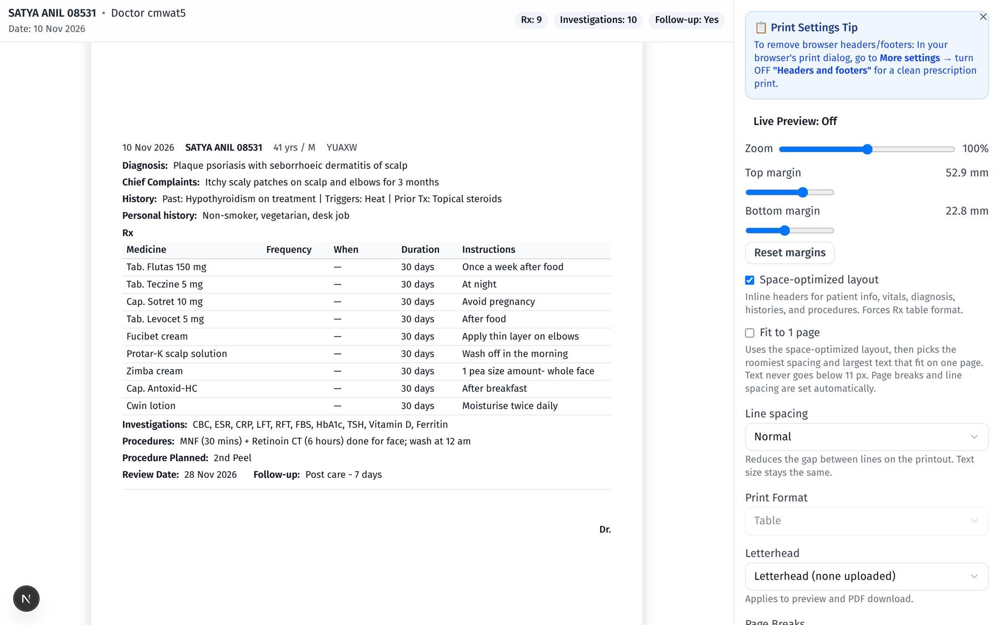
*Print Preview with Space-optimized layout ticked: every heading sits on the line of its value*

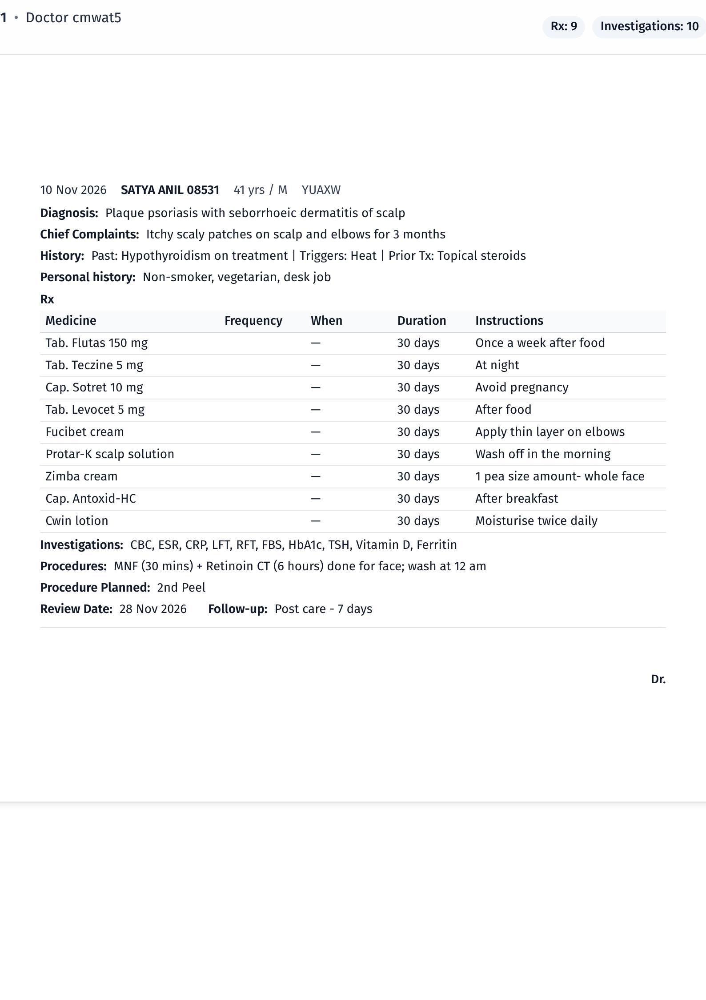
*The printed page: 9 medicines, 10 investigations, Review Date and Follow-up sharing one line*

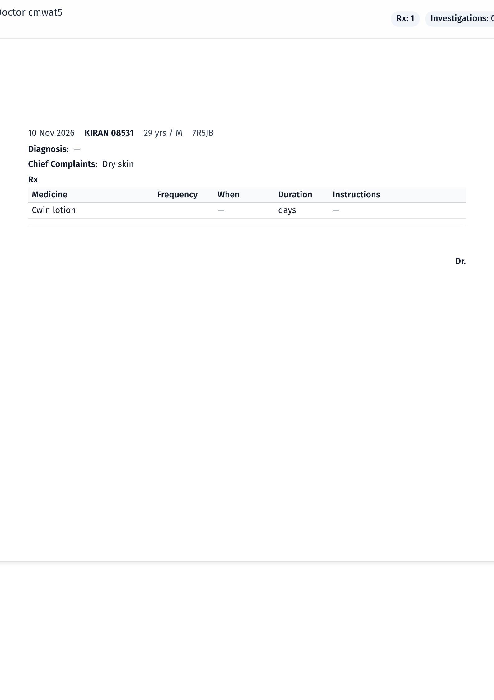
*A visit with most fields blank: empty blocks print nothing, but Diagnosis prints a dash*

Browser tests:
- cr-audit-visits.cjs (new): 15 CR-08 checks on the rendered print pages

Unit tests:
- frontend/__tests__/visits/PrescriptionBuilder.pagedjs.margins.test.tsx

## CR-09

**Pharmacy Billing: "Load" button does nothing** · High · **Done**

Load now opens the bill with the prescribed items and quantities, linked to stock, and flags the ones the pharmacy cannot supply. The old Pharmacy Billing screen was replaced by Sales → New sale, which carries the pending-prescription queue.

| Point | Requirement | Result | What was seen | Source |
|---|---|---|---|---|
| 1 | Load opens the bill with the prescribed items and quantities | Met | bill for ANVITHA 57393 | browser |
| 2 | Unmatched / out-of-stock items are loaded but flagged for the pharmacist | Met | link inventory before billing, link inventory before billing, No match, No match | browser |
| 3 | If loading fails, a clear error is shown | Met | frontend/__tests__/pharmacy/SalesBill.prescription-load.test.tsx: "shows a visible load error and retries the same prescription" | unit test, passed today |
| 4 | Saving the bill removes the prescription from Pending | Met | cr24-bills.cjs: "the prescription leaves Pending on screen and in the queue" (only a finished bill does this; Save draft keeps it pending) | existing e2e suite |

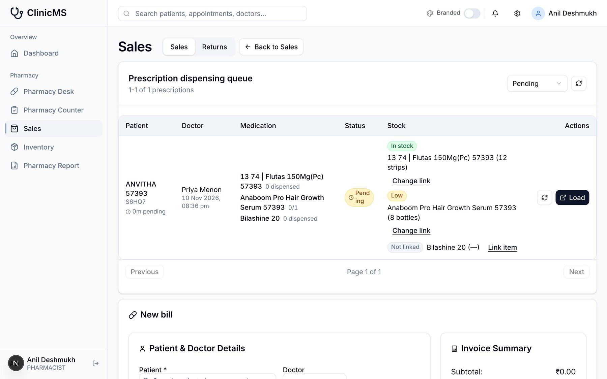
*Pending prescription in the queue with its Load button*

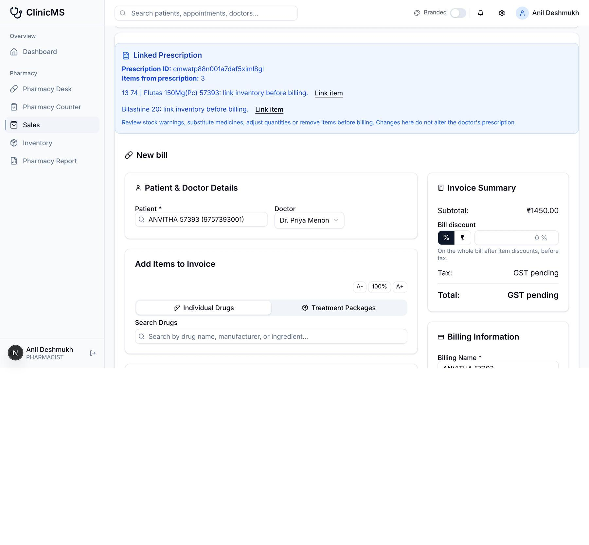
*After Load: the bill holds the prescribed medicines; the one not in stock is flagged*

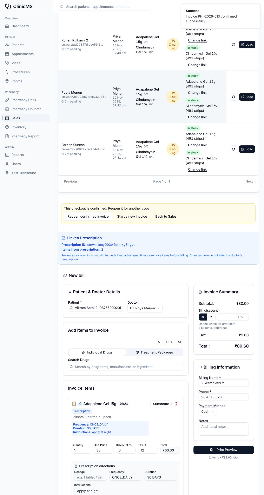
*From the existing suite: the same flow finished into a numbered bill*

Browser tests:
- cr-audit-pharmacy.cjs (new): Load on a prescription written in the browser by the doctor
- scripts/stack/scenarios/cr24-bills.cjs: 168 checks across pharmacist, doctor and admin at 1280 and 390 px, all passed

Unit tests:
- frontend/__tests__/pharmacy/SalesBill.prescription-load.test.tsx (15 tests)
- backend/src/modules/pharmacy/tests/pharmacy-billing-pending.spec.ts

## CR-10

**Pharmacy stock and item matching are wrong: redo inventory and stock** · High · **Partly done**

The linking, the movement log and the stock column are built and work. Merging duplicates and importing a filled stock-take file are not built, and the Sales bill's manual add still searches the full drug list. Whether the clinic's real stock figures are now right can only be judged on the live database.

Still to do:
- Merge duplicate items (point 4).
- Import of a filled stock-take file (point 3); counts are typed in on screen instead.
- Sales bill manual search still uses the full drug list (point 8).

| Point | Requirement | Result | What was seen | Source |
|---|---|---|---|---|
| 5 | Every stock movement is logged with date, user and reason (purchase and billing shown) | Met | From To Search Method All methods Purchase invoice Opening stock Customer return Prescription dispensed Pharmacy bill Counter sale Partner daily sale Supplier return Loss or breakage Blocked stock Stock count Movement correction Approved stock edit Location tr | browser |
| 3a | Stock list can be exported (Excel/CSV) for a physical stock take | Met |  | browser |
| 3b | A filled stock-take file can be imported to reset counts | Not met | only "Opening stock import" exists; counts are entered on screen (Stock counts) | browser |
| 4 | Duplicate items can be merged | Not met | no Merge action on the stock list | browser |
| 6 | Stock column shows each prescribed item's status with quantity (In stock / Low / Out / Not linked) | Met | ANVITHA 57393 S6HQ7 0m pending Priya Menon 10 Nov 2026, 08:36 pm 13 74 \| Flutas 150Mg(Pc) 573930 dispensed Anaboom Pro Hair Growth Serum 573930/1 Bilashine 200 dispensed Pending In stock 13 74 \| Flutas 150Mg(Pc) 57393 (12 strips) Change link Low Anaboom Pro Hair Growth Serum 57393 (8 bottles) Chan | browser |
| 7 | Refresh button re-checks stock and matching | Met |  | browser |
| 2 | Free-text items can be linked to an inventory item by the pharmacist ("Link item") | Met | Change link, Change link, Link item | browser |
| 1 | The stocked medicine arrives linked to its inventory item (by ID) | Met |  | browser |
| 8 | Picker and billing use the clinic's own stocked items first | Partly | The Rx picker searches clinic stock only (backend/src/modules/prescriptions/prescription-drug-search.ts). The Sales bill's manual add and Substitute still search the whole drug master (frontend/src/components/pharmacy/PharmacyInvoiceBuilderFixed.tsx:944-965). | code reading |
| check | 20 random items match the shelf count on the live system | Cannot tell | Needs the clinic's live database and a physical count; not checkable from the code. | code reading |

*Stock column per prescribed item: In stock / Low / Not linked, with quantities and a Link item action*

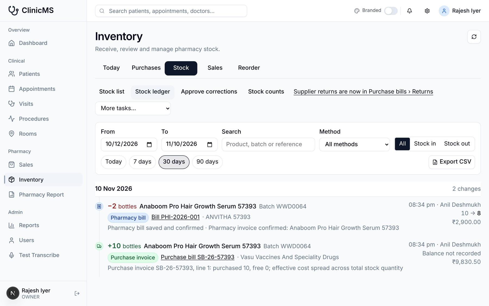
*Stock ledger: every movement with date, method and who did it*

Browser tests:
- cr-audit-pharmacy.cjs (new): 8 CR-10 checks

Unit tests:
- backend/src/modules/pharmacy/tests/cr10-stock-identity.spec.ts (6 tests)
- frontend/__tests__/pharmacy/PrescriptionDispensingQueue.stock.test.tsx (5 tests)

## CR-11

**Standard format for medicine names (Tab. / Syp. / cream)** · High · **Not done**

Not built. Names are still one free-text field; the Rx picker and the printed prescription show the stored name as it is, codes and pack sizes included.

Still to do:
- Separate form / strength fields and a name built from them.
- Combination-product tick box.
- Codes and pack sizes kept off the prescription.
- Clean-up of existing names.

| Point | Requirement | Result | What was seen | Source |
|---|---|---|---|---|
| 1 | New-item form stores form, brand name, strength, pack size and item code as separate fields | Not met | fields: Default duration · Default duration unitDaysWeeksMonthsYears · Default frequency · Default when · Default instructions · Item Name * · Type * · Description · Generic Name · Brand Name · Category · Sub-Category · Manufacturer · Supplier · Barcode · SKU · Cost Price (₹) * · Selling Price (₹) * | browser |
| 4 | "Combination product" tick box on the new-item form | Not met |  | browser |
| 5 | Rx picker shows the standard name ("Tab. Flutas 150 mg"), without code or pack size | Not met | picker offers: 13 74 \| Flutas 150Mg(Pc) 57393 | browser |
| 2 | Codes and pack sizes never print on the prescription | Not met | prints "13 74 \| Flutas 150Mg(Pc) 57393" | browser |
| 3 | Existing items cleaned up; items missing strength listed for the clinic | Not met | No such list exists. Data clean-up itself can only be confirmed on the live database. | code reading |

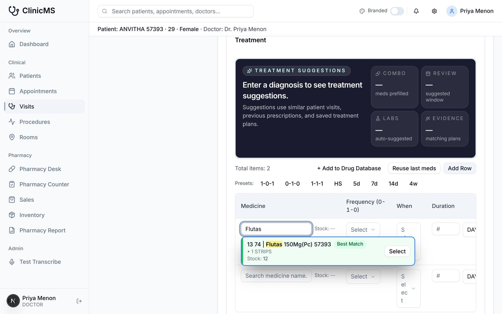
*Rx picker offers the stored name with its code ("13 74 | Flutas 150Mg(Pc)")*

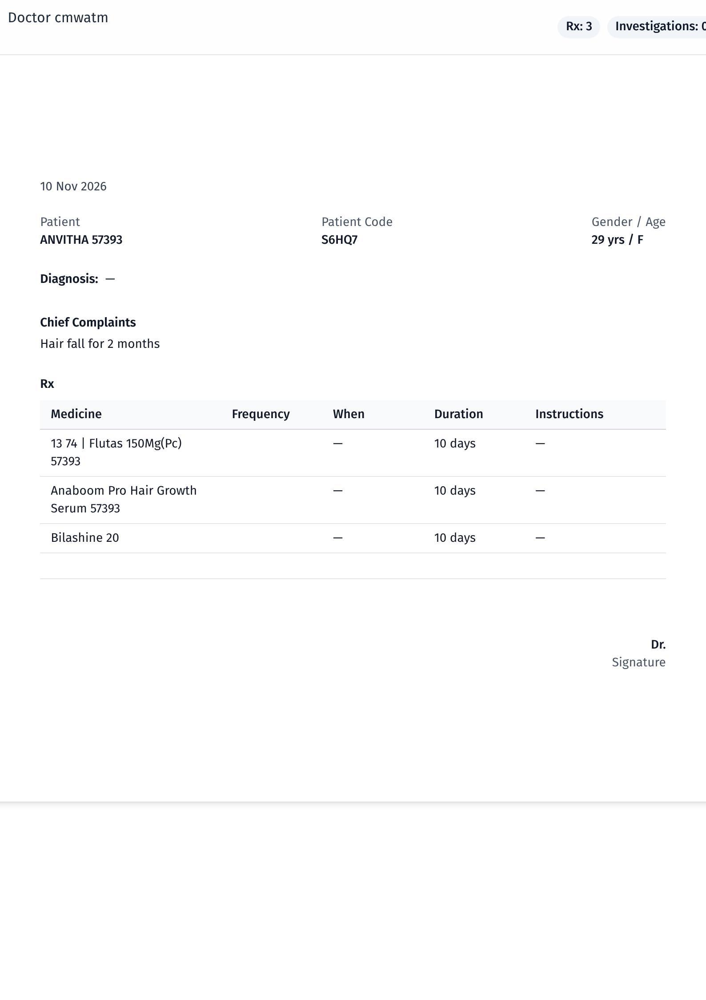
*The same raw name prints on the prescription*

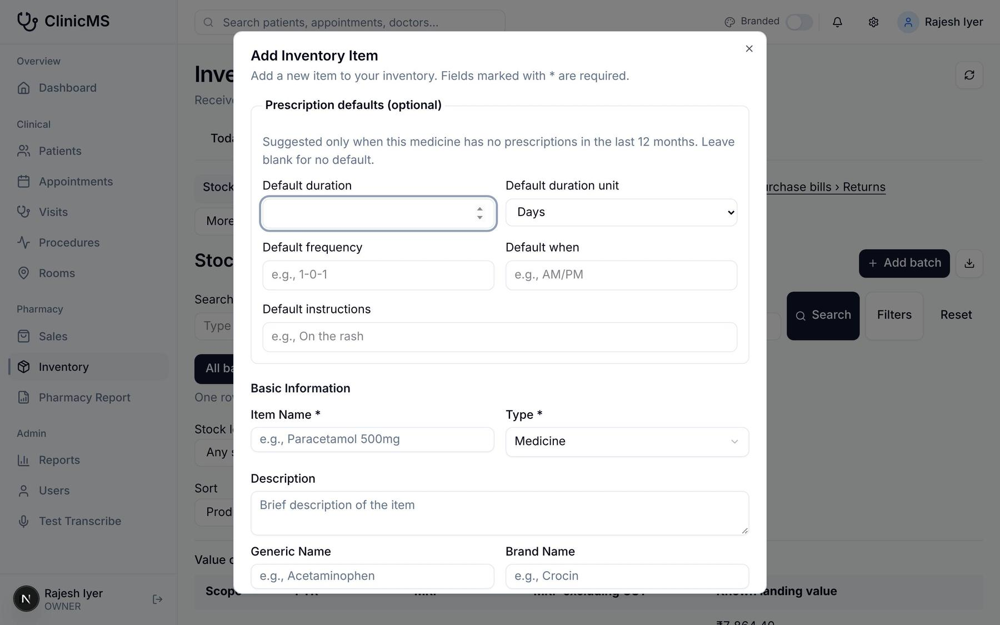
*New-item form: no Form, Strength or Combination product fields*

Browser tests:
- cr-audit-pharmacy.cjs (new): 4 CR-11 checks, all showing the request is not met

Unit tests:
- None for the name format

## CR-12

**Combine Inventory and Inventory Updates into one section** · Medium · **Done**

One Inventory menu item. Price and stock edits are made from the Stock tab with a reason, wait for a doctor, and show in Today → What needs attention.

| Point | Requirement | Result | What was seen | Source |
|---|---|---|---|---|
| 1 | One "Inventory" menu item; "Inventory Updates" removed | Met | menu: Dashboard, Patients, Appointments, Visits, Procedures, Rooms, Sales, Inventory, Pharmacy Report, Reports, Users, Test Transcribe | browser |
| 5 | "Reorder targets" is no longer a separate menu item | Met |  | browser |
| 1b | The old Inventory Updates address opens the approval queue inside Inventory | Met | /dashboard/inventory?area=stock&view=approvals | browser |
| 2 | Stock edit (with reason) is made from the Inventory Stock tab and waits for approval | Met | stock still 8 after the pharmacist's edit | browser |
| 3a | Pending edits show in Today → What needs attention | Met | 1 Price/stock edits awaiting approval (1) | browser |
| 3b | Stock changes only when a doctor approves the edit | Met | stock 8 -> 7 after the doctor approved | browser |
| 4 | Stock tab lists the clinic's own items, not the full drug catalogue | Met | 24 clinic stock rows in this database | browser |
| 6 | Physical counts (stock take) live under Stock → Stock counts | Met |  | browser |

*Left menu: a single Inventory entry, no Inventory Updates*

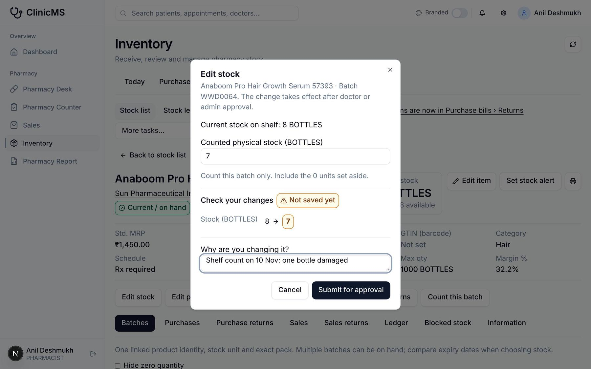
*Pharmacist edits stock from the item, with a reason*

*Today shows "Price/stock edits awaiting approval (1)"*

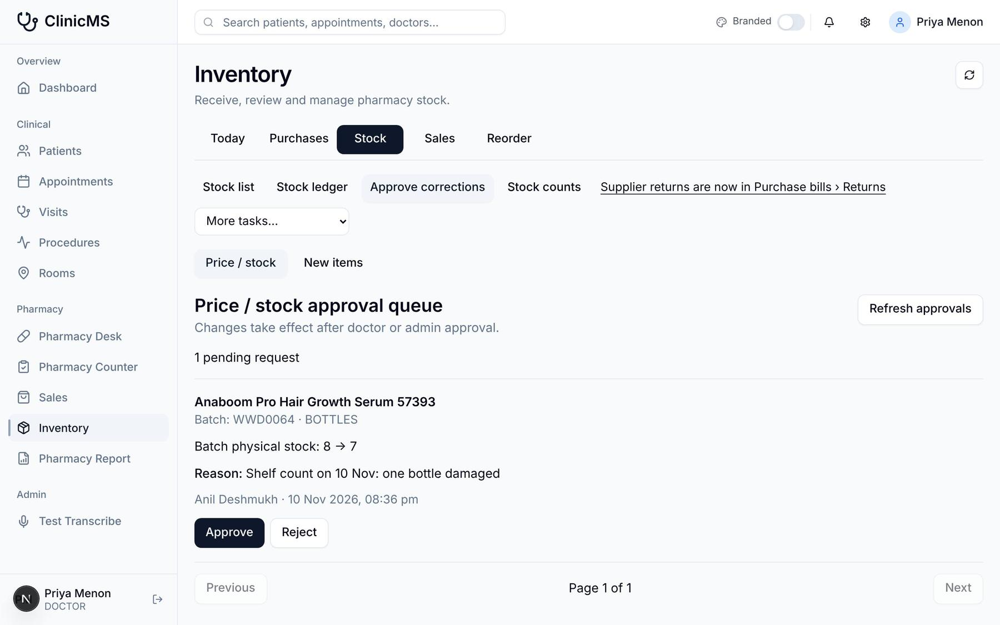
*The doctor's approval queue; stock changed only after Approve*

Browser tests:
- cr-audit-pharmacy.cjs (new): 8 CR-12 checks
- scripts/stack/scenarios/merge-main.cjs and access-roles.cjs also cover the edit and approval path

Unit tests:
- frontend/__tests__/inventory/StockEditDialog.test.tsx
- frontend/__tests__/inventory/InventoryUpdates.test.tsx
- backend/src/modules/pharmacy/tests/inventory-batch-edits.spec.ts

## CR-13

**Bigger font and fewer taglines (all screens)** · High · **Partly done**

Text was made larger everywhere (body 18 px, table text 16 px or more, headings 20 px and up). The grey taglines the request names are still on the Inventory screen, some badges are 14 px, and there is no per-user Text size setting.

Still to do:
- Remove the named taglines.
- Per-user Text size (Normal / Large / Extra large).
- Raise the 14 px badges and secondary lines to 16 px.

| Point | Requirement | Result | What was seen | Source |
|---|---|---|---|---|
| 1 | The grey taglines named in the request are removed from Inventory | Not met | still shown: Receive, review and manage pharmacy stock. \| Every action opens the matching records. | browser |
| 3a | Body and table text at least 16 px | Met | body 18px; Sales table cells 16/18px | browser |
| 3b | Headings and patient names 18-20 px | Met | page heading 32px; patient name in the Sales table 18px | browser |
| 3c | No text below 16 px on the Sales screen | Not met | 2 of 18 text elements are under 16px; smallest 14px | browser |
| 4 | Per-user Text size setting (Normal / Large / Extra large) | Not met | no "Text size" control found in the header menus | browser |
| 2 | Hints kept only where needed, as an (i) tooltip | Partly | An info-tooltip exists and is used in a few places (reports, stock list); most hints are still inline grey text. 12 page headers still pass a grey description. | code reading |
| 5 | Tables wrap rather than shrink at larger sizes | Partly | Text is rem-based so it does not shrink, but table cells default to no-wrap inside a scrolling container (frontend/src/components/ui/table.tsx). | code reading |

*Inventory still shows "Receive, review and manage pharmacy stock." and "Every action opens the matching records."*

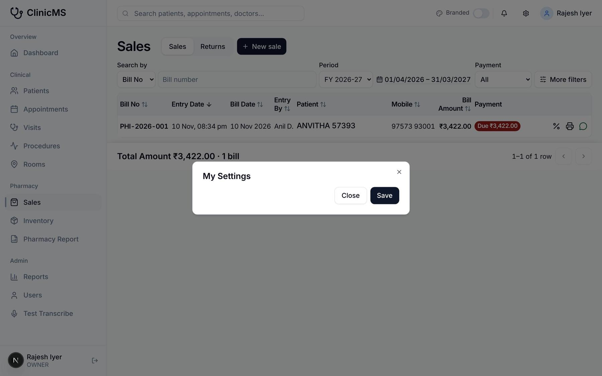
*No Text size control in the header menus*

Browser tests:
- cr-audit-pharmacy.cjs (new): 5 CR-13 checks (computed font sizes read from the browser)

Unit tests:
- None

## CR-14

**Purchase invoice matching says "No close match" for items already in inventory** · High · **Partly done**

The clinic's own example still fails on the real matching service: "ZITCARE FORT CAPSULE, 15's" comes back "Not in inventory" with create-new recommended, although "Zitcare Forte Capsule" is saved. Fort = Forte is tolerated only once the "15's" pack text is out of the way.

Still to do:
- Ignore pack text such as "15's" when matching.
- Show 3-5 candidates.
- Remember confirmed matches per supplier.
- Stop carrying "(loose ...)" into names.

| Point | Requirement | Result | What was seen | Source |
|---|---|---|---|---|
| check | Invoice line "ZITCARE FORT CAPSULE, 15's" (as SLV Pharma prints it) finds the saved "Zitcare Forte Capsule" as the top match | Not met | top candidate: none; label: Not in inventory; action: CREATE_NEW | browser |
| 2 | Small spelling differences tolerated: "ZITCARE FORT CAPSULE" with the pack typed as "15 capsules" finds Zitcare Forte | Met | top candidate: Zitcare Forte Capsule; label: Possible match | browser |
| 4 | No "create new" recommendation when a same-brand item exists | Not met | recommended action for the invoice line: CREATE_NEW | browser |
| 3 | Clinic's own items searched first; top 3-5 candidates plus a search box | Partly | The service ranks at most 3, from the drug master rather than stock first; the screen shows only the top one. A manual search box exists (frontend/src/components/pharmacy/PurchaseManualMatchSearch.tsx). | code reading |
| 5 | Confirmed matches remembered per supplier for future invoices | Not met | A confirmation writes an audit row that is never read back (backend/src/modules/pharmacy/pharmacy-purchase-invoice.service.ts:830-836). | code reading |
| 6 | "(loose ...)" never added to product names | Not met | Confirm Match overwrites the line with the saved name, suffix included; backend/src/modules/inventory/inventory-names.ts:15-16 re-appends the loose label. | code reading |

Browser tests:
- cr-audit-pharmacy.cjs (new): the real matching endpoint called with the clinic's invoice text against a database holding Zitcare Forte

Unit tests:
- No CR-14 test exists. Nearest: backend/src/shared/search/product-search.spec.ts

## CR-15

**Purchase invoice suggests a wrong product when there is no real match** · High · **Done**

Abzorb is no longer suggested for Moisturex: with no name match the line reads "Not in inventory" with create new item, and confirming a different product is refused with a mismatch warning unless acknowledged. Point 5 (audit of past invoices) cannot be confirmed from here.

| Point | Requirement | Result | What was seen | Source |
|---|---|---|---|---|
| 1 | Manufacturer / MRP / pack alone never qualifies: Abzorb is not suggested for Moisturex | Met | candidates: 0 | browser |
| 2 | No real match → "Not in inventory" with create new item as the action | Met | label: Not in inventory; action: CREATE_NEW | browser |
| 4 | Plain labels instead of scores | Met | labels returned: Not in inventory, Possible match, Not in inventory | browser |
| 3 | Confirming Moisturex against Abzorb is refused with a mismatch warning unless acknowledged | Met | 409 {"code":"PURCHASE_PRODUCT_MISMATCH","message":"These look like different products. Confirm anyway?","mismatches":["Product names differ"],"requestId":"99d20620-896e-44cd-a9ed-d78008ed712a","errorCode" | browser |
| 5 | Past invoices audited for manufacturer-only matches and stock corrected | Cannot tell | A read-only audit script exists (scripts/diagnostics/cr15-purchase-match-audit.cjs); docs/qa/cr-15-purchase-product-matching.md reports 8 invoices audited, 0 corrections. Needs the live database to confirm. | code reading |

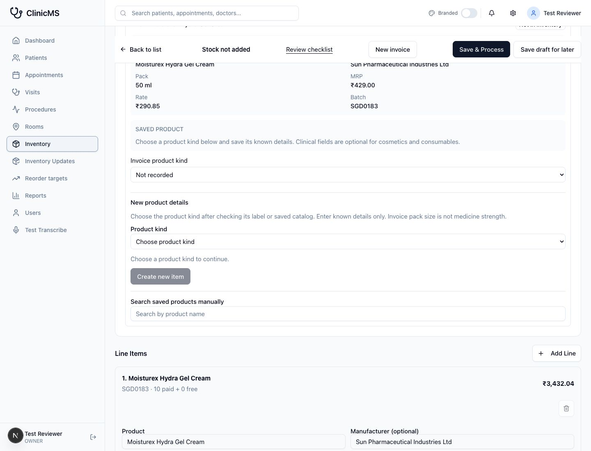
*Screen from the earlier CR-15 browser check (docs/qa/cr15, synthetic data): "Not in inventory" with Create new item*

Browser tests:
- cr-audit-pharmacy.cjs (new): the real matching and confirmation endpoints, including the 409 mismatch refusal

Unit tests:
- backend/src/modules/pharmacy/tests/pharmacy-purchase-invoice.service.spec.ts (CR-15 cases at :549-589 and :849)
- frontend/__tests__/pharmacy/PurchaseInvoiceWorkbench.test.tsx:748

## CR-16

**Visit history panel shows far too much** · High · **Done**

The past-visit panel opens compact: chief complaint, diagnosis, history and a plain list of medicine names, each once. No dose or frequency figures and no internal fields. Full details is one click away.

| Point | Requirement | Result | What was seen | Source |
|---|---|---|---|---|
| 2 | Compact panel shows chief complaints | Met |  | browser |
| 3 | Compact panel shows personal history and other history | Met |  | browser |
| 4 | Compact panel lists medicine names | Met | 9 of 9 names listed | browser |
| 5 | No frequency, dose, timing, duration, quantity, route, generic or GST in the default panel | Met |  | browser |
| 6 | Each medicine appears once | Met |  | browser |
| 7 | Internal fields (Regimen State, Touched, Gst Rate, Language) are gone | Met |  | browser |
| check-1 | The panel fits on screen without scrolling | Met | panel is 600px tall in a 900px window | browser |
| 8 | The full regimen is one click away (Full details) | Met |  | browser |
| 7b | Full details also hides the internal fields | Met |  | browser |
| 8b | Full details switches back to the compact view | Met |  | browser |

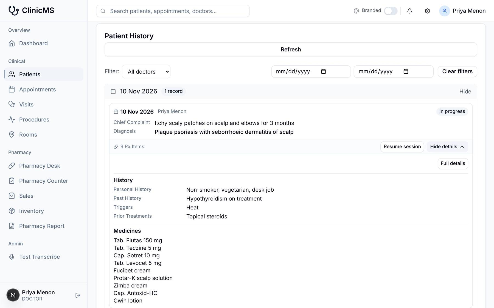
*Compact panel on a follow-up patient: complaint, history, medicine names only*

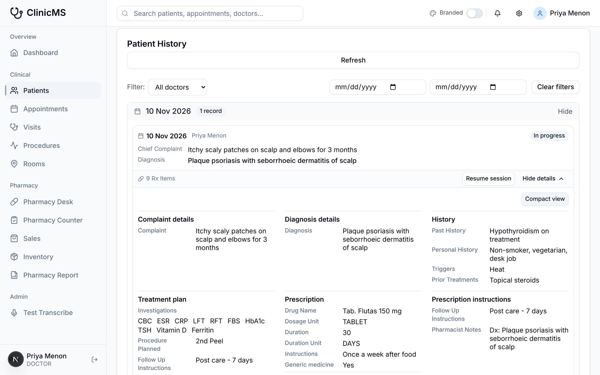
*Full details, one click, with the regimen and without internal fields*

Browser tests:
- cr-audit-visits.cjs (new): 10 CR-16 checks on a visit written in the browser

Unit tests:
- frontend/__tests__/visits/PatientHistoryVisitCard.test.tsx (18 tests)

## CR-17

**Appointments: billing information, bill type, and a Daily Collection tab** · Medium · **Not done**

Not built. Appointment rows show no billing information or bill type, and the left menu has no Daily Collection entry. A Daily Collection report does exist under Pharmacy Report, covering pharmacy takings only.

Still to do:
- Billing information on each appointment row.
- Bill type (first consultation / review / procedure).
- Daily Collection in the left menu.

| Point | Requirement | Result | What was seen | Source |
|---|---|---|---|---|
| 3 | "Daily Collection" tab in the main left-hand menu | Not met | menu: Dashboard, Patients, Appointments, Visits, Procedures, Rooms, Sales, Inventory, Pharmacy Report, Reports, Users, Test Transcribe | browser |
| 1 | Each appointment row shows its billing information | Not met | row shows: #1 10:00-10:30 ANVITHA 57393 FOLLOW-UP OPD 29y F Scheduled INFO RESCHED START | browser |
| 2 | Each row shows the bill type (first consultation / review / procedure bill) | Not met | row carries only the visit type and a FOLLOW-UP flag | browser |
| 3-partial | What exists instead: a Daily collection report under Pharmacy Report (pharmacy takings only) | Note |  | browser |

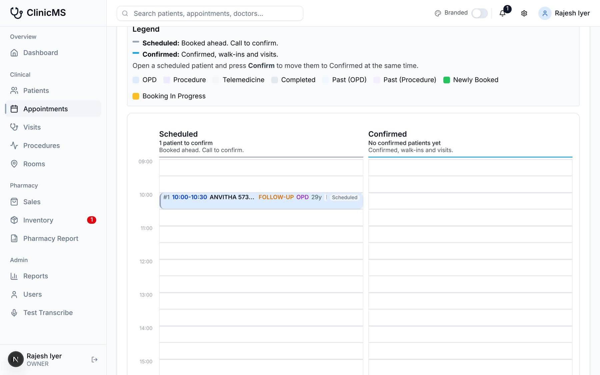
*Appointment row: time, patient, visit type, age, room and status; nothing about billing*

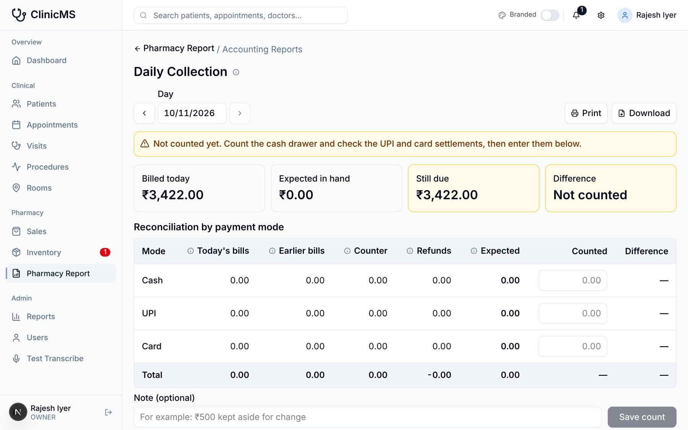
*The nearest thing: Daily Collection inside Pharmacy Report*

Browser tests:
- cr-audit-pharmacy.cjs (new): 4 CR-17 checks on a booked appointment

Unit tests:
- None for billing on appointments

## CR-18

**Patient History: remove Triggers and Prior Treatments** · Low · **Not done**

Not done. Both fields are still on the form, are saved, and print under History. Personal history (CR-04) is present alongside them.

Still to do:
- Remove the Triggers field.
- Remove the Prior Treatments field.

| Point | Requirement | Result | What was seen | Source |
|---|---|---|---|---|
| 1 | "Triggers" field removed from Patient History | Not met | labels: Past History, Medication History, Menstrual History, Family History, Diabetes, Hypertension, Thyroid, Personal history, Triggers, Prior Treatments | browser |
| 2 | "Prior Treatments" field removed from Patient History | Not met | input with placeholder "Topicals/systemics tried" still renders | browser |
| 3 | "Personal history" field is present | Met |  | browser |
| print | Triggers / Prior Tx no longer print under History | Not met | History line prints: "Past: Hypothyroidism on treatment \| Triggers: Heat \| Prior Tx: Topical steroids" | browser |

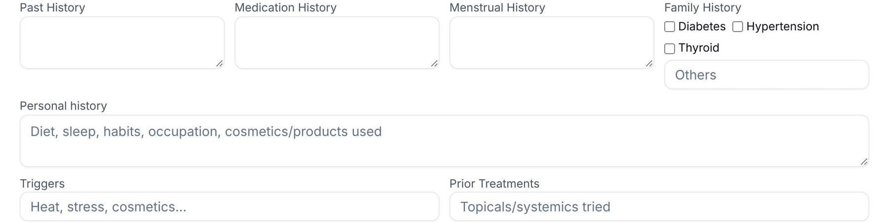
*Patient History today: Triggers and Prior Treatments still under Personal history*

Browser tests:
- cr-audit-visits.cjs (new): 4 CR-18 checks

Unit tests:
- None assert the removal

## CR-19

**Rx table: column widths and the Add Row button** · Medium · **Not done**

Not done. Duration is as wide as Instructions (216 px against 219 px), a 29-character instruction is cut off, and the single Add Row button only adds at the end.

Still to do:
- Narrow the Duration column.
- Widen Instructions.
- Add Row after every row.

| Point | Requirement | Result | What was seen | Source |
|---|---|---|---|---|
| 1 | Duration column is narrow (no wider than the value it holds) | Not met | Duration column 216px wide | browser |
| 2 | Instructions column shows "1 pea size amount- whole face" in full | Not met | Instructions column 219px, text needs 260px of 185px | browser |
| 3 | Add Row is available after every row (insert in the middle) | Not met | buttons on a row: Remove | browser |
| 3b | With the first row active, Add Row inserts below it rather than at the end | Not met | rows 4 -> 5; order: Isotroin 20 Capsule \| Trudema gentle cleanser \| Epiduo gel \| (blank) \| (blank) | browser |

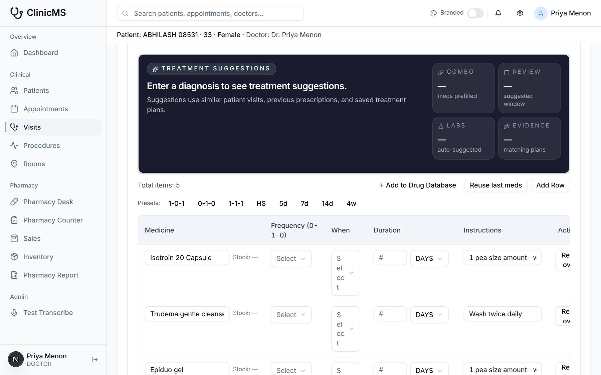
*Rx table: "1 pea size amount- whole face" is cut off; rows only have Remove*

Browser tests:
- cr-audit-visits.cjs (new): 4 CR-19 checks measured in the browser

Unit tests:
- None

## CR-20

**Investigations: custom investigations saved permanently** · Medium · **Done**

A custom investigation is saved for the clinic, shows as a standing checkbox on other patients' prescriptions, and can be renamed or removed.

| Point | Requirement | Result | What was seen | Source |
|---|---|---|---|---|
| 1a | A typed custom investigation is added and ticked on this prescription | Met |  | browser |
| 1 | It is saved permanently on the server | Met | GET /clinic-investigations returns 1 saved item(s) | browser |
| 2 | It appears as a standing, unticked checkbox on another patient's prescription | Met |  | browser |
| 3a | The clinic can rename a saved investigation | Met |  | browser |
| 3b | The clinic can remove a saved investigation | Met |  | browser |

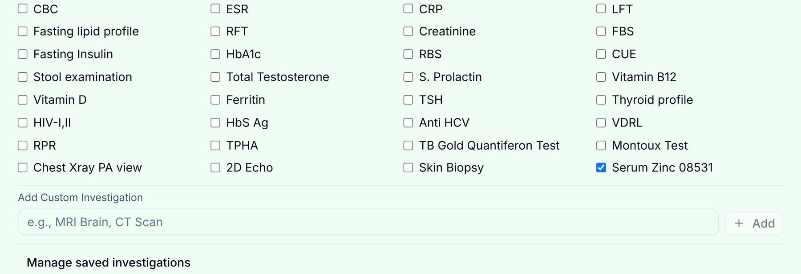
*Custom investigation added and ticked*

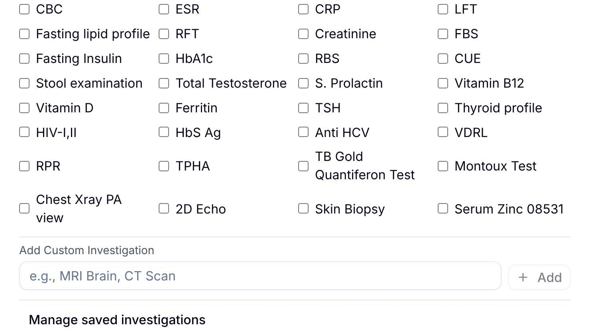
*The same investigation as a standing checkbox on another patient*

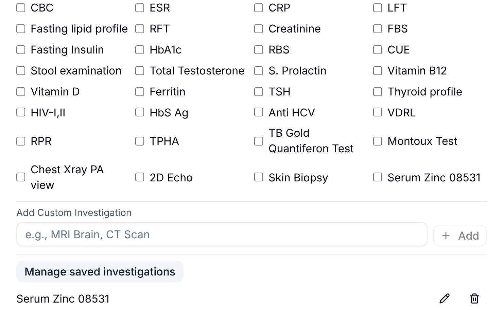
*Manage saved investigations: rename and remove*

Browser tests:
- cr-audit-visits.cjs (new): 6 CR-20 checks

Unit tests:
- frontend/__tests__/visits/PrescriptionBuilder.custom-investigations.test.tsx (13 tests)
- backend/src/modules/clinic-investigations/*.spec.ts

## CR-21

**Keep patient name, age and sex on screen when Patient Context is collapsed** · High · **Done**

The header reads "Patient: NAME · age · sex · Doctor" from Visit #1, stays when Patient Context is collapsed, and stays pinned while scrolling to the Rx section. "Patient: Unknown" is gone.

| Point | Requirement | Result | What was seen | Source |
|---|---|---|---|---|
| 3 | Header reads the patient from the visit (no "Patient: Unknown") | Met | Patient: ABHILASH 08531 · 33 · Female · Doctor: Dr. Priya Menon | browser |
| 2 | Works on a brand-new patient's Visit #1 | Met | Patient: ABHILASH 08531 · 33 · Female · Doctor: Dr. Priya Menon | browser |
| 1 | Name, age and sex stay visible with Patient Context collapsed | Met | Patient: ABHILASH 08531 · 33 · Female · Doctor: Dr. Priya Menon | browser |
| 5 | Collapsing hides only the extra detail (ID, phone) | Met | phone visible: false | browser |
| 4 | Identity line stays on screen while scrolled down to the Rx section | Met | {"top":72,"inView":true,"onTop":true,"scrolled":2468} | browser |

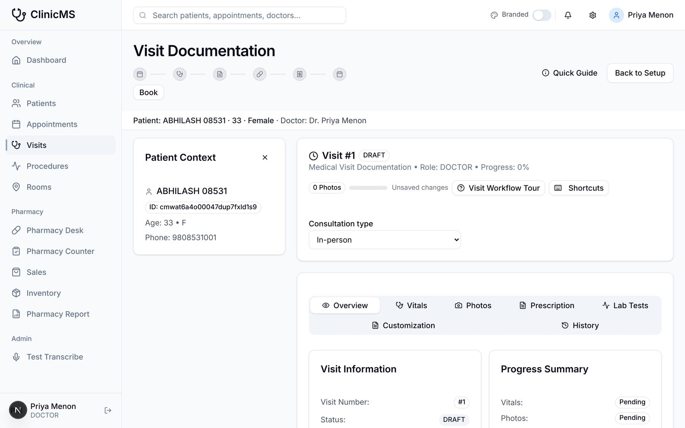
*Visit #1 for a new patient: the header names the patient*

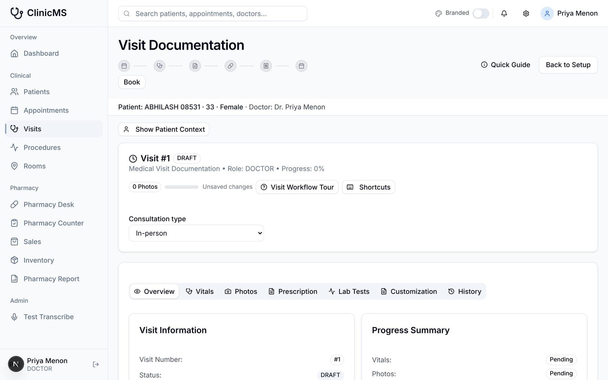
*Patient Context collapsed: identity still in the header*

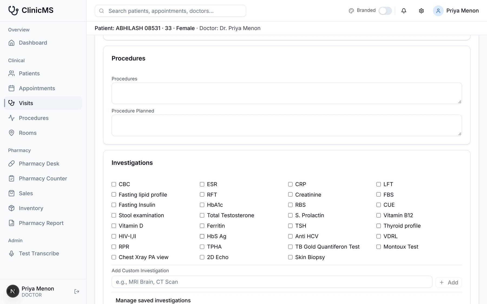
*Scrolled down to Investigations: identity line still pinned at the top*

Browser tests:
- cr-audit-visits.cjs (new): 5 CR-21 checks
- verification/cr-state-coverage-2026-11-07/models/cr21-visit-identity.cjs re-run today: 16 of 16 states, 17 of 17 transitions, 0 failures

Unit tests:
- frontend/__tests__/visits/VisitIdentityBar.test.tsx
- frontend/__tests__/lib/visit-identity.test.ts

## CR-22

**Make "On Examination" collapsible** · Medium · **Done**

Collapsed by default, opens on a click with all its fields, keeps what was typed, and stays collapsed on the next visit. The choice is remembered in the browser, so it does not follow the doctor to another computer.

| Point | Requirement | Result | What was seen | Source |
|---|---|---|---|---|
| 2 | On Examination is collapsed by default | Met | aria-expanded=false | browser |
| 1 | Clicking the heading opens the section with all its fields | Met |  | browser |
| 5 | Collapsing hides the fields without deleting what was typed | Met |  | browser |
| 4 | The doctor's last choice is remembered | Met | stored preference = false | browser |
| 4b | Open the next visit: On Examination is still collapsed | Met |  | browser |

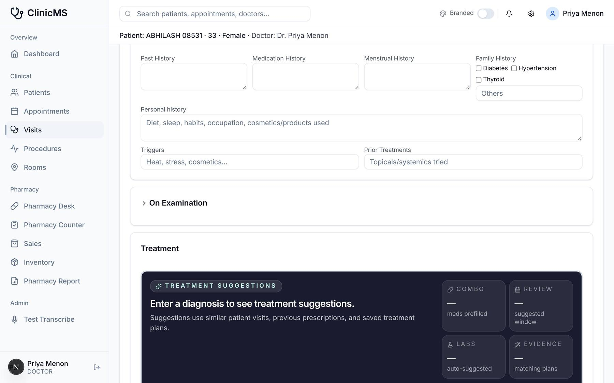
*On Examination as a single collapsed heading between Patient History and Treatment*

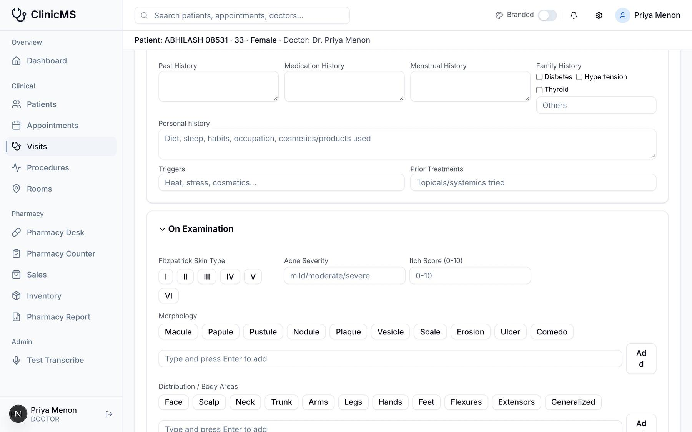
*Opened: all existing fields*

Browser tests:
- cr-audit-visits.cjs (new): 5 CR-22 checks
- verification/cr-state-coverage-2026-11-07/models/cr22-on-examination.cjs re-run today: 11 of 11 states, 16 of 16 transitions, 0 failures

Unit tests:
- frontend/__tests__/visits/PrescriptionBuilder.on-examination.test.tsx
- frontend/__tests__/visits/on-examination-panel.test.ts

## CR-23

**Space-optimised layout must tighten vertical gaps to fit one page** · High · **Done**

With 9 medicines and 10 investigations the prescription prints on one page with the option ticked and on two without it. Text size is the same in both; only spacing changes.

| Point | Requirement | Result | What was seen | Source |
|---|---|---|---|---|
| 4 | 9 medicines and 10 investigations fit on one page with Space-optimized layout ticked | Met | optimized 1 page(s); normal layout 2 page(s) | browser |
| 1-3 | Vertical space is tighter than the normal layout | Met | content height 1625px normal -> 836px optimized | browser |
| 5 | Text size is not reduced | Met | value text 14px in both layouts | browser |
| 6 | Normal layout keeps its roomier spacing | Met |  | browser |

*Space-optimized: one page*

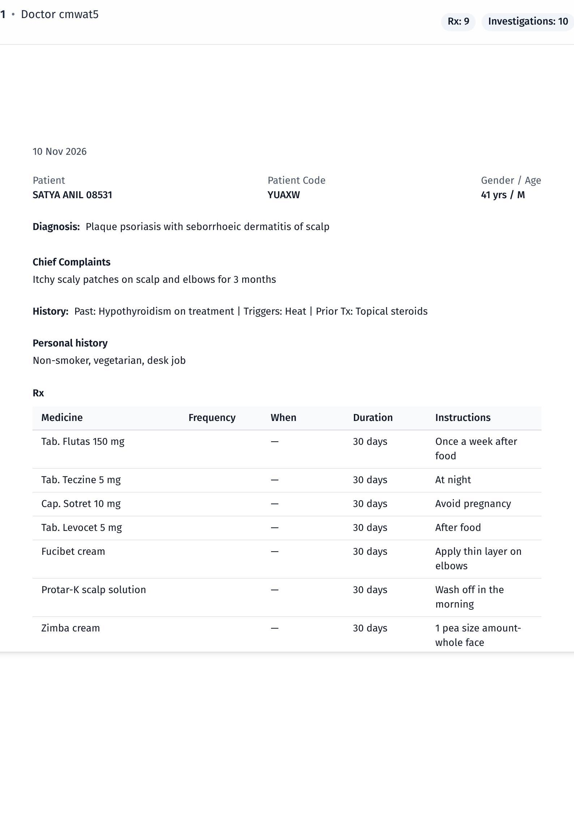
*Normal layout, page 1 of 2: the roomier spacing is unchanged*

Browser tests:
- cr-audit-visits.cjs (new): 4 CR-23 checks on the rendered pages

Unit tests:
- frontend/__tests__/lib/print-fit.test.ts

## CR-24

**Build the Sales tab like eVitalRx** · High · **Done, with gaps**

The Sales register is built: the asked columns in order, payment badges, print and WhatsApp on each row, Draft rows, sortable headers, financial-year default, New sale, and a pinned total. One gap in the filter bar: there is no separate Name / Mobile search box; name and mobile are options in the one "Search by" selector.

Still to do:
- A separate Name / Mobile search box, if the clinic wants it as in the reference.

| Point | Requirement | Result | What was seen | Source |
|---|---|---|---|---|
| 1 | Columns in order: Bill No · Entry Date · Bill Date · Entry By · Patient · Mobile · Bill Amount · payment | Met | cr24-sales.cjs scenario 01 | existing e2e suite |
| 2 | Payment mode as a coloured badge on each row | Met | cr24-sales.cjs scenarios 04, 14 | existing e2e suite |
| 3 | Print and WhatsApp icons on every row | Met | cr24-sales.cjs scenario 06 | existing e2e suite |
| 4 | Unsaved bills show as Draft and can be reopened | Met | cr24-sales.cjs scenario 05; cr24-bills.cjs draft reopen and finish | existing e2e suite |
| 5 | Sortable column headers | Met | cr24-sales.cjs scenario 03 | existing e2e suite |
| 6 | Filter bar: field selector + search, date range (financial year), Name / Mobile search, payment dropdown, More Filters with count | Partly | All present except a separate Name / Mobile box (frontend/src/components/pharmacy/sales/SalesRegister.tsx:231-272). | code reading |
| 7 | "+ New" button | Met | "New sale" opens the bill; the Sales Return link became the Returns tab (CR-25) | existing e2e suite |
| 8 | Running total pinned at the bottom | Met | cr24-sales.cjs scenarios 01, 02, 13 | existing e2e suite |
| check | Filter to one day: the bottom total updates | Met | cr24-sales.cjs scenario 02 | existing e2e suite |

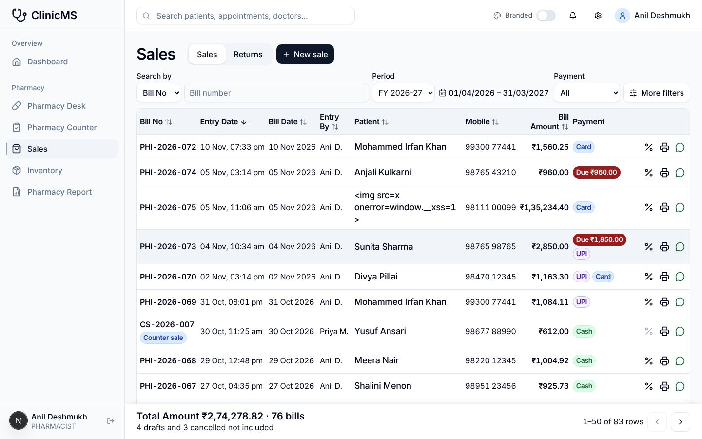
*Sales register, financial year by default, total pinned at the bottom*

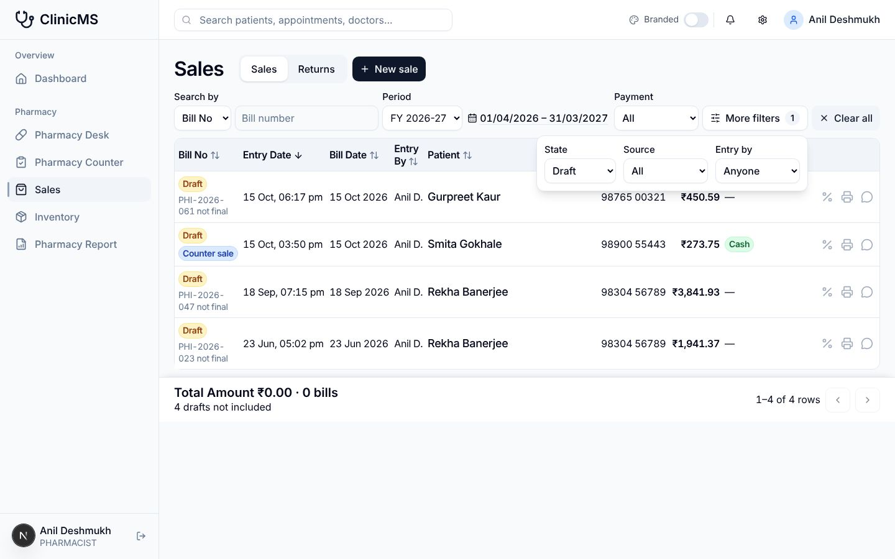
*Draft rows*

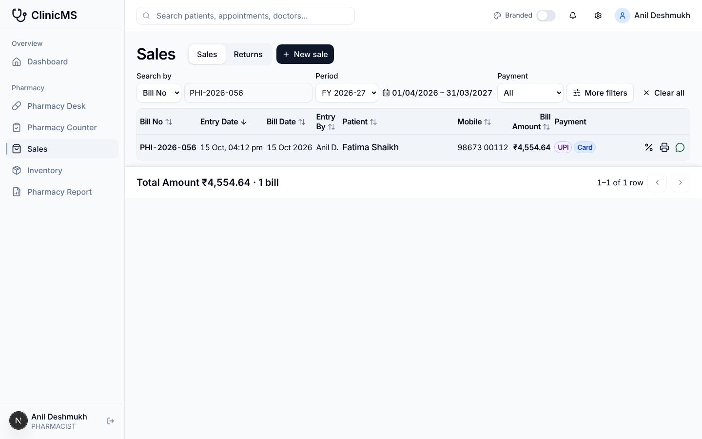
*Print and WhatsApp on the row*

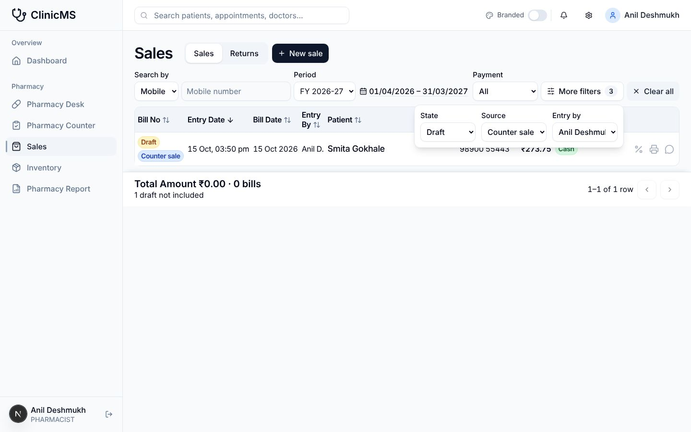
*More filters with the active count*

Browser tests:
- scripts/stack/scenarios/cr24-sales.cjs: 23 scenarios, 381 checks, all passed
- scripts/stack/scenarios/cr24-bills.cjs: 168 checks across pharmacist, doctor and admin at 1280 and 390 px, all passed
- scripts/stack/scenarios/cr24-discounts.cjs: 180 checks, all passed
- scripts/stack/scenarios/access-roles.cjs: 99 checks, all passed (pharmacist, doctor and admin reach every pharmacy screen; reception is refused)

Unit tests:
- frontend/__tests__/pharmacy/SalesPage.test.tsx (22 tests)
- backend/src/modules/pharmacy/tests/pharmacy-sales-register*.spec.ts (31 tests)

## CR-25

**The Sales tab holds two sub-tabs: Sales and Returns** · High · **Done**

Sales and Returns are tabs on the same screen with the same filter bar, sortable columns, New return, an empty-state message and pagination.

| Point | Requirement | Result | What was seen | Source |
|---|---|---|---|---|
| 1 | "Sales" is a main tab in the left menu | Met |  | browser |
| 2-4 | Returns is a proper sub-tab with the same layout, filter bar and sortable columns | Met | cr24-sales.cjs scenarios 08, 20 | existing e2e suite |
| 5 | "+ New" on Returns raises a sales return | Met | cr24-sales.cjs scenarios 08, 18, 19 (the form opens in the Inventory editor and comes back) | existing e2e suite |
| 6 | Clear empty state when nothing matches | Met | cr24-sales.cjs scenario 08: "No returns match your search" | existing e2e suite |
| 7 | Pagination at the bottom | Met | cr24-sales.cjs scenario 09 | existing e2e suite |

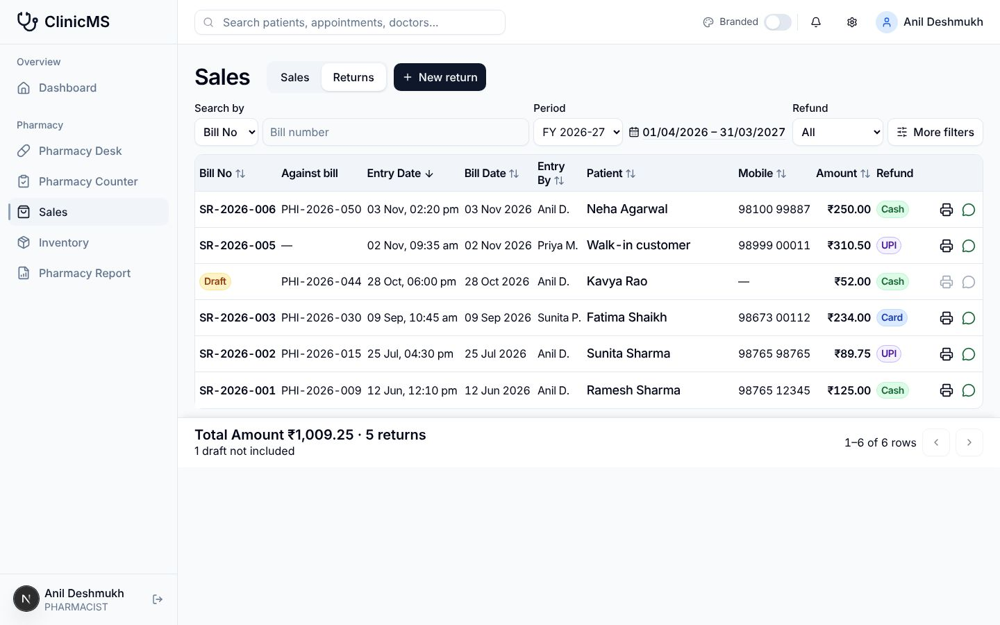
*Returns tab beside Sales*

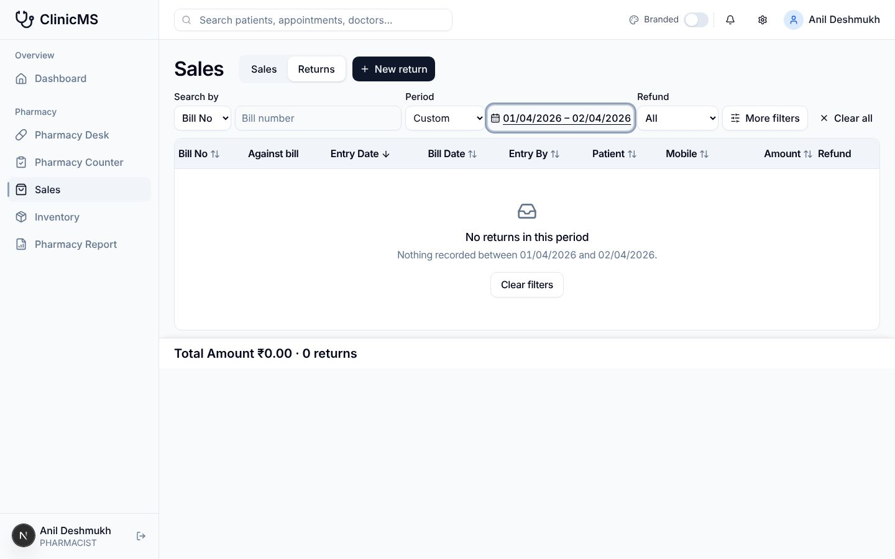
*Empty state on Returns*

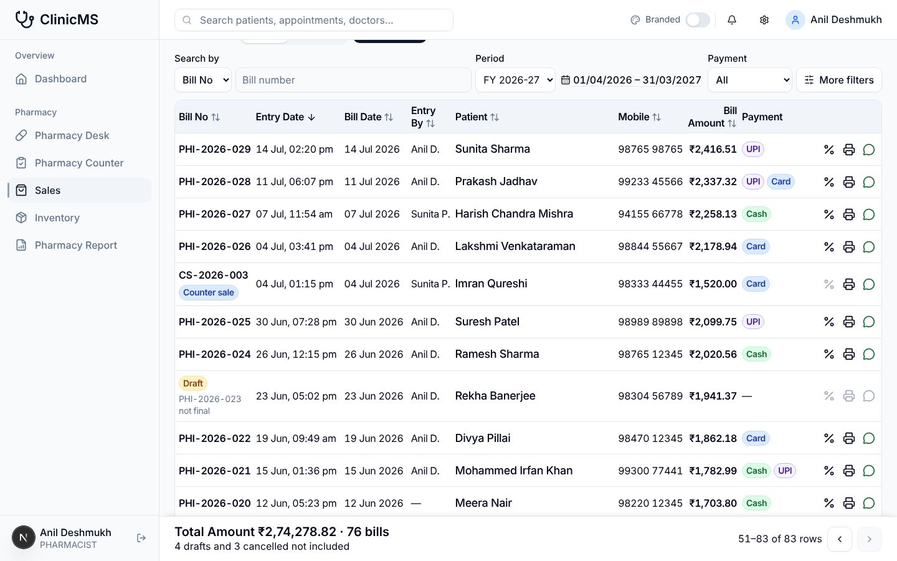
*Pagination*

Browser tests:
- scripts/stack/scenarios/cr24-sales.cjs: 23 scenarios, 381 checks, all passed

Unit tests:
- frontend/__tests__/pharmacy/SalesPage.test.tsx
- frontend/__tests__/pharmacy/sales-register-model.test.ts

## CR-26

**Build the Purchase tab like eVitalRx** · High · **Done, with gaps**

The Purchase bills register is built inside Inventory → Purchases: the asked columns, Bill No. as a link, Due / Overdue / Paid badges with Mark paid beside them, sorting, New purchase and a More menu. Gap: Distributor search is an option in the field selector rather than its own box. Purchase is not a top-level menu item (the request left that open).

Still to do:
- A dedicated Distributor Name box, if wanted.
- Decide whether Purchase should be a top-level menu item.

| Point | Requirement | Result | What was seen | Source |
|---|---|---|---|---|
| 1 | Columns in order: Sr No · Bill No · Entry Date · Bill Date · Entry By · Distributor · Bill Amount · payment status | Met | cr26-purchase.cjs scenario 01 | existing e2e suite |
| 2 | Bill No. opens the purchase invoice | Met | cr26-purchase.cjs scenario 10 | existing e2e suite |
| 3 | Payment status badge with a one-click control to mark the invoice settled | Met | cr26-purchase.cjs scenarios 04-06 (confirm popover, then Undo) | existing e2e suite |
| 4 | Sortable column headers | Met | cr26-purchase.cjs scenario 02 | existing e2e suite |
| 5 | Filter bar with a Distributor Name search | Partly | Distributor is an option in the "Search by" selector and a dropdown inside More filters (frontend/src/components/inventory/purchase/PurchaseRegister.tsx:200-240). | code reading |
| 6 | "+ New" and a More menu | Met | cr26-purchase.cjs scenarios 10, 17 | existing e2e suite |
| 7 | Row opens the whole invoice with its line items | Met | cr26-purchase.cjs scenario 10 | existing e2e suite |

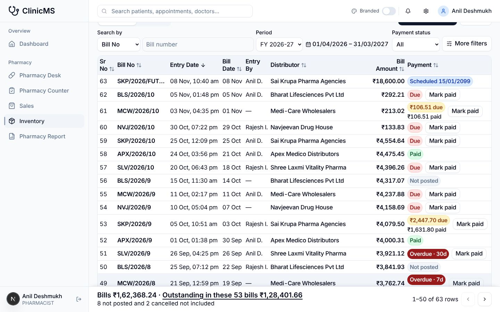
*Purchase bills register*

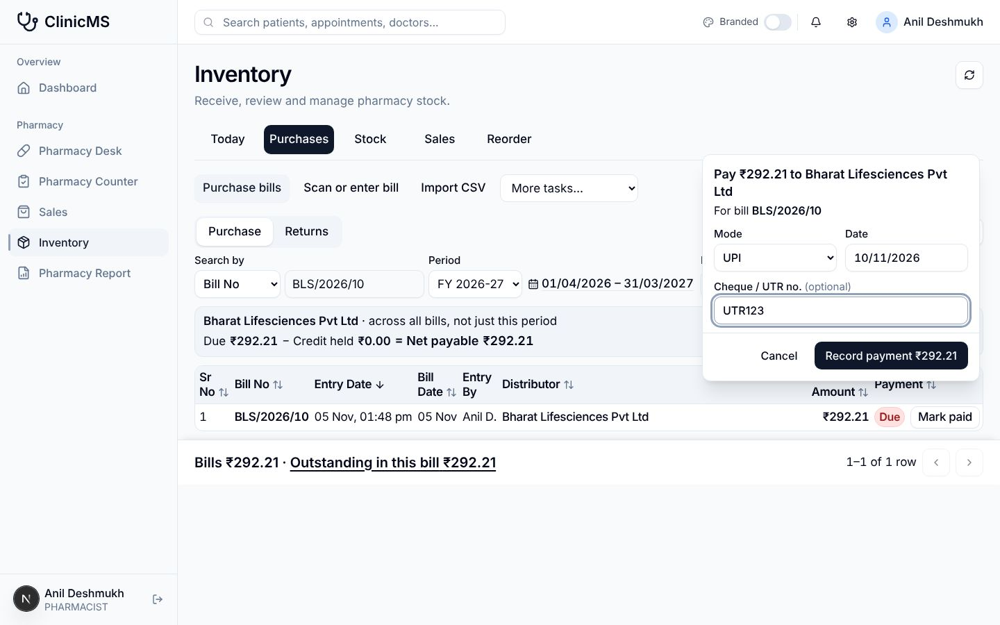
*Mark paid from the row*

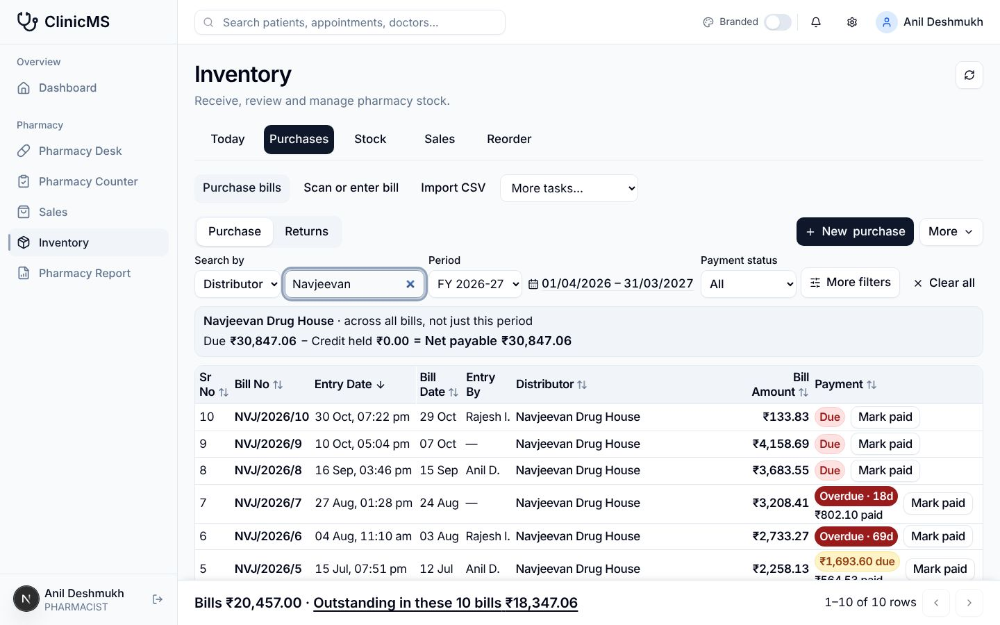
*Filtered to one distributor*

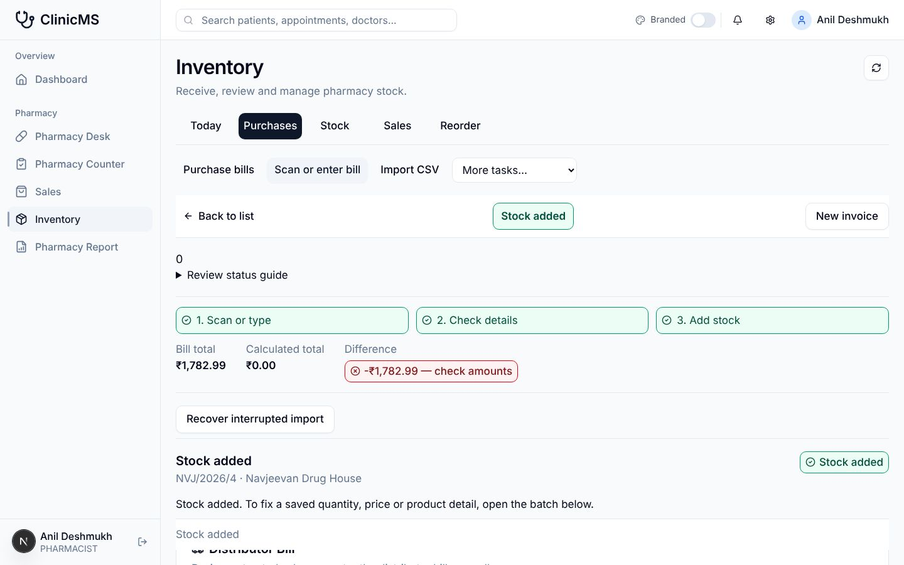
*Bill No. opens the invoice*

Browser tests:
- scripts/stack/scenarios/cr26-purchase.cjs: 20 scenarios, 337 checks, all passed
- scripts/stack/scenarios/access-roles.cjs: 99 checks, all passed (pharmacist, doctor and admin reach every pharmacy screen; reception is refused)

Unit tests:
- frontend/__tests__/inventory/PurchaseRegister.test.tsx (29 tests)
- backend/src/modules/pharmacy/tests/pharmacy-purchase-register*.spec.ts (28 tests)

## CR-27

**Purchase Returns sub-tab, settled by distributor credit notes** · High · **Done, with gaps**

Purchase and Returns sit side by side. A return lowers stock, sits as "Credit note awaited" until the credit note is entered, and the credit can be set off across several bills with the balance shown. Gap: a return started from "New return" on the Returns tab has no way to pick the invoice the goods came in on; the link exists only when the return is started from a purchase bill.

Still to do:
- Invoice picker on "New return" from the Returns tab.

| Point | Requirement | Result | What was seen | Source |
|---|---|---|---|---|
| 1 | Purchase has two sub-tabs, same layout | Met | cr27-returns.cjs scenarios 01, 16 | existing e2e suite |
| 2 | A return records distributor, source invoice, item, batch, expiry, quantity and value | Partly | Source invoice is set only via "Return to supplier" on a bill (frontend/src/components/inventory/WorkflowDocumentEditor.tsx:246-263). The suite raises its returns through the API rather than the form. | code reading |
| 3-4 | Credit note is a record; return shows "Credit note awaited" until entered | Met | cr27-returns.cjs scenarios 03, 05 | existing e2e suite |
| 5 | Credit balance per distributor, net position in one place | Met | cr27-returns.cjs scenarios 11, 12 | existing e2e suite |
| 6 | Partial use across invoices, remaining balance shown | Met | cr27-returns.cjs scenarios 09, 10 | existing e2e suite |
| 7 | Stock goes down when the goods go back, logged with date, user and reason | Met | A RETURN movement is written when the return challan is created (backend/src/modules/inventory/inventory-workflow.service.ts:2138-2140, reason from supplier-return.ts:55-59). The database spec for it (purchase-returns.database.spec.ts) needs its own database and did not run here. | code reading |
| 8 | Returns columns and statuses | Met | cr27-returns.cjs scenario 01 | existing e2e suite |

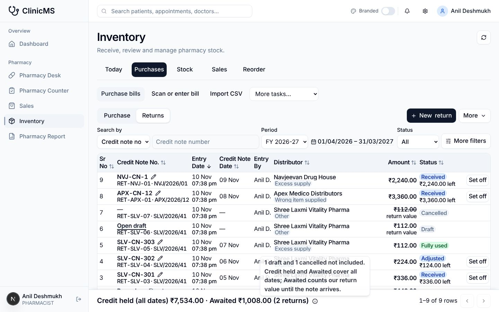
*Returns register with credit-note status*

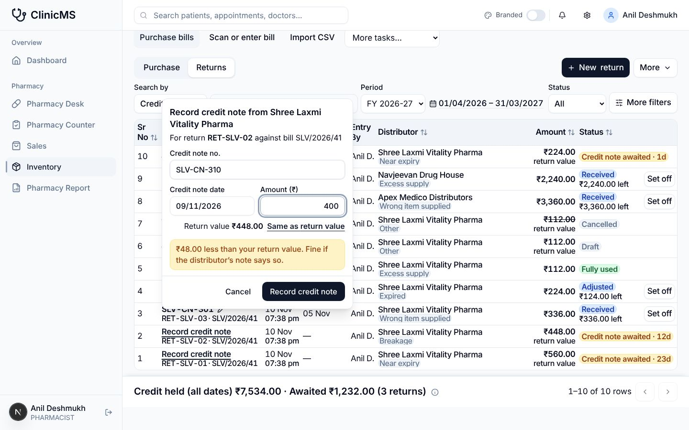
*Record the credit note*

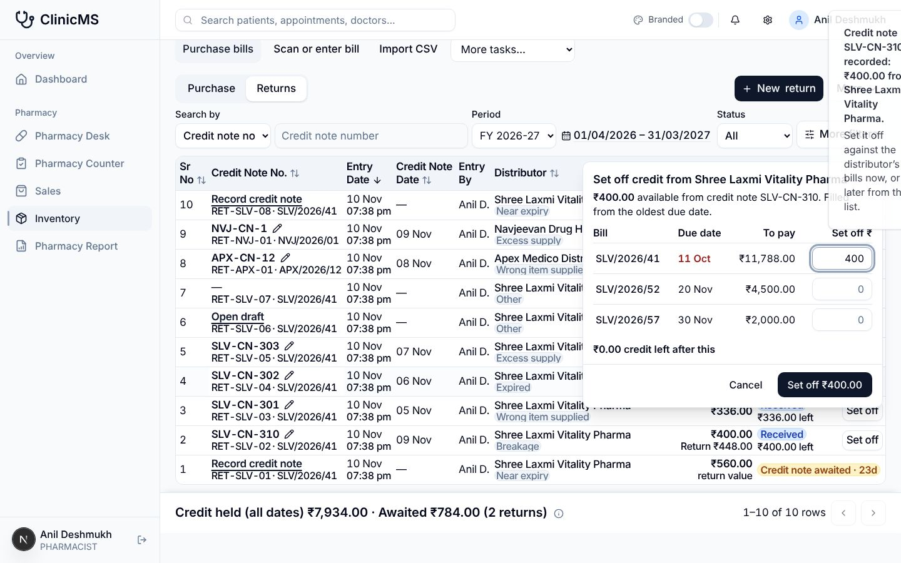
*Set the credit off against bills*

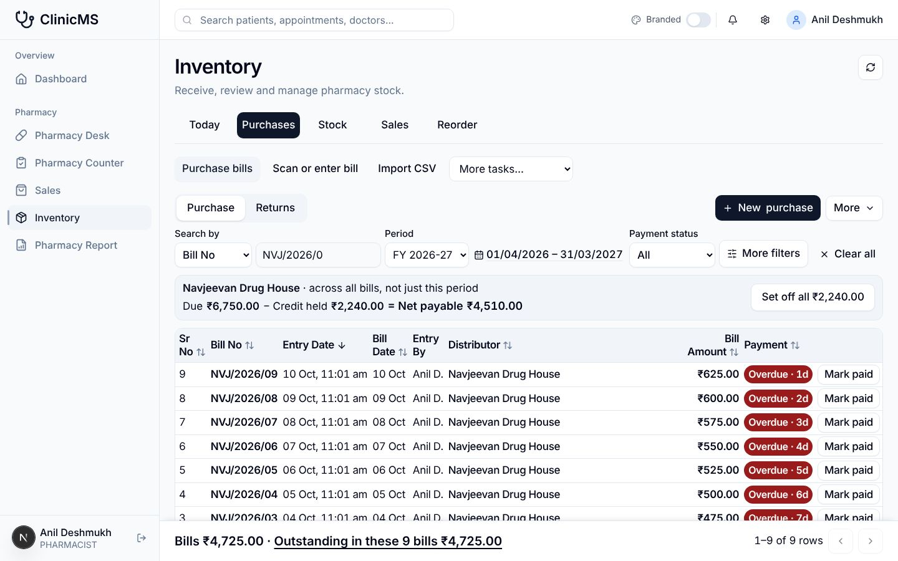
*Distributor position: due less credit held*

Browser tests:
- scripts/stack/scenarios/cr27-returns.cjs: 26 scenarios, 125 checks, all passed

Unit tests:
- frontend/__tests__/inventory/PurchaseReturns.test.tsx (21 tests)
- backend/src/modules/pharmacy/tests/purchase-returns.database.spec.ts (30 tests)

## CR-28

**Terms of Trade (TOT) in the Purchase tab** · High · **Done, with gaps**

The essential part is built: terms per distributor and product (discount, scheme, minimum expiry, margin, PTR and rule, note), entered in steps, read-only for staff, and shown as "Agreed" against "Invoice" on the purchase bill. The second phase (automatic checking, mismatch flags, Returnable) is not built.

Still to do:
- Phase 2: automatic checking, mismatch flag, Returnable.

| Point | Requirement | Result | What was seen | Source |
|---|---|---|---|---|
| 5a | Staff see Terms of Trade read-only | Met | Read-only. Doctors and admins can change terms. | browser |
| 5b | The server refuses a staff member's attempt to save terms | Met | PUT /pharmacy/trade-terms as pharmacist -> 403 | browser |
| 5c | Doctors can add and edit terms | Met |  | browser |
| 3 | Entry flow in steps: Distributor → Items → Scheme, distributor searchable by name or GSTIN | Met |  | browser |
| phase2-1 | Phase 2: a setting to turn on automatic purchase checking against saved terms | Not met | no such setting | browser |
| 1-2 | Terms recorded per distributor and product: discount, scheme, minimum expiry, margin, PTR and rule | Met | cr28-tot-entry model: 27 of 27 states, 38 of 38 transitions | existing e2e suite |
| 4 | Who entered it and when, plus a note | Met | cr28-tot-entry model | existing e2e suite |
| 6 | Shown on the purchase invoice screen when goods from that distributor are entered | Met | cr28-tot-invoice model: 10 of 10 states, 10 of 10 transitions | existing e2e suite |
| phase2-2 | Phase 2: mismatch flagged before the invoice is saved | Not met | The bill shows Agreed and Invoice side by side but compares nothing (frontend/src/components/pharmacy/AgreedTerms.tsx). | code reading |
| phase2-3 | Phase 2: flagged item marked Returnable, feeding CR-27 | Not met | "returnable" appears nowhere in the code. | code reading |

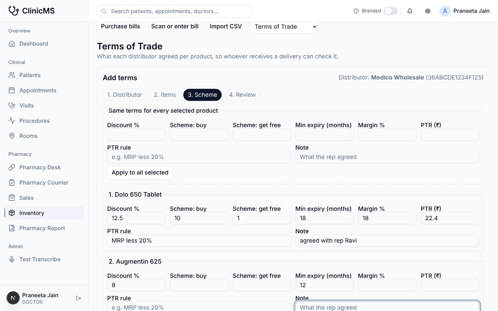
*Entering terms: Distributor → Items → Scheme (from the state-coverage run)*

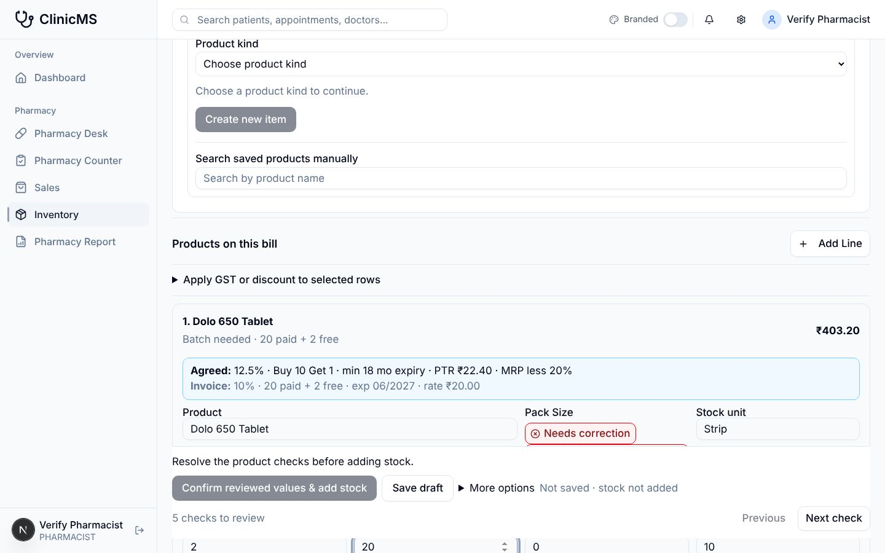
*On a purchase bill: Agreed 12.5% against Invoice 10%, shown but not flagged*

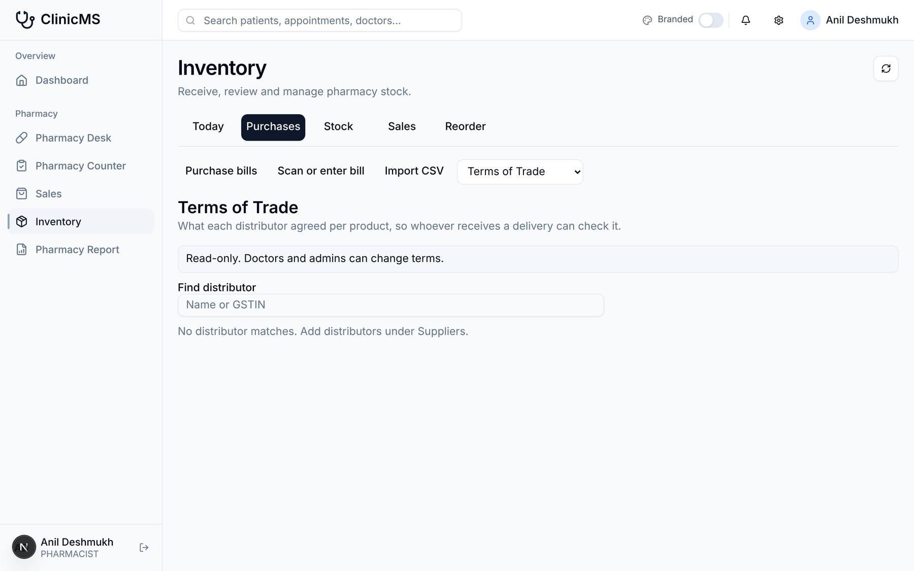
*Pharmacist: read-only*

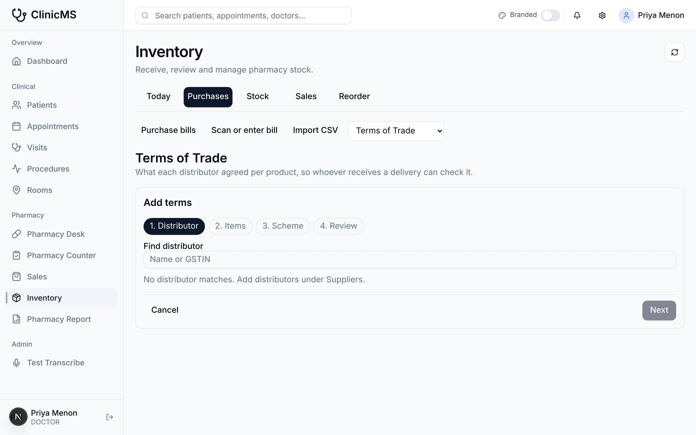
*Doctor: Add terms*

Browser tests:
- cr-audit-pharmacy.cjs (new): 5 CR-28 checks including the server refusing a pharmacist's save
- verification/cr-state-coverage-2026-11-07/models re-run today: cr28-tot-entry 27/27 states, 38/38 transitions; cr28-tot-invoice 10/10, 10/10
- cr28-tot-roles model stops on a wording check only: it expects "Read-only. Only doctors can change terms." and the screen now says "Read-only. Doctors and admins can change terms."

Unit tests:
- backend/src/modules/pharmacy/tests/pharmacy-trade-terms.spec.ts (12 tests)
- frontend/__tests__/pharmacy/TradeTermsWorkspace.test.tsx

## CR-29

**Stock Optimization in the Inventory tab** · High · **Not done**

Not built. There is no data-quality strip, no Run optimization, no returnable / non-returnable split, and no rules. The only related thing is a "Missing information" filter with counts, inside the Stock list's Filters panel.

Still to do:
- Everything in this request.

| Point | Requirement | Result | What was seen | Source |
|---|---|---|---|---|
| 1 | Data-quality strip across the top of Inventory (missing location / category / HSN / min-max / unmapped) | Not met | no strip on the Inventory screen | browser |
| 2 | "Run optimization" action that sorts slow-moving stock into returnable / non-returnable | Not met | no Stock Optimization task in Stock, Purchases or Reorder | browser |
| 4 | Settable rules: non-moving days and minimum batch value | Not met | no such settings | browser |
| 1-partial | What exists instead: a "Missing information" filter with counts, inside the Stock list's Filters panel | Note | Any · HSN missing (23) · MRP missing (23) · Batch missing (1) · Expiry missing (1) · Maximum missing (23) · Minimum missing (23) · Category missing (23) · Location missing (2) · Pack size missing (23) | browser |
| 3 | Grouped by distributor, one return draft per supplier | Not met | No such code. | code reading |

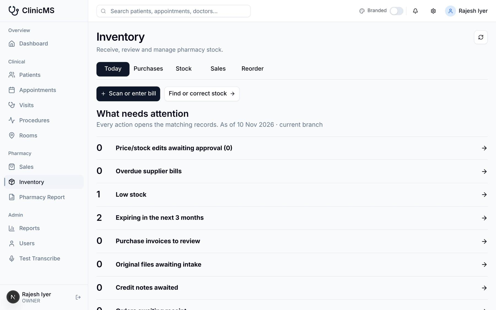
*Inventory opens with no data-quality strip*

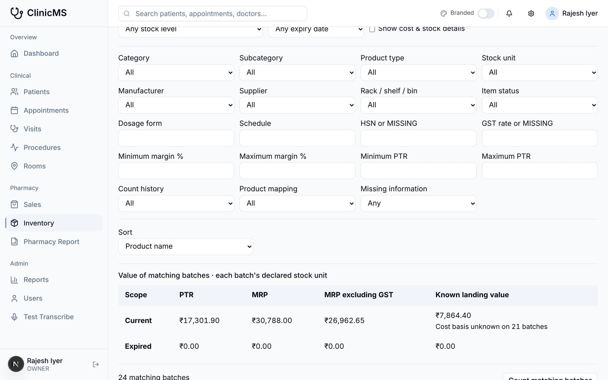
*What exists: a Missing information filter with counts*

Browser tests:
- cr-audit-pharmacy.cjs (new): 4 CR-29 checks

Unit tests:
- None for stock optimization

## CR-30

**Doctor approval before a new item enters inventory** · Parked · **Parked**

The request says do not build this now. It is built and switched on: a new item added by a staff member becomes a request, and a doctor approves or rejects it. Tell the clinic, since it changes how staff add items today.

| Point | Requirement | Result | What was seen | Source |
|---|---|---|---|---|
| parked | PARKED item, built anyway: a staff member's new item becomes a request for doctor approval | Note | POST /inventory/items as pharmacist -> PENDING_APPROVAL | browser |
| parked-ui | The doctor's approval queue lists the requested item with Approve / Reject | Note |  | browser |

*Approve corrections → New items: the staff member's request waiting for a doctor*

Browser tests:
- cr-audit-pharmacy.cjs (new): 2 checks
- verification/cr-state-coverage-2026-11-07/models/cr30-item-request-lifecycle.cjs re-run today: 26 of 26 states, 32 of 32 transitions

Unit tests:
- backend/src/modules/inventory/tests/inventory-item-request*.spec.ts (26 tests)

## CR-31

**Stock reconciliation every 10 days, with staff sign-off** · High · **Done**

Built: a cycle length setting (10 days by default), items dealt to named staff, a counting screen with the difference worked out, sign-off that locks the record, doctor approval before stock changes, a reminder in Today, on-demand counts and a history. It is off until switched on in Settings.

Still to do:
- Switch it on and choose who counts (it ships off).
- Decide whether reconciliation needs its own permission.

| Point | Requirement | Result | What was seen | Source |
|---|---|---|---|---|
| 1-2 | Cycle length and items per person per day are settings; items dealt to assigned staff | Met | cr31-reconciliation.cjs settings and planning scenarios | existing e2e suite |
| 3 | Counting screen: item, batch, expiry, system quantity, counted quantity, difference | Met | cr31-reconciliation.cjs count-sheet scenarios | existing e2e suite |
| 4 | Sign-off records who, when, what and the variances; locked afterwards | Met | cr31-reconciliation.cjs sign-off scenarios | existing e2e suite |
| 5 | Stock changes only when a doctor approves the variance; approval logged | Met | cr31-reconciliation.cjs approval scenarios; approvers are doctor, owner, admin | existing e2e suite |
| 6 | A reconciliation permission controls who can be assigned and who can sign off | Partly | It uses the existing pharmacy:compliance:audit permission, which also gates the daily cash count, rather than a permission of its own. | code reading |
| 7 | Reminder in Today, no lockout | Met | cr31-reconciliation.cjs | existing e2e suite |
| 8 | On-demand count for a single item or shelf | Met | cr31-reconciliation.cjs shelf and item picker scenarios | existing e2e suite |
| 9 | History: date, who signed, items counted, total variance | Met | cr31-reconciliation.cjs history scenarios | existing e2e suite |

*Settings: cycle length and items per person per day*

*Counting screen with the difference*

*Sign off*

*Doctor's approvals*

*History of counts*

Browser tests:
- scripts/stack/scenarios/cr31-reconciliation.cjs: 37 scenarios, 203 checks, all passed

Unit tests:
- frontend/__tests__/inventory/StockCounts.test.tsx (17 tests)
- backend/src/modules/inventory/tests/inventory-reconciliation.spec.ts (38 tests)

## CR-32

**AI-suggested min/max stock levels** · Parked · **Parked**

Parked, and not built as described. A rule-based relative exists under Reorder: min/max proposals worked out from sales history as days of cover, reviewed before they apply. It is not AI, has no per-category setting and no price band.

| Point | Requirement | Result | What was seen | Source |
|---|---|---|---|---|
| parked | PARKED item, partly built: min/max proposals worked out from sales history (rule-based, not AI) | Note | "Generate target proposal" under Reorder | browser |

*Reorder → target proposals*

Browser tests:
- cr-audit-pharmacy.cjs (new): 1 check

Unit tests:
- frontend/__tests__/inventory/ReplenishmentTargets.test.tsx

## CR-33

**Reports tab: daily collection and the full GST report set** · High · **Done**

Pharmacy Report has categories down the left, a search box, common reports on the landing page, Daily Collection with a drawer count, and all eleven GST reports, each with a period filter and Excel / CSV / PDF export. GSTR-2A and 2B are built from the clinic's own books, not from the GST portal.

Still to do:
- Confirm with the accountant that books-side GSTR-2A / 2B are what they want.

| Point | Requirement | Result | What was seen | Source |
|---|---|---|---|---|
| org-1 | Left-hand list of report categories: GST, Margin, Stock, Accounting, Others | Met | GST REPORTS · MARGIN REPORTS · STOCK REPORTS · ACCOUNTING REPORTS · OTHERS | browser |
| org-3 | Most-used reports are surfaced on the landing page | Met |  | browser |
| org-2 | Search box across all reports: "GSTR" finds the GST returns | Met |  | browser |
| B-purchase-register | GST report "Purchase Register" opens with a date filter and export | Met | table: true; export: Excel (.xlsx) / CSV / PDF | browser |
| B-purchase-bills | GST report "Purchase Bills" opens with a date filter and export | Met | table: true; export: Excel (.xlsx) / CSV / PDF | browser |
| B-sales-register | GST report "Sales Register" opens with a date filter and export | Met | table: true; export: Excel (.xlsx) / CSV / PDF | browser |
| B-sales-bills | GST report "Sales Bills" opens with a date filter and export | Met | table: true; export: Excel (.xlsx) / CSV / PDF | browser |
| B-day-wise-summary | GST report "Day wise Summary" opens with a date filter and export | Met | table: true; export: Excel (.xlsx) / CSV / PDF | browser |
| B-gstr-1 | GST report "GSTR-1" opens with a date filter and export | Met | table: true; export: Excel (.xlsx) / CSV / PDF | browser |
| B-gstr-3b | GST report "GSTR-3B" opens with a date filter and export | Met | table: true; export: Excel (.xlsx) / CSV / PDF | browser |
| B-gstr-2a | GST report "GSTR-2A" opens with a date filter and export | Met | table: true; export: Excel (.xlsx) / CSV / PDF | browser |
| B-gstr-2b | GST report "GSTR-2B" opens with a date filter and export | Met | table: true; export: Excel (.xlsx) / CSV / PDF | browser |
| B-hsn-wise | GST report "HSN wise GST" opens with a date filter and export | Met | table: true; export: Excel (.xlsx) / CSV / PDF | browser |
| B-composition | GST report "Composition GST Report" opens with a date filter and export | Met | table: true; export: Excel (.xlsx) / CSV / PDF | browser |
| A | Daily collection: bills raised, split by payment mode (cash / UPI / card), against money counted | Met |  | browser |

*Reports landing: categories and common reports*

*Searching GSTR*

*Daily Collection: bills raised against money counted, by payment mode*

*GSTR-3B*

Browser tests:
- cr-audit-reports.cjs (new): 15 CR-33 checks, each GST report opened and its export menu read
- scripts/stack/scenarios/cr33-reports.cjs: 23 of 23 scenarios passed (includes Excel, CSV and PDF downloads carrying the screen's totals)

Unit tests:
- backend/src/modules/pharmacy/tests/pharmacy-gst-reports.spec.ts (28 tests)
- backend/src/modules/pharmacy/tests/pharmacy-daily-collection.spec.ts (12 tests)
- frontend/__tests__/pharmacy/PharmacyReportWorkspace.test.tsx (12 tests)

## CR-33a

**GST Purchase Bills report: column detail** · High · **Done, with gaps**

Slab groups, totals row under the header, month total and export are there. Two gaps: no Show Columns control, and at laptop width only Sr No., Bill No. and Entry Date stay frozen; Bill Date and Distributor scroll away.

Still to do:
- Show Columns.
- Keep Bill Date and Distributor frozen at normal laptop widths.

| Point | Requirement | Result | What was seen | Source |
|---|---|---|---|---|
| controls | Controls: month picker, Type, GST filter, Go, Download, month total top right | Met |  | browser |
| show-columns | "Show Columns" control to choose which columns appear | Not met | no column chooser on the report | browser |
| slabs | One column group per GST slab (CESS · 0% · 5% · 12% · 18% · 28% · 40% · Total), each with Base · SGST · CGST · IGST | Met |  | browser |
| fixed | Fixed columns on the left: Sr No. · Bill No. · Entry Date (with time) · Bill Date · Distributor | Met |  | browser |
| totals | A totals row sits directly under the header and its grand total matches the figure at the top | Met | grand total 22477.2 vs headline 22477.2 | browser |
| frozen | Scrolling right keeps Sr No., Bill No., the dates and Distributor frozen | Not met | scrolled out of view at 1440px: Bill Date, Distributor | browser |
| frozen-billno | At least Bill No. stays visible when scrolled fully right | Met |  | browser |

*Purchase Bills: fixed columns and the first slab group*

*Scrolled right at 1440 px: Bill Date and Distributor are gone*

Browser tests:
- cr-audit-reports.cjs (new): 7 CR-33a checks
- scripts/stack/scenarios/cr33-reports.cjs: 23 of 23 scenarios passed (includes Excel, CSV and PDF downloads carrying the screen's totals)

Unit tests:
- backend/src/modules/pharmacy/tests/pharmacy-gst-reports.spec.ts

## CR-33b

**GST Sales Register: column detail** · High · **Done, with gaps**

The twelve columns in order, totals under the header, row arithmetic, print, download and customer search with totals following all work. Two gaps: no More Filters and no second dropdown for payment or bill type.

Still to do:
- More Filters with a count.
- Payment / bill type dropdown.

| Point | Requirement | Result | What was seen | Source |
|---|---|---|---|---|
| columns | Columns in order: Bill No. · Bill Date · Customer · Mobile · Gross · Disc. · Taxable · CESS · SGST · CGST · IGST · Total (flat, no slab bands) | Met | Bill No. · Bill Date · Customer · Mobile · Gross · Disc. · Taxable · CESS · SGST · CGST · IGST · Total | browser |
| arithmetic | On every row Gross − Disc. = Taxable and Taxable + CESS + SGST + CGST + IGST = Total | Met | 25 bills checked | browser |
| totals | Totals under the header; the Total column's month total matches the figure top right | Met | totals row 25,396.52 vs headline 25396.52 | browser |
| order | Every bill of the month appears once, in bill-number order | Met | 501 … 526 | browser |
| print-download | Print and Download are both on this report | Met |  | browser |
| more-filters | More Filters, with the active count shown | Not met | no More Filters control on the Sales Register | browser |
| second-dropdown | A second dropdown ("All") to filter on payment or bill type | Not met | dropdowns: This month (November 2026)/Last month (O \| Sales/Returns/Sales net of returns | browser |
| search | Searching a customer's name narrows the list and the totals follow | Met | 6 bills for Meera; rows add to 8178.52; headline 8178.52 (was 25396.52) | browser |

*Sales Register: flat columns with totals under the header*

*Searching a customer: rows and totals narrow together*

Browser tests:
- cr-audit-reports.cjs (new): 8 CR-33b checks
- scripts/stack/scenarios/cr33-reports.cjs: 23 of 23 scenarios passed (includes Excel, CSV and PDF downloads carrying the screen's totals)

Unit tests:
- backend/src/modules/pharmacy/tests/pharmacy-gst-reports.spec.ts

## CR-33c

**Day wise Summary: column detail** · High · **Done**

One row per day with the bill-number range, slab groups, totals that add up, a date range, Sales or Purchase, and download. Days with no billing are shown as ₹0 rows.

| Point | Requirement | Result | What was seen | Source |
|---|---|---|---|---|
| bill-range | Bill No. shows the range of bill numbers issued that day (first - last) | Met | 10 Nov 2026: 1 - 602gap: 4, 5, 6 +593 more+ 1 counter sale, + 1 customer return | browser |
| controls | Date-range picker, Type dropdown (Sales / Purchase), Go, Download and the range total top right | Met |  | browser |
| one-row-per-day | One row per day, in date order | Met | 31 rows for a 31-day month | browser |
| zero-days | Days with no billing are shown as a ₹0 row (so a missed day stands out) | Met |  | browser |
| slabs | GST slab groups (CESS · 0% · 5% · 12% · 18% · 28% · 40% · Total), each with Base · SGST · CGST · IGST | Met |  | browser |
| totals | Daily rows add up to the totals row under the header and to the figure top right | Met | days 25396.52; totals row 25396.52; headline 25396.52 | browser |
| purchase | Switching the type to Purchase summarises purchases the same way | Met | 4 bills over 31 days | browser |

*Day wise Summary for a month*

*Bill number range and gaps for the day*

*Type switched to Purchase*

Browser tests:
- cr-audit-reports.cjs (new): 7 CR-33c checks
- The older state model (cr33c-day-wise-summary.cjs) can no longer start: it opens the report from Inventory → Purchases, and the report has since moved to Pharmacy Report

Unit tests:
- backend/src/modules/pharmacy/tests/pharmacy-reports.service.spec.ts

## CR-33d

**Item Wise Margin Report: column detail** · High · **Done**

Four tiles, the asked columns, highest margin first, profit with the percentage in brackets, an (i) on every header, tags filter, item links and download. Rows reconcile: Sales − Purchase − Net GST = Profit. The warning about inventory clean-up appears on the reports landing page, not on this report.

| Point | Requirement | Result | What was seen | Source |
|---|---|---|---|---|
| tiles | Four summary tiles: Total Sale Amount, Total Purchase, Total Net GST, Total Profit in rupees and as a percentage | Met | Total Profit

₹3,248.85 (45.64%) | browser |
| controls | Date range, Type, Tags filter, search-field selector + search box, Go, More Filters, Download | Met | 6 of 6 inputs | browser |
| columns | Columns: Item Name · Category · Unit · Manufacturer · Sale (qty) · Stock · MRP · Sales Amt. · Purchase · Net GST · Profit (%) | Met | Item Name · Category · Unit · Manufacturer · Sale (qty) · Stock · MRP · Sales Amt. · Purchase · Net GST · Profit ₹ (%) | browser |
| sort | Default sort is highest margin first | Met | margins: 66.76, 32.2 | browser |
| profit-format | Profit shows the rupee amount with the margin percentage in brackets | Met | ₹1,848.00 (66.76) | browser |
| item-link | Item Name is a link through to the item | Met |  | browser |
| tooltips | Column headers carry an (i) explanation of how the figure is worked out | Met | 11 of 11 headers have an info control | browser |
| one-row-per-item | The same medicine never appears on two rows | Met | 6 rows | browser |
| reconcile | Sales Amt. − Purchase − Net GST equals the Profit shown on each row | Met | 2 costed rows checked | browser |

*Item Wise Margin: tiles and rows, highest margin first*

Browser tests:
- cr-audit-reports.cjs (new): 10 CR-33d checks on items bought and sold through the app
- The older state model (cr33d-item-margin.cjs) can no longer start, for the same reason as CR-33c

Unit tests:
- frontend/__tests__/pharmacy/ItemMarginReport.test.tsx (9 tests)
- backend/src/modules/pharmacy/pharmacy-item-margin.spec.ts

## CR-34

**Item detail page in Inventory: batches and ledger per item** · High · **Done, with gaps**

The item page is built with all seven tabs. The ledger lists the purchase and the sale with a running balance that ends at current stock. Missing from the header: product photo, CESS, and min / default / max discount % (a single Margin % stands in for the margin slab). Ledger download is CSV only.

Still to do:
- Product photo.
- CESS.
- Min / Default / Max discount %.

| Point | Requirement | Result | What was seen | Source |
|---|---|---|---|---|
| header | Item header shows manufacturer, name, pack, current stock, MRP, GST, HSN, GTIN, category, schedule, location, min/max qty, edit and stock-alert buttons | Met |  | browser |
| header-photo | Product photo (click to zoom) in the header | Not met | no image on the item page | browser |
| header-cess | CESS shown in the header | Not met |  | browser |
| header-discount | Min / Default / Max discount % and margin slab | Not met | only a single "Margin %" figure | browser |
| tabs | Tabs: Batches · Purchases · Purchase Returns · Sales · Sales Returns · Ledger · Blocked Stock | Met | Batches · Purchases · Purchase returns · Sales · Sales returns · Ledger · Blocked stock · Information | browser |
| batches | Batches tab columns: batch, qty, expiry, MRP, PTR, discount %, landing price, margin %, total by MRP, total by PTR, GST % | Met | Batch no. · Qty · Expiry · MRP · PTR · Discount % · Landing price · Margin % · Total by MRP · Total by PTR · GST % · Actions · WWD0064Current / on hand · Total | browser |
| batches-hide-zero | "Hide zero quantity" tick box | Met |  | browser |
| batches-print | Print label / QR for a batch | Met |  | browser |
| ledger-columns | Ledger columns: bill no., entry date, type, batch, in, out, closing balance, customer / distributor | Met | Bill No. / Sr. No. · Entry date · Type · Batch · In · Out · Batch closing · Item closing · Customer / Distributor · By · Action | browser |
| ledger-rows | Ledger lists the purchase (10 in) and the sale (2 out) of this item with who it was bought from / sold to | Met | SB-26-57393PINV-SB-26-57393-8kq1twyq \| 10 Nov 2026, 08:34 pm \| PurchasePurchase invoice \| WWD0064 \| 10 \|  \| 10 \| 10 \| Vasu Vaccines And Speciality Drugs \| Anil Deshmukh \| Open purchase correction  \|\|  PHI-2026-001INV-PHI-2026-001 \| 10 Nov 2026, 08:34 pm \| SalePharmacy bill \| WWD0064 \ | browser |
| ledger-balance | Running closing balance ends at the current stock (8) | Met | closing balances: 10, 8 | browser |
| ledger-filters | Date-range filter, transaction-type filter and Download on the ledger | Met |  | browser |

*Item header and Batches tab*

*Ledger: purchase 10 in, sale 2 out, closing 8 = current stock*

Browser tests:
- cr-audit-pharmacy.cjs (new): 12 CR-34 checks on an item bought and sold through the app

Unit tests:
- frontend/__tests__/inventory/InventoryItemPage.test.tsx (9 tests)
- backend/src/modules/inventory/inventory-item-ledger.spec.ts (8 tests)
