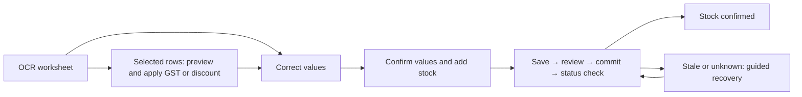

# Inventory repair and before/after stategraphs

This change reduces OCR review to corrections plus one explicit confirmation. It also closes inventory write bypasses and makes list loading, read failures and empty results distinct. Baseline: main `6084c1cb49057f2d1e5a389f6e452b0f74cd7d89`.

## Before and after

The diagrams are evidence maps, not a claim that every application state is perfect. Green nodes have bounded browser evidence. Blue nodes have real UI/HTTP/database recovery evidence. Amber nodes need a stated external or narrower verification boundary. Gray nodes were explored through source or models only.

- [Rendered before/after graphs](STATEGRAPHS.md)
- [Before OCR](before-ocr.mmd) → [After OCR](after-ocr.mmd)
- [Before inventory workspace](before-workspace.mmd) → [After inventory workspace](after-workspace.mmd)
- [Browser coverage matrix](browser/coverage.tsv), [report](browser/report.md), [rerunnable harness](browser/README.md)




The compact diagrams above show the interaction change. The detailed graphs include required corrections, catalogue failures, stale drafts, unknown stock outcomes, receipt links and review-only handoff. They are manually maintained application maps, separate from the generated formal-model graph.

| Matched desktop fixture | Before | After |
| --- | ---: | ---: |
| Correct flagged invoice | 3 actions | 1 action |
| Four corrections | 11 actions | 5 actions |
| Ten corrections across two rows | 20 actions | 11 actions |

Counts include field replacements and completion controls. They exclude reading, scrolling and individual keystrokes. Each is one deterministic synthetic observation, not an elapsed-time benchmark or an estimate for every invoice. [All ten matched cases](browser/friction.tsv) preserve the baseline and final observations. Distinct incorrect values still require corrections; repeated GST/discount changes can be applied to selected rows in a batch.

## Behavior repaired

- The final confirmation captures an immutable snapshot of the displayed values. Known review flags are acknowledged by that explicit action. Missing, invalid, unsupported and upload-only flags remain blocking.
- Batch GST/discount changes require a preview, affect selected rows only, reject invalid resulting values and become stale if the draft changes. Undo preserves subsequent manual edits. No server write occurs before saving.
- Staff with review permission can finish at `REVIEWED` and hand off to staff with stock permission. Reopening a reviewed invoice requires an audited reason.
- Stale edits remain available for comparison and resubmission. Unknown posting outcomes lock writes until a fresh status read establishes whether stock was committed or an explicit retry is safe.
- A saved product remains saved if its subsequent catalogue check fails. Retrying the check does not save the product again. Older readiness responses cannot unlock a newer incomplete draft.
- Purchase, loss and supplier lists expose loading, error/retry, empty and populated states. Purchase/loss filters suppress late old results. Delayed mutation callbacks reload the current query.
- Phone stock search uses the full row. The OCR footer leaves the focused correction field visible; desktop and phone screenshots were inspected.
- Legacy and workspace metadata edits share actor, revision, protected-field, reason and audit enforcement. Sale writes reject inactive/expired batches, including concurrent eligibility changes. Workflow key replays reauthorize the stored document kind. Agent proposals use server-defined permissions.

## Verification boundaries

The final local run passed all 710 frontend tests, 585 scoped backend tests, six PostgreSQL API-boundary tests and 32 purchase/workflow PostgreSQL tests. All workspaces built successfully. The scoped backend run skipped 96 opt-in database tests; the separate database runs above cover the named suites, not all 96. CI enables the new API-boundary database suite as well as the existing recovery gates.

The browser package covers 24 bounded cases. [Database/UI recovery](database-ui-recovery.json) covers four mounted UI workflows (purchase, partner, supplier and opening import), plus a stock HTTP/database scenario: 37 assertions in total. That run uses real cookie authentication and isolated PostgreSQL schemas; it excludes full application boot and the unmounted legacy shelf surface.

The [prior count/intake scenario](prior-count-intake-recovery.json) adds 20 real UI/database assertions covering stale counts, fresh recounts, missing-invoice rejection and authorized interrupted-import recovery. CI exposed a collapsed wrapper hiding the recovery button; a failing visibility regression preceded the fix restoring one directly visible action. The unchanged prior scenario then passed. The historical [stock/intake source mapping](../inventory-state-clarity-fix-2026-10-25/report.md) was independently revalidated and its drift guard retained; the unchanged checker passed [all declared profiles](stock-intake-model-summary.json).

The receipt browser fixture establishes retained receipt identity and zero-added wording, not real ledger quantity effects. External OCR extraction, Gmail delivery, source-document highlighting, physical scanners, and every role/state/device combination remain unverified here. Unsupported upload flags remain an explicit block requiring completion or re-upload; they are not silently accepted.

The existing guided-recovery model was rerun unchanged: 27,500 concrete states, 150,745 edges, four failing negative controls and same-invoice recovery from every modeled state. It does not prove the whole UI. The combined confirmation corresponds to abstract approval followed by review; batch changes and review-only handoff are outside its scope. See its [correspondence and limits](../invoice-guided-recovery/README.md).

## Reproduce

Run `npm ci`, generate the Prisma client and build `shared-types`, then:

```sh
npm test --workspace=frontend -- --runInBand
npm test --workspace=backend -- --runInBand src/modules/inventory src/modules/pharmacy src/modules/pharmacy-agent
npm run build
```

The PostgreSQL boundary tests opt in with `INVENTORY_API_BOUNDARIES_TEST_DATABASE_URL`. Purchase and workflow recovery suites opt in with `PURCHASE_AUTOMATION_TEST_DATABASE_URL` and `INVENTORY_WORKFLOW_RECOVERY_TEST_DATABASE_URL`. Use a local disposable database with schema-creation permission. `RECOVERY_E2E_DATABASE_URL=... npm run test:recovery:e2e` runs the real HTTP/database/browser proof; the runner owns and cleans up its schemas and servers.

Run contract format/list checks on each affected source file separately. All 60 checks passed across 30 source files. These validate syntax and attachment, not semantic compliance. The workflow `CONTRACTS` file was inspected manually because `cc-check list` does not support that file type; the workflow YAML parsed and includes the new database gate. The independent review executed the actual hook, metadata service chain and bulk helper before accepting the fixes. No unresolved code or comment finding remained. The installed `deslop` skill was absent; direct diff, whitespace, comment, suppression and scope checks were used.

Experience First removed duplicate acknowledgments. Model the Domain made the current query and final reviewed snapshot explicit. Prove It Works required completed recovery transitions, not just visible error messages. The [decision trail](decisions.tsv) and competing design artifacts retain those choices.
