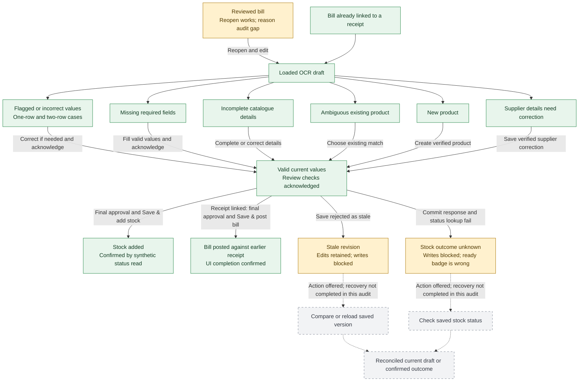
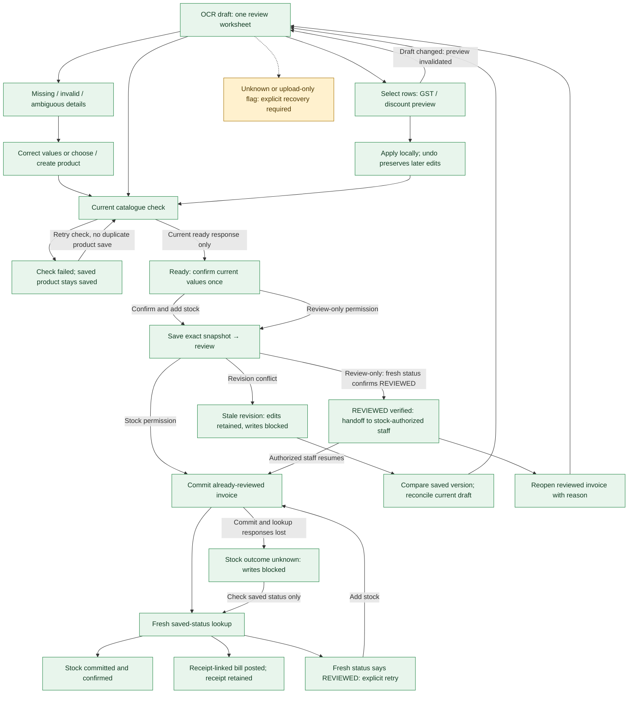
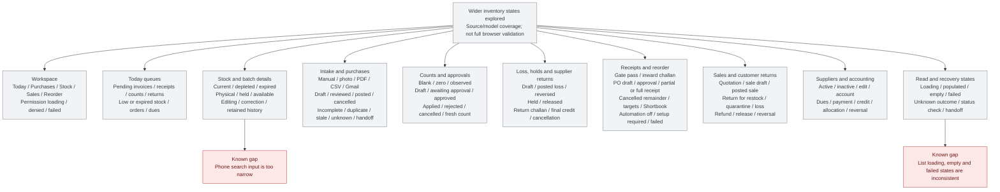
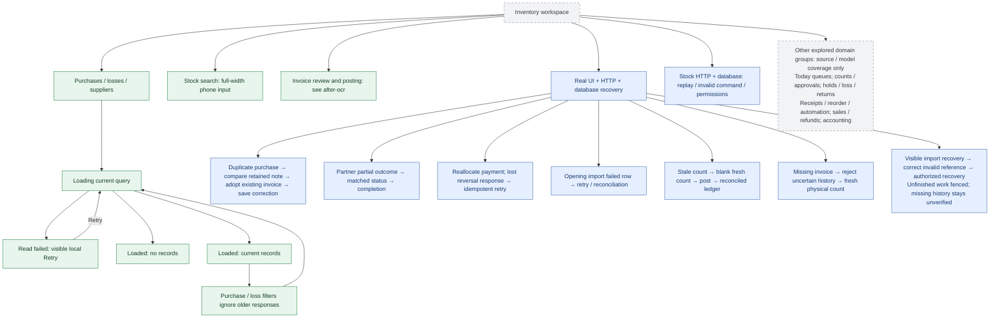

# Before and after UI stategraphs

Green: bounded browser evidence. Blue: real UI/HTTP/database evidence. Amber: a known gap or explicit recovery boundary. Gray: source/model exploration only. These graphs do not claim exhaustive correctness; see [scope and evidence](README.md).

## OCR before

## OCR after

## Inventory workspace before

## Inventory workspace after

