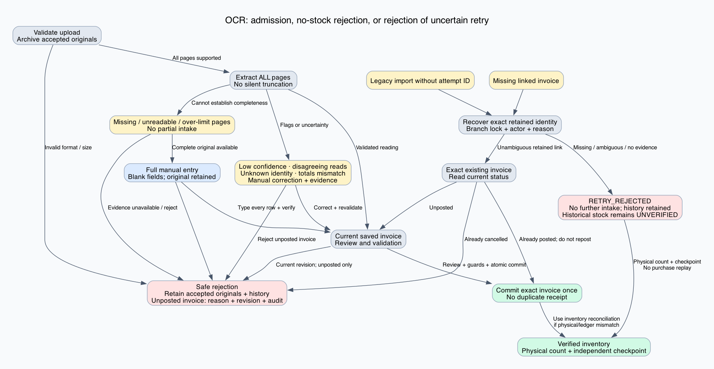
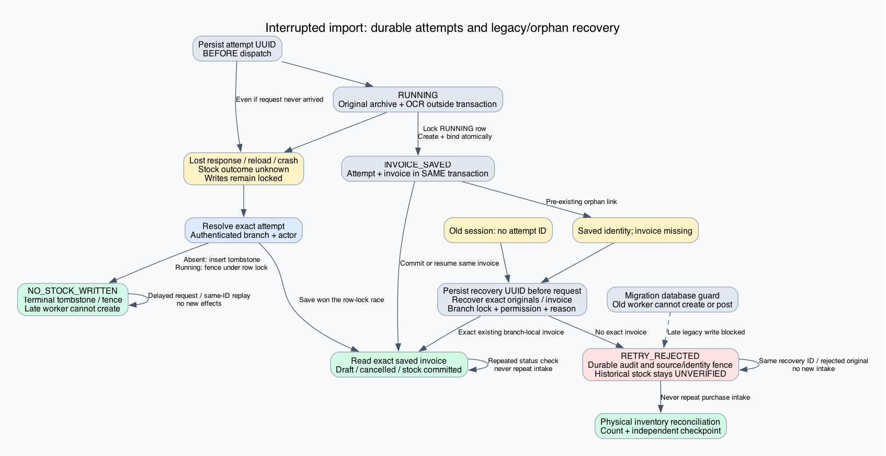

# OCR recovery: legacy imports and missing invoice links

This extends the [previous OCR lifecycle proof](../inventory-ocr-recovery-2026-10-24/report.md) and the [inventory reconciliation proofs](../inventory-reconciliation-2026-10-24/report.md). It closes the two previously unhandled workflow states without inventing historical stock facts.

## Final graphs





Both graphs have editable DOT and scalable SVG companions.

## Claim and terminal outcomes

The guarded reachability claim is:

`AG EF (VerifiedInventory OR NoStockRejected OR RetryRejected)`

- **VerifiedInventory:** eligible physical goods have verified identity, quantity and quarantine status, with independent ledger agreement established by the existing count/checkpoint workflow when needed.
- **NoStockRejected:** the current attempt provably created no stock and cannot create it later, or a saved unposted invoice was cancelled with a reason and audit. The original 39-state model calls this `SAFELY_REJECTED`.
- **RetryRejected:** additional purchase intake for an uncertain workflow is durably rejected. Its original identity/evidence and an actor/reason audit remain. **Historical stock may already have been posted.** The operator retains a direct path to Counts & audit for physical reconciliation; supplier accounting remains separate.

These terminal outcomes are deliberately different. Retry rejection is not a retroactive no-stock certificate, reversal, or claim that inventory has already been reconciled. The existence of a path does not imply automatic eventual completion.

## Operator paths for the new states

| State | Safe path |
|---|---|
| Legacy session without attempt ID, with an exact retained original or invoice | Persist a new recovery UUID before dispatch; recover the exact branch-local invoice and resume its current status. |
| Legacy session with unlinked original, conflicting links, or no retained identity | **Recover legacy or missing invoice** records the reason and a durable `RETRY_REJECTED` result. Intake stays locked; accepted originals and the draft remain. Open **Reconcile physical inventory in Counts & audit**. No evidence is fabricated. |
| Saved attempt whose linked invoice is missing | Preserve its original invoice ID; reject further intake with `stockOutcome=UNVERIFIED`, retaining known source IDs and the audit. Reconcile physical stock without recreating the purchase receipt. |
| Recovery request/response interrupted | Reuse the persisted recovery UUID. Replay returns the same saved identity or rejection; no duplicate audit or purchase intake. |
| Failed, malformed, foreign or mismatched recovery response | Keep the lock and retry the same recovery identity after availability/authorization is restored. |
| Delayed old worker | Database protocol guard rejects its invoice creation or first stock posting. Return through legacy recovery. |
| Concurrent current worker and recovery | Branch serialization chooses one order: saved original linkage wins and recovery resumes that invoice; rejection wins and source binding rolls back the worker's draft transaction. |
| Future attempt-linked invoice deletion | The foreign key rejects deletion; the original invoice remains available for normal recovery. |
| `RETRY_REJECTED` | Replays cannot reopen the attempt. Known rejected source/invoice identities cannot be linked or posted again. Physical reconciliation remains available. |

The checker retains all 39 original lifecycle classes and their witnesses, adding seven named classes for these mechanisms: **46 classes total**. Its original interruption model checks **18 states / 28 transitions**. The legacy/orphan model checks **30 state instances**, including both zero and one historical posting. Exact witnesses and assumptions are in [model-results.json](model-results.json).

## Proof 1: migration fences old workers

Invoice INSERT and first stock posting require transaction-local `app.purchase_recovery_protocol=2`. Current service transactions set it; unmodified old workers do not. Triggers acquire the same branch advisory lock used by recovery. A statement already holding a conflicting table lock finishes before trigger installation; its effects belong to the unknown historical prefix. Once migration has completed, a delayed old worker cannot create another invoice or post stock. There is no dependence on an operator merely asserting that workers have been drained.

The original upload/link trigger also rejects binding a retained original to a new invoice when that source has a durable rejection. Restoring a missing invoice ID does not grant authority to post it: its rejected identity remains fenced.

## Proof 2: recovery cannot race into a second receipt

Let `R` be the branch lock. Current draft creation acquires `R` before claiming the attempt; it creates the invoice, binds the attempt and links originals within one transaction. Legacy recovery also acquires `R` before reading links and recording its decision.

If creation wins, recovery observes the committed link and returns that exact invoice. If recovery wins, it records source rejection before releasing `R`; subsequent source binding throws and rolls back the entire creation transaction. OCR itself holds no long-lived transaction. At no point does absence of a search result authorize replacement receipt creation.

## Proof 3: missing records do not become false no-stock claims

A missing saved invoice keeps the attempt in an unknown outcome until recovery. Recovery changes it to `RETRY_REJECTED`, preserving the missing invoice ID, retained source IDs, reason, branch and actor. It never changes it to `NO_STOCK_WRITTEN`, creates a substitute invoice, changes stock quantities or deletes history. Audit and rejection commit atomically. Repeated calls return the terminal outcome without another audit.

The model explicitly includes `historicalPostings=1` for an orphan. Rejection leaves it equal to one: **additional receipt effects are zero**, while historical effects remain unchanged. A new foreign key installed `NOT VALID` preserves pre-existing orphan references but enforces future link writes and restricts referenced invoice deletion.

## Proof 4: the UI cannot accidentally reopen rejected intake

The recovery UUID is persisted before network dispatch. The response must match that UUID; a rejected result must explicitly say `stockOutcome=UNVERIFIED`. Failure or mismatch leaves the previous lock intact. A terminal rejection is persisted independently and is itself a write-lock condition, even if a subsequent readback changes other UI status. Reload retains the original draft, rejection reference and Counts & audit link.

Recovery requires purchase read, create and review permission, and every source reference is checked within the authenticated branch. An existing attempt additionally remains actor-scoped. Foreign references and replacement saved-invoice IDs cannot be used to recover another record.

## Proof 5: composition with physical reconciliation

The original admission, page completeness, response-loss and unposted cancellation proofs continue to apply. For uncertain legacy/orphan outcomes the system refuses another receipt. The operator counts physical stock, resolves identity and held-stock attribution, and records an independent checkpoint using the established inventory workflow. This reconciles current inventory without pretending to reconstruct historical accounting or reversing an unknown purchase.

## Scope and deployment

Apply both OCR recovery migrations before enabling this application version. The second migration intentionally blocks purchase creation/posting by older binaries, so those workers should be replaced; draining is operational hygiene rather than the proof's only fence. The migration preserves pre-existing orphan identities, and the new application adds no production-data repair during deployment.

The theorem assumes installed intact guards, retained branch-local stock records, authorized staff, truthful physical evidence and eventual database availability. Permanent outages, corrupted recovery guards and arbitrary loss of inventory history remain outside it. OCR factual correctness and automatic eventual completion are not claimed. Unknown original identity cannot be reconstructed from nothing: rejection and physical reconciliation are the available safe path, not renewed purchase intake.

## Evidence and reproduction

The database tests execute the real migration against a pre-existing orphan and verify both source-binding race orders, old-worker blocking, durable replay, source preservation, future foreign-key enforcement and authorization. UI tests cover old sessions, reload persistence, exact readback and malformed responses. Browser recovery scenarios run with the new PostgreSQL triggers enabled.

Contract syntax/discoverability checks passed for supported TypeScript/Python locations. The installed checker does not support JavaScript files or direct `CONTRACTS` listing; the changed browser harness and SQL directory obligations were inspected manually, with this limit recorded in the contract results.

Full build passed. **903 backend tests** (including **105 PostgreSQL tests across eight suites**) and **547 frontend tests** passed. All five browser recovery scenarios passed with the final database guards installed. The finite models and 22 service probes passed. The PDF runtime check included both supported pages and rejected an over-limit file before OCR.

See [validation-summary.json](validation-summary.json) for final build/test totals and exclusions. The executable finite model and algebraic arguments are supported by tests; they are not a whole-program refinement proof.

```sh
npm run build
npm test
python3 verification/inventory-ocr-legacy-recovery-2026-10-24/check_ocr_model.py
```
