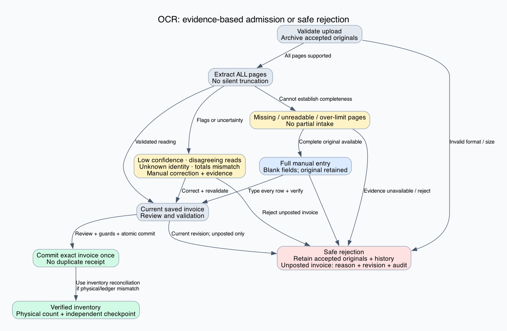
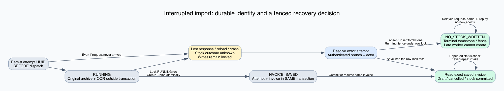

# OCR recovery, safe rejection and inventory reconciliation

Latest extension: [legacy and missing-invoice recovery](../inventory-ocr-legacy-recovery-2026-10-24/report.md). Earlier validation below is historical; the extension records the current source and verification results.
This extends the [inventory proofs](../inventory-reconciliation-2026-10-24/report.md). The earlier 30-state abstraction did not prove the complete OCR lifecycle. This revision explicitly covers extraction, page completeness, persisted automation outcomes, response loss, worker interruption, manual transcription and rejection.

## Claim and scope

For each supported OCR lifecycle class, under the guards below:

`AG EF (VerifiedInventory OR SafelyRejected)`

`VerifiedInventory` means eligible physical goods are admitted once and, when needed, the existing physical-count/checkpoint workflow establishes verified identity, quantity, quarantine and independent ledger agreement. `SafelyRejected` means the current import cannot create stock, or a saved **unposted** invoice is cancelled with a reason and audit; accepted originals and history remain retained. Invalid format/size requests are rejected before archival; their local files remain with the operator. Rejection never reverses an already posted receipt.

The claim is conditional reachability. It does not assert automatic eventual completion, factual OCR accuracy, or reconstruction of historical accounting. Two independent readings can agree and still be wrong. Admission always assumes usable complete evidence and truthful human verification where required; without that evidence, rejection is the safe exit.

## Final state graphs





Editable DOT and scalable SVG files accompany both PNGs. The original six inventory graphs continue to describe downstream physical reconciliation.

## Implementation and operator paths

- The browser generates and persists an attempt UUID **before dispatch**. Both automatic import routes require it. Unknown outcomes lock additional writes and expose **Resolve interrupted import**.
- `POST /pharmacy/purchase-invoices/ocr/import-attempts/:attemptId/resolve` uses the authenticated branch and actor. It creates a terminal tombstone for a request that never arrived, fences an interrupted running attempt, or returns its saved invoice identity. A failed or mismatched response never unlocks the editor.
- Draft creation locks the running attempt row and binds its invoice ID in the **same database transaction**. OCR runs outside that transaction. Once fenced, delayed OCR cannot create a draft. Attempt IDs never return to RUNNING and never expire automatically.
- If an invoice already exists, recovery reads that exact invoice. A repeated request cannot run extraction or stock intake again. A key reused for different bytes/order/receipt date is rejected.
- Originals are archived before extraction. An over-limit PDF is rejected before rendering/extraction, rather than passing only its first pages to OCR. The default limit is five; the configured limit remains authoritative. A supported document must render every page.
- Missing/cropped pages and legacy truncation flags cannot be dismissed as ordinary checked fields. Staff can supply complete evidence or choose **Enter complete invoice manually**. That action discards extracted values and previous checks, retains the original and saved invoice identity, and requires a new final review. Manual entry must include all pages and rows.
- **Reject this upload** abandons a confirmed no-stock local draft while retaining its original. **Reject invoice** atomically changes a current unposted invoice to CANCELLED with a reason and actor audit. Already posted receipts require linked correction/physical reconciliation instead.

## Coverage of OCR states

The executable [model results](model-results.json) contain a witness for every enumerated lifecycle class, including intermediate and terminal states.

| State family | Recovery or rejection |
|---|---|
| Not dispatched; rejected format or size | Start a valid request, or reject without stock |
| Registered; original archived; extracting | Complete extraction, or resolve the durable attempt |
| OCR unavailable; unreadable/empty result; NOT_SAVED | Confirm no stock, retry with a new UUID, transcribe the complete original, or reject |
| Incomplete/missing pages; page limit exceeded; legacy truncated result | Complete replacement evidence, full manual transcription, or rejection; never partial intake |
| Row/field disagreement; low confidence; independent verifier unavailable | Correct and verify against the original, or reject |
| Source highlights unavailable | Review the original without highlights; geometry has no stock authority |
| Product/supplier unresolved; totals mismatch | Correct and revalidate, or reject unposted invoice |
| DRAFT; OCR_REVIEW_REQUIRED; RECONCILIATION_FAILED; SAVED_FOR_REVIEW | Current-revision correction and review, or audited cancellation |
| REVIEWED | Commit once, reopen safely for correction, or reject while unposted |
| Duplicate; stale revision | Read the exact existing/current invoice; never create another receipt blindly |
| Unknown outcome with/without invoice ID; worker crash | Resolve UUID, then either fenced no-stock recovery or exact invoice readback |
| DRAFT_SAVED | Resume the recorded invoice; its live status may already be committed/cancelled |
| STOCK_COMMITTED | Existing physical reconciliation/linked correction; cannot reject as unposted |
| CANCELLED; safely rejected | Terminal no-intake outcome; a genuinely new eligible receipt needs a new request |

A source-highlight failure is optional and cannot discard an otherwise usable reading. Eligibility failures such as expired goods are rejected for purchase intake; counting existing expired stock does not make it saleable.

## Proof 1: a no-stock answer fences future writes

Let durable attempt state `A ∈ {ABSENT, RUNNING, NO_STOCK_WRITTEN, INVOICE_SAVED}`. Its only transitions are:

- `ABSENT → RUNNING`: unique attempt registration.
- `ABSENT → NO_STOCK_WRITTEN`: recovery inserts a tombstone before a delayed request arrives.
- `RUNNING → NO_STOCK_WRITTEN`: resolution or a pre-save failure.
- `RUNNING → INVOICE_SAVED`: claimed row, invoice creation and binding commit together.

The final two transitions contend on the same PostgreSQL row. If resolution wins, the worker's conditional claim updates zero rows and its draft transaction aborts. If saving wins, resolution observes INVOICE_SAVED and returns the invoice identity. A transaction rollback undoes both the invoice and its binding. There is no transition from NO_STOCK_WRITTEN back to RUNNING.

Therefore `A = NO_STOCK_WRITTEN ⇒ no invoice or stock was created by this attempt`, and no delayed worker for that attempt can later create one. This is an **attempt-scoped** statement, not proof that the same bill was never posted by another request. Existing original/invoice duplicate checks remain necessary.

## Proof 2: response loss does not repeat stock

The browser retains the UUID before network dispatch. A missing response therefore does not lose the server lookup identity. If the invoice transaction committed, its ID exists in the attempt row even if processing, response delivery or the worker subsequently fails. Recovery reads that invoice rather than creating another. Stock posting keeps the existing transaction/version and exactly-once receipt guards. A retry with the same UUID returns the persisted outcome without rerunning the worker.

A lookup failure, malformed response, wrong attempt ID or missing linked invoice never establishes no-stock; the UI remains locked. Under eventual database/read availability and retained records, resolution reaches one of the two safe outcomes above.

## Proof 3: page limits cannot authorize partial intake

Before iterating PDF pages, the decoder's page count is compared with the configured limit. A larger document throws before OCR. For a supported document, every rendered page is retained and the rendered count must equal the declared count. Thus the page-limit implementation supplies all pages or supplies none to OCR.

This proves transport completeness relative to the decoder, not that the supplied file contains every real invoice page. Independent-read completeness/row-count checks and human evidence handle that distinction. Unconfirmed completeness remains blocked. Full manual entry starts from blank fields so it cannot silently reuse a partial OCR reading as a complete invoice.

## Proof 4: rejection cannot erase or repeat a posted receipt

Saved-invoice rejection requires branch membership, authenticated actor, reason, current revision, an allowed unposted status and `stockCommittedAt = null`. Its conditional update and audit share one transaction. A concurrent stock commit changes the guarded revision/status and prevents rejection. Conversely, a successful CANCELLED transition causes the processing path to refuse intake. Originals and lines are retained; rejection has no quantity effects. Posted stock remains subject to the existing linked-correction and physical-reconciliation rules.

## Proof 5: lifecycle coverage composes with inventory recovery

The lifecycle checker enumerates the named outcomes and finds a guarded path from each to verified inventory or rejection. A second checker explores **all reachable interleavings in its finite worker/attempt abstraction**, including delay before registration, extraction failure, worker crash, response loss, cancellation and save/resolve races. It asserts that no-stock excludes an invoice, rejection has zero stock effect, and posting occurs at most once.

For an admissible receipt, the terminal stock path composes with the earlier inventory proofs: resolve identity/held-stock discrepancies, take a fresh count, and record an independent checkpoint. Invalid evidence need not be invented to satisfy liveness: rejection is an explicit terminal result.

These are algebraic arguments and finite abstraction checks supported by real service/database tests. They are **not** a mechanically verified refinement proof of all application code.

## Deployment and assumptions

Apply `backend/prisma/migrations/20261024120000_purchase_import_recovery/migration.sql` before starting this application version. Drain old workers before rollout: requests made by the old version without an attempt UUID cannot acquire this new fence retroactively. Old uncorrelated browser sessions must be investigated against saved originals/invoices; this checker does not certify them as no-stock. Never clear an unknown lock merely because a search returned no invoice.

Normal recovery assumes retained records, valid branch-local quantities, authorized staff, truthful physical evidence and eventual database availability. Arbitrary database corruption, missing linked records and permanent outages remain outside the theorem. Reconciliation of quantities does not settle supplier invoices or credits.

## Validation result

Full build passed. **894 backend tests and 542 frontend tests passed**, with zero failures. Backend tests include **97 real PostgreSQL tests** across eight suites. All five browser recovery scenarios passed. The real PDF decoder probe confirms complete two-page rendering and rejection of a six-page document at a five-page limit. Contract format/discoverability checks passed for eleven affected source/test locations. Three opt-in tests remain skipped and thirteen legacy backend files remain excluded by existing configuration.

The OCR model covers **39 lifecycle classes and 18 reachable interruption states (28 transitions)**. The original 30-state inventory model and 22 service probes remain green. These results apply to the source fingerprints in this directory.

## Reproduce

```sh
npm run build
node verification/inventory-ocr-recovery-2026-10-24/check_pdf_runtime.cjs
python3 verification/inventory-ocr-recovery-2026-10-24/check_ocr_model.py
```

See [validation results](validation-summary.json) for the exact suite totals, skipped tests, source hashes and verification limits. No live OCR-provider transmission or production-data change is part of this validation.
