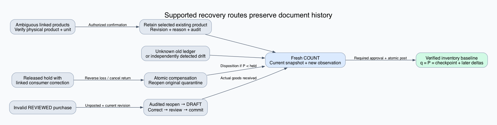
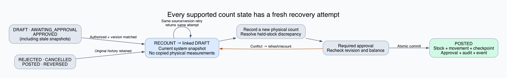
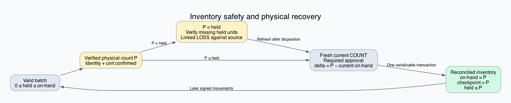
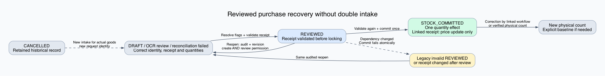
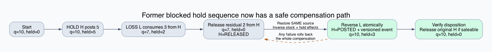
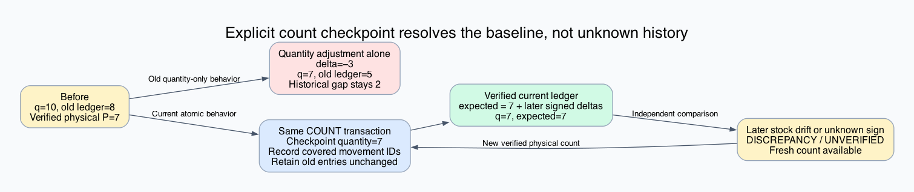

# Inventory reconciliation: repaired recovery paths

**OCR extension:** the [OCR lifecycle and interruption proofs](../inventory-ocr-recovery-2026-10-24/report.md) add durable import outcomes, complete-page rejection, manual recovery and audited rejection. The 30 states below cover inventory recovery; they are not exhaustive OCR lifecycle coverage.

The identified gaps are fixed in the local working tree. Every state in the **supported recovery model** has an authorized path to a verified inventory balance. The guarantee is **reachability**, `AG EF Reconciled`, under the assumptions below. It is not a promise that every original document eventually posts or that missing historical facts can be reconstructed.

This revision supersedes the initial audit. The original findings and evidence are retained in `before-fixes-*` as historical snapshots; their links may resolve to updated files. Nothing was deployed and production data was not changed. [Source fingerprints](source-baseline.json) identify the reviewed working tree; the checker rejects source drift.

## What changed

| Gap | Implemented recovery / prevention | Decisive regression |
|---|---|---|
| A released hold blocked reversal of its linked loss or return | Compensation atomically reopens the **same** source, appends its versioned event, and restores stock to quarantine. A failed compensation rolls everything back. | Post hold 5, consume 3, release 2, reverse/cancel consumer; result is stock 10, held 3. Injected failure restores all prior records. |
| An invalid REVIEWED purchase could not be edited | Validate linked receipt before review and again at commit. Authorized staff can reopen an unchanged, unposted REVIEWED bill to DRAFT with a review-reopened audit. UI supports finding and replacing its receipt. | Invalid receipt rejected before review; stale reopen rejected; committed bill cannot reopen; HTTP route requires create **and** review authority. |
| An opening import could overwrite a concurrent sale | Existing-batch imports do not write stock quantity/status and compare the batch revision. A conflicting product link rejects the import. | A sale changes 10 to 9 after the import read; import leaves stock 9. Second-product linking is rejected. |
| Ledger agreement was inferred from current stock | Every posted physical count records a quantity checkpoint, actor, document, timestamp and exact covered movement IDs, including zero-variance counts. Ledger derives expected stock independently from that checkpoint. | Unknown old movement remains intact; a zero-variance count establishes baseline; a later unauthorized quantity drift is detected. |
| Stale, rejected or cancelled counts reused stale measurements / import identity | `RECOUNT` creates an idempotent linked DRAFT with a current system snapshot and **blank** physical observations. Original history is retained. | All seven supported count statuses, replay and stale-version rejection; UI sends RECOUNT without saving old measurements. |
| Direct manager count posting omitted approval attribution | Manager approval is recorded in the count transaction. | Posted count contains approvedBy and the physical-count audit. |
| Multiple product links could block identity review | Authorized explicit physical identity/unit confirmation retains one existing active branch product, with revision guard and before/after audit. Quantities and units do not change. | Unknown product, stale revision and unconfirmed requests reject; successful resolution retains quantities and stock units. |

## State graphs

Blue indicates a recovery action, green a reconciled state, amber an evidence or availability condition. Graph edges are guarded operations, not unconditional transitions.













The last two filenames are retained for existing links; their diagrams now show the repaired paths. Editable DOT and scalable SVG files accompany every PNG. `render_graphs.py` regenerates them with Graphviz.

## Supported state and assumptions

For one retained branch batch, define

`S = (I, q, h, r, D, E, M, C)`.

`I` is its product/batch identity and stock unit; `q` is on-hand stock; `h` is held stock; `r` is the current revision; `D` is document state/version; `E` is signed document effects; `M` is movement history. `C = (b, K, document, actor, time)` is an optional physical checkpoint with quantity `b` and the set `K` of movement IDs covered at that checkpoint. `P` is a new independently verified physical observation in the **same** stock unit.

A supported recoverable batch has representable integer quantities `0 ≤ h ≤ q`, retained branch-local records, and attributable held stock. Its identity is either valid or resolvable by selecting the verified existing product without a unit conversion. A nonempty finite set of batches is treated componentwise. Archived batches can first be reactivated through the existing metadata workflow. Expired stock may be counted but is not thereby made saleable.

Recovery requires:

1. Staff can verify physical identity, units and quantity. A wrong or absent physical observation cannot be proved true by software.
2. Authorized staff have the required read/write permissions and can supply approvals and reasons. Reversals retain existing manager and downstream-dependency guards.
3. Held quantities exceeding physical stock are investigated and given a truthful source-linked disposition. Missing held goods are recorded as a loss; saleable stock may be released after verification. The proof does not require falsely releasing missing goods for sale.
4. There is a finite interval in which the chosen sequence gets current revisions and successful database commits. Continuous competing writes, indefinite approval refusal and database outage do not imply completion.
5. For purchase intake, the physical goods and their corrected batch/receipt evidence are eligible for that intake. A cancelled purchase is retained; an actual new intake uses a new request identity. Already committed purchases use linked corrections or physical reconciliation, not reopening/double intake.

Arbitrary database corruption, orphaned holds without retained sources, unsupported unit conversions, malicious direct database writes and reconstruction of unknown old accounting facts are outside this supported-state theorem. An unknown old movement is **inside** the checkpoint recovery scope, but its original direction remains unknown.

`Reconciled(S,P)` at the recovery commit means:

- verified identity/unit and `q = P`;
- `0 ≤ h ≤ P`, preserving any legitimate quarantine;
- a recorded checkpoint `C.b = P` with all movements visible to that successful count transaction in `C.K`;
- atomic count audit, event and required approval attribution;
- expected ledger balance equals `q` independently of the current-stock field.

A later physical movement changes both real stock and the signed ledger; agreement with the earlier physical observation is not a claim that the shelf remains unchanged forever.

## Proof 1 — safety is preserved

Let an accepted quantity effect be `δ`, with `u` held units removed first and `v` held units added afterward. The implementation checks each intermediate balance:

`h₁ = h − u ≥ 0`, `q₁ = q + δ ≥ h₁`, and `0 ≤ h₁ + v ≤ q₁`.

Therefore `0 ≤ h′ ≤ q′`. Stock and hold effects, document versions, movements and events execute in the workflow transaction. Rejected intermediate states do not commit. Induction on any finite sequence of accepted effects proves balance safety, starting from a valid batch.

Unique document effect identities, expected versions and guarded transitions prevent a retry from repeating the same stock effect. RECOUNT is stock-neutral. Purchase reopening and identity resolution are also stock-neutral. The existing-batch import no longer assigns an absolute quantity, so the previously demonstrated sale/import overwrite cannot occur through that update payload. Its revision guard also prevents stale metadata from replacing a newer checkpoint.

This is a proof of the stated transition rules. Service tests exercise those rules with transactional fixtures; they do not prove the PostgreSQL engine or every unrelated writer.

## Proof 2 — compensation after source release

Let source H originally quarantine `a` units. Consumer L removes `c ≤ a` units, and H releases its residual `a − c`. Ignoring unchanged unrelated holds, the state is:

`q₁ = q₀ − c`, `h₁ = 0`, `H.status = RELEASED`.

Reverse L (or cancel its supplier-return challan). Within one transaction, `restoreHoldSource` changes **H** to POSTED with a new version/event; compensation appends inverse effects `(+c stock, +c held)`. Hence

`q₂ = q₁ + c = q₀`, `h₂ = c`, and `0 ≤ h₂ ≤ q₂`.

No unrelated hold supplies the restored units. The original source's prior release and consumer history remain recorded. Any later verified release acts on H's residual source balance. Other active consumers remain deducted by `holdBalances`; applying the argument to each corrected consumer yields the same result inductively. A failure at any step rolls back source reopening and inverse effects together.

## Proof 3 — every supported physical balance has a recovery path

Given `q ≥ h ≥ 0` and verified `P ≥ 0`:

- If `P ≥ h`, use a fresh count with `δ = P − q`. The movement guard accepts `q + δ = P ≥ h`, so the post-state has `q′ = P` and preserves quarantine.
- If `P < h`, verify and disposition `x = h − P` missing held units against their actual sources. Then `q₁ = q − x`, `h₁ = h − x = P`, and `q₁ ≥ h₁` because `q ≥ h`. Take a fresh observation/snapshot and post `δ = P − q₁`. The result is `q′ = P`, `h′ = P`. Any confirmed saleable release can occur separately.

There are finitely many held sources and batches. Under the evidence/authorization assumptions, source dispositions terminate, and the count can be posted in a stable transaction interval. The argument includes `P = 0`, an existing zero-stock batch, and both positive and negative variances. Blank observations never count as zero.

For count document status `s ∈ {DRAFT, AWAITING_APPROVAL, APPROVED, REJECTED, CANCELLED, POSTED, REVERSED}`, the new RECOUNT edge produces a linked DRAFT with current system quantities and no physical observations. Thus stale and terminal documents cannot remove the fresh-count path. The same source/version retries return the same child; if that child has since become stale or terminal, perform RECOUNT on the child. The UI opens that returned child.

Other retained workflow document statuses do not prevent creating a new count for the batch. Existing dependency guards may block reversing a particular historical transaction; that is separate from physical reconciliation. Correct the dependency in its own workflow when historical compensation is required. A fresh physical count must not be represented as proof that an unrelated financial credit or bill has been settled.

## Proof 4 — a verified checkpoint establishes an independent ledger

For a checkpoint `C = (b,K,...)`, define

`L_C(M) = b + Σ{ signedDelta(m) | m.id ∉ K }`.

If a later movement lacks a known sign, or a covered movement is missing, `L_C` is undefined and the UI reports UNVERIFIED. Before any checkpoint, it also reports UNVERIFIED. It never chooses `b = currentStock − sum(movements)`.

The successful COUNT transaction posts any nonzero variance, then records `b = P` and `K = IDs(M)` as visible to that transaction. Immediately afterward the uncovered sum is zero, so

`L_C(M) = P = q′`.

For a subsequent signed movement `δ`, both stock and `L_C` increase by `δ`. Thus agreement is preserved by induction over accepted signed movements. If stock alone drifts by `ε`, the independent difference becomes `q − L_C = ε`; the ledger can now reveal the discrepancy. A new authorized physical count remains the recovery path.

This does **not** rewrite the old accounting problem. With an older independent ledger `L`, a quantity-only count preserves the historical gap:

`P − (L + (P − q)) = q − L`.

The new explicit checkpoint resolves the starting point for current inventory verification. It preserves all earlier unknown entries and the audit of the decision to establish that baseline. Zero-delta counts also establish a checkpoint; they do not fabricate a zero movement.

## Proof 5 — reviewed purchases can safely return to correction

`reopenReview` requires branch-local REVIEWED status, `stockCommittedAt = null`, an authenticated actor and matching `updatedAt`. The update uses an atomic compare-and-swap inside its transaction and appends `REVIEW_REOPENED` to the audit. Therefore a concurrently committed or revised invoice cannot also be reopened from the stale revision. The endpoint requires both editing and review permissions. No quantity effect is performed by reopening.

A valid linked receipt must be a posted branch inward challan for the supplier, not already billed by another committed purchase, with one matching receipt line per bill line and matching quantity, batch, expiry, MRP and unit. Review checks this before locking; commit checks it again because dependencies can change. A commit failure rolls back its claim and effects; the bill can then be reopened. For an already received linked challan, bill posting retains the existing quantity and applies the bill's price basis. A posted invoice remains protected against duplicate stock intake.

## Implementation mapping

- [Workflow transitions, approval and checkpoint](../../backend/src/modules/inventory/inventory-workflow.service.ts), [fresh count](../../backend/src/modules/inventory/inventory-workflow.service.ts), [original-source restoration](../../backend/src/modules/inventory/inventory-workflow.service.ts).
- [Independent ledger](../../backend/src/modules/inventory/inventory-ledger.ts), consumed by the workspace item detail response.
- [Existing-batch import guard](../../backend/src/modules/inventory/inventory-import.service.ts).
- [Identity recovery](../../backend/src/modules/inventory/inventory-identity-recovery.service.ts) and the stocktake controller route `POST /inventory/workspace/stocktake/resolve-identity`.
- [Purchase reopening](../../backend/src/modules/pharmacy/pharmacy-purchase-invoice.service.ts), [receipt validation](../../backend/src/modules/pharmacy/pharmacy-purchase-invoice.service.ts), and `POST /pharmacy/purchase-invoices/:id/reopen-review`.
- Operator actions are in WorkflowDocumentEditor, WorkspaceStock and PurchaseInvoiceWorkbench. No schema migration is needed; checkpoint metadata and existing audit/event tables are used.

## Verification and limits

`check_model.py` exhaustively checks integer quantities through 12: 8,190 movement cases, 819 directly postable counts, 1,183 physical-recovery cases, 1,820 hold-compensation cases and 2,197 checkpoint cases. It finds a witness to Reconciled from every one of 30 abstract states. These are finite abstraction checks supporting the algebraic proofs above, **not** a mechanically verified refinement proof of all application code.

The service regression suite initially reproduced the gaps with 11 failures. The updated suite has 22 passing tests covering public workflow transitions, transaction rollback, all count statuses, checkpoints, import race prevention, identity resolution, receipt validation and reopening. `source_probes.cjs` runs that real suite and saves [source-results.json](source-results.json). Its database is an in-memory transactional fixture.

The integrated branch passes the full build and configured regression suites: **884 backend tests and 534 frontend tests**, with zero failures. The backend total includes **88 real PostgreSQL tests**, covering concurrent inventory operations, opening-import recovery, purchase receipt idempotency, payment and partner-sale recovery, and visit lifecycle behavior. Three opt-in live/browser tests remain skipped; thirteen legacy backend files remain excluded by existing configuration. All backend builds now enforce strict type checking. See [ship validation](ship-readiness.md) and [machine-readable results](validation-summary.json).

`cc-check` is pinned as `@spolu/cc-check@0.2.0`. Format and discoverability checks pass on **38 changed TypeScript/TSX files**. The `.cjs` service probe runner is unsupported by this checker and was manually reviewed; its 22 executable probes pass. Contract syntax does not establish semantic compliance; affected obligations were reconciled with code and tests.

This branch preserves the purchase `reopen-review` API, opening-import retry tracking, and other recovery changes already merged into main. The new identity endpoint includes only physical identity resolution; unrelated local bulk-merge and stocktake-import work is not included. The six graphs remain current; the purchase graph labels reopening with audit and revision. Earlier original-checkout build/runtime results are retained in `before-main-*` snapshots and are not claimed as validation of this later integrated tree. Source fingerprints were refreshed after reviewing the integration and re-running the evidence.

Reproduce the model, service evidence and diagrams from the repository root:

```sh
python3 verification/inventory-reconciliation-2026-10-24/check_model.py
node verification/inventory-reconciliation-2026-10-24/source_probes.cjs
python3 verification/inventory-reconciliation-2026-10-24/render_graphs.py
```

The model deliberately retains counterexamples to unconditional eventual completion, to posting every original terminal document, and to reconstructing unknown history. The supported claim is that an authorized, evidence-based, safe recovery path remains available.
